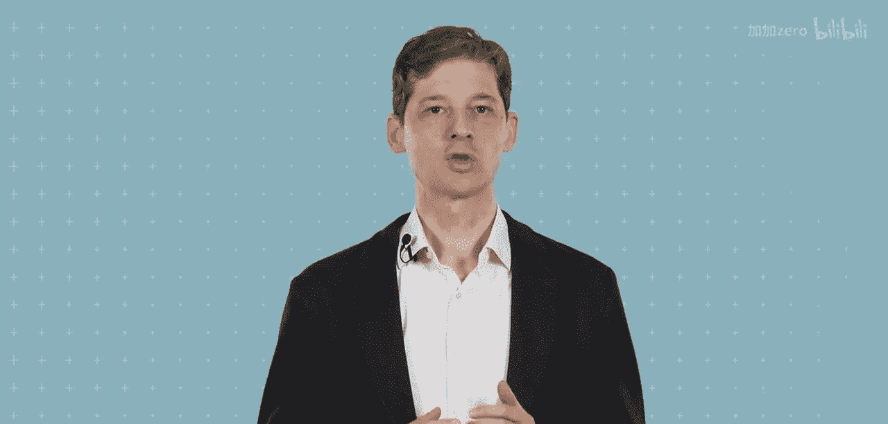
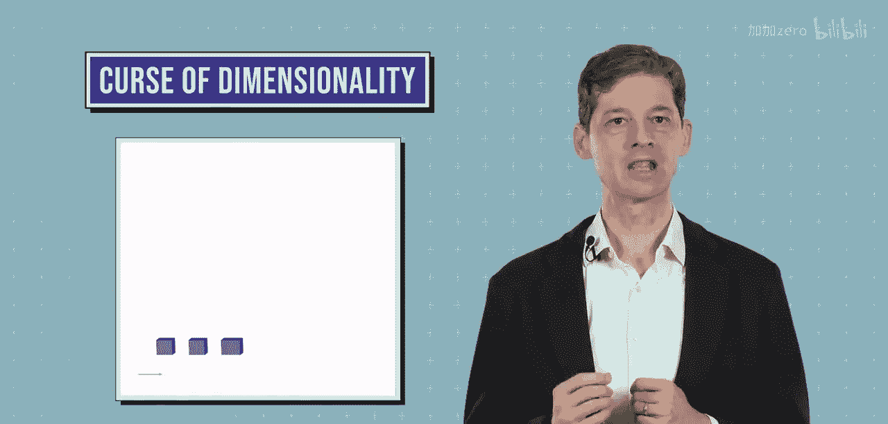
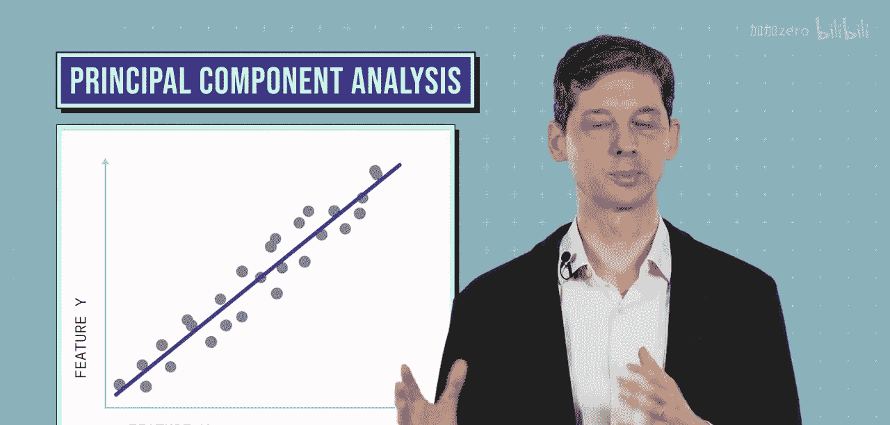
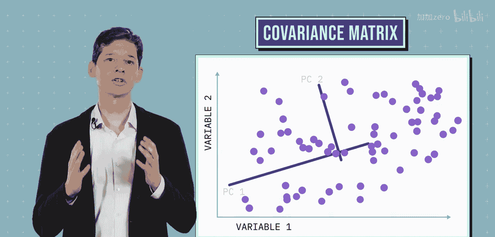
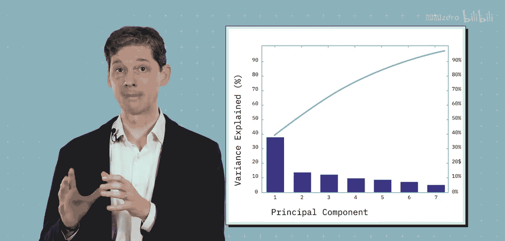
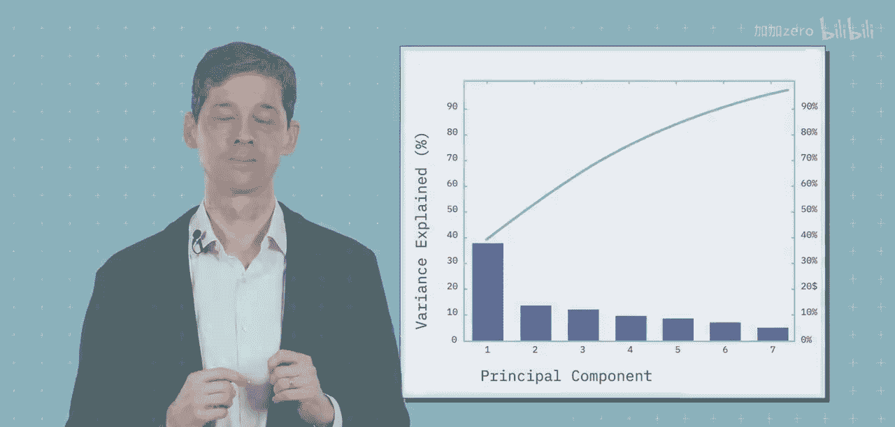
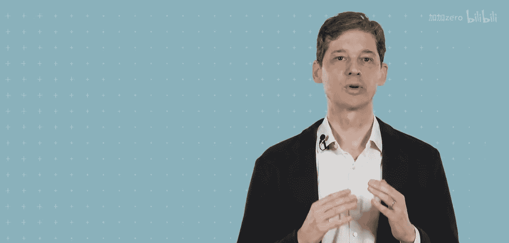
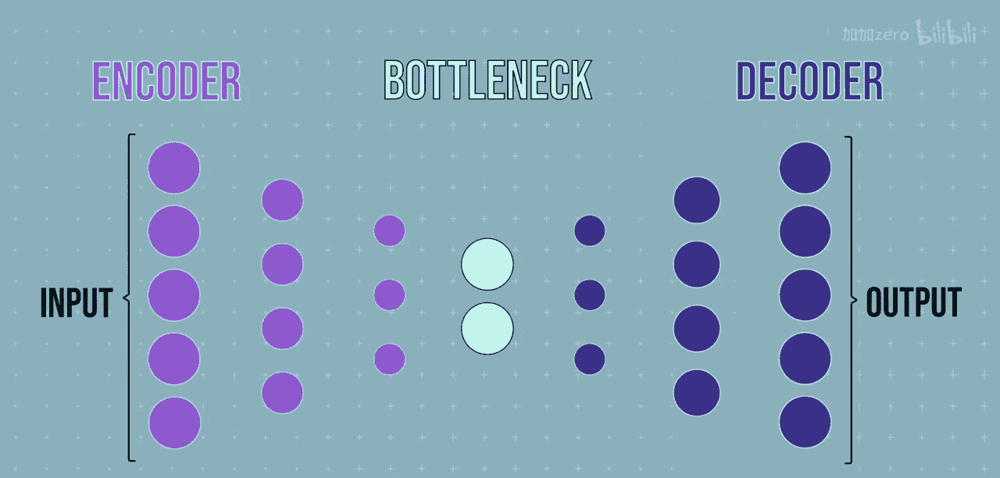

# 070：无监督学习-降维 🧠

在本节课中，我们将要学习无监督学习中的一个核心概念：降维。我们将探讨为什么需要降维，并详细介绍两种主要的降维技术：主成分分析和自编码器。

## 概述

处理高维输入空间的问题时，我们需要考虑复杂的模型，这些模型需要大量样本进行训练。这被称为“维度灾难”。降维的目标是在保持数据集中大部分信息的同时，将数据集表示在更低的维度中。

## 降维的必要性

上一节我们介绍了无监督学习的基本概念，本节中我们来看看降维的具体动机。

在压缩后的表示上工作所需的样本更少。但压缩过度可能有害，因为我们有丢失相关信息的风险。我们需要根据数据集中可用的样本数量来权衡这一利弊。

例如，考虑一个人脸图像数据集。每个样本都是一张包含数百万像素的图像。在如此高维的空间中工作会消耗大量内存和计算能力，而且最重要的是，这通常是无效的。随机挑选一张图像恰好生成一张人脸的概率几乎为零。这表明我们当前使用的表示方法对于表示数据集中包含的信息是低效的。

我们可以利用数据中的结构来构建一个新的、更紧凑的表示，在这个表示上解决新的学习任务会更容易。

## 主成分分析

一种最流行的降维技术是主成分分析。

从原始输入特征出发，PCA创建新的特征，这些新特征是原始特征的线性组合。

让我们看一张显示二维空间中点的图像。我们可以看到，这两个特征看起来彼此高度相关，因为点非常接近一条直线。如果我们想将输入特征从两个减少到一个，我们会如何选择？

如果我们考虑那条直线并将所有点投影到该直线上，这将涉及数据的线性变换。这些新特征允许我们在尽可能保留原始信息的情况下，替换两个原始特征。

正如我们将看到的，PCA的目标是生成一个尽可能保留原始方差的新表示。

### PCA的工作原理

那么，PCA如何找到投影数据的这些直线呢？

这是通过计算数据集的协方差矩阵来实现的。为了找出最重要的方向，PCA考虑与最大特征值相关的特征向量。

这是第一个主成分，即方差最大的方向。

特征向量中的值指定了原始输入特征线性组合的系数。第二个主成分将与第二大特征值相关的特征向量，依此类推所有其他成分。根据特征向量的性质，所有新特征彼此正交。

### 如何选择主成分

现在，我们如何选择要选择多少个以及哪些主成分呢？

首先，我们必须按特征值降序对特征向量进行排序。然后，给定一个我们希望新表示保留的原始方差百分比阈值，从第一个主成分开始，我们不断添加新特征，直到所选成分的特征值之和与所有成分的特征值之和的比率超过所选阈值。

以下是选择主成分的步骤：
1.  计算协方差矩阵的特征值和特征向量。
2.  将特征向量按对应特征值大小降序排列。
3.  设定要保留的方差百分比（例如95%）。
4.  从第一个主成分开始累加，直到累计方差贡献率达到阈值。

在图片中，我们看到了PCA在人脸图像数据集上的应用。数据集中有128张大小为256x128像素的人脸图像。在这张图片中，我们看到了前15个主成分（在这种情况下称为特征脸）的可视化表示。在左上角，是在这个15维空间中重建的人脸。

这样，我们不再需要使用超过30,000个值来表示每个像素的强度，而可以仅用15个值来表示一张人脸。当然，如图所示，重建的准确性随着考虑的特征脸数量的增加而提高。

## 非线性降维

不幸的是，原始特征的线性组合并不总是能够捕捉数据中的隐藏结构。

如果我们有一个数据点分布如图所示的例子，我们将无法识别出一个主要方向，即使数据明显占据特征空间的一个流形。😊

在这种情况下，我们需要借助能够创建非原始特征线性组合的新特征的降维方法，例如局部线性嵌入、自组织映射、核PCA、ISOMap等。最近，也提出了深度学习方法来执行非线性降维。

### 自编码器

一种流行的方法称为自编码器。

自编码器的思想是训练一个深度神经网络来学习恒等函数。我们希望网络能够正确重建输入。

降维是通过使用特定的神经网络架构实现的，该架构由编码器、解码器以及中间的瓶颈层组成。编码器将数据压缩到其低维表示。瓶颈层（也称为潜在空间）存储低维表示。解码器将我们的低维数据重建回其初始维度。

如果这样的神经网络能够正确重建输入，则意味着存储在瓶颈层中的特征包含了关于我们数据集的相关信息。训练后，解码器被丢弃，瓶颈层的输出直接用作输入的降维表示。

除了降维，自编码器还用于图像去噪。🎼

## 总结

本节课中我们一起学习了降维技术。我们了解到，处理高维数据时面临“维度灾难”，降维旨在保留信息的同时降低数据维度。我们重点学习了两种方法：**主成分分析**，它通过线性变换找到数据方差最大的方向；以及**自编码器**，这是一种使用神经网络学习数据紧凑表示的非线性方法。掌握这些技术对于处理图像、文本等高维数据至关重要。

在下一课中，我们将看到另一组用于发现数据中相关模式的无监督学习技术：关联规则。