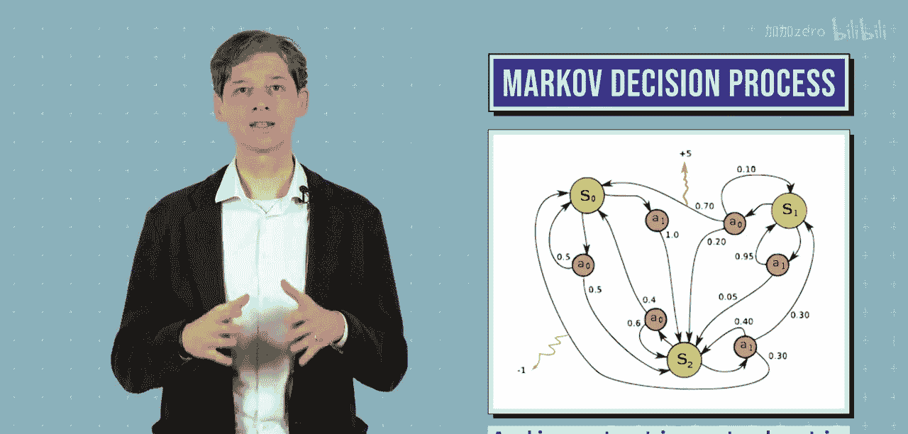
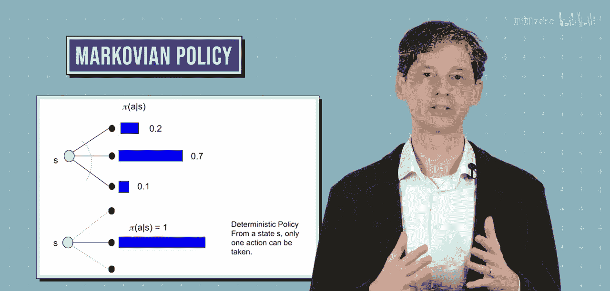
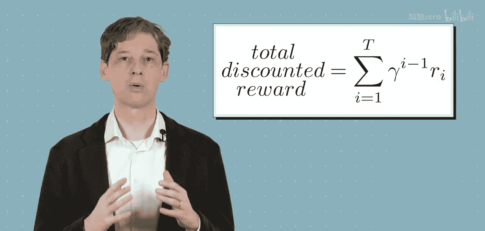
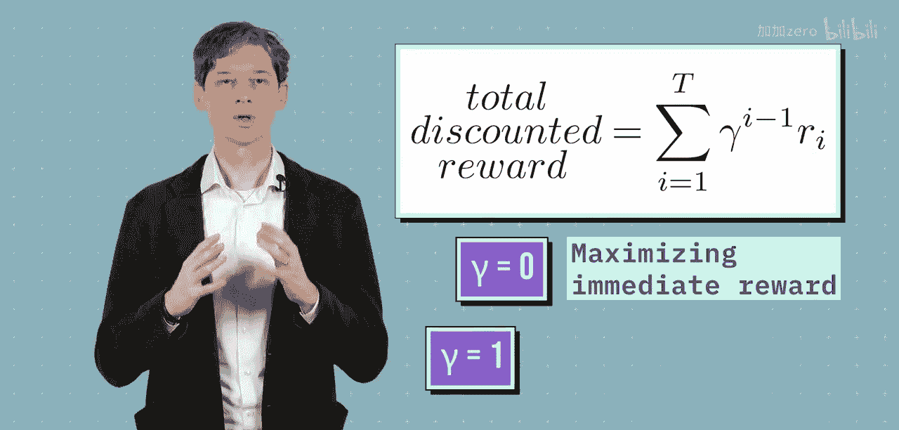
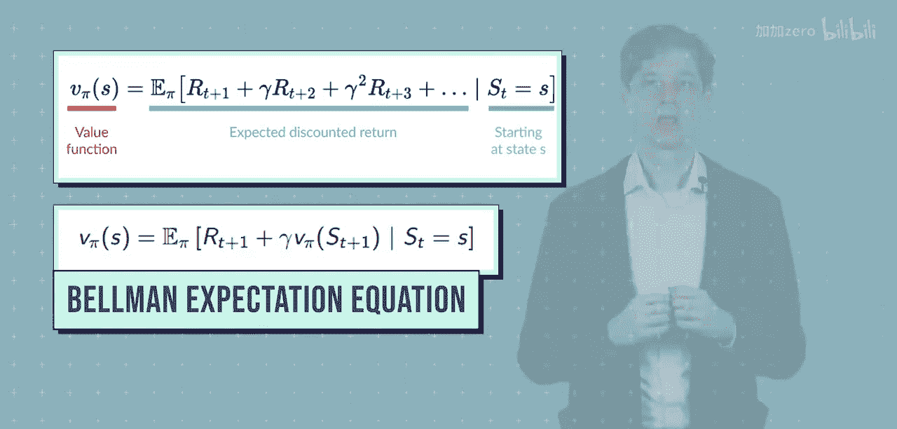
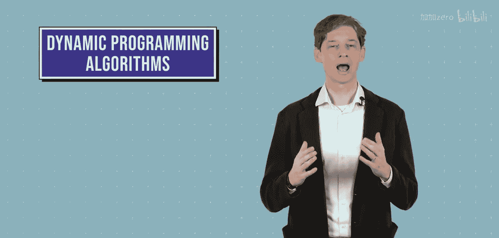

# 073：马尔可夫决策过程

在本节课中，我们将要学习描述序贯决策问题的核心数学模型——马尔可夫决策过程。我们将了解其基本构成、核心假设以及如何求解最优策略。

## 概述

描述序贯决策问题最常用的数学基础是马尔可夫决策过程。马尔可夫决策过程，简称MDP，描述了一个离散时间的随机控制过程。在这个过程中，智能体可以观察问题的状态，执行一个动作，并观察该动作带来的即时奖励以及导致的新状态。

## 马尔可夫假设

MDP基于马尔可夫假设，该假设可以表述为：**给定当前状态，未来与过去独立**。马尔可夫假设的一个结果是，为了做出最优决策，我们只需依赖对当前状态的观察，而无需记住我们是如何到达这个状态的。

例如，当我们玩魔方时，为了解开它，我们无需知道是如何达到当前魔方配置的。这意味着我们不需要在内存中保存智能体与环境交互的历史，从而极大地简化了问题。

## MDP的构成要素

一个离散时间有限MDP由以下几个要素构成：

*   **状态集合 S**：一个有限的状态集合。
*   **动作集合 A**：一个有限的动作集合。
*   **状态转移函数 P**：具体来说，`P(s, a, s')` 表示在状态 `s` 执行动作 `a` 后，到达状态 `s'` 的概率。
*   **奖励函数 R**：`R(s, a)` 指定了在状态 `s` 执行动作 `a` 所获得的即时奖励。
*   **折扣因子 γ**：指定了未来奖励相对于即时奖励的重要性。

## 策略

为了定义智能体的行为，我们使用策略的概念。一个马尔可夫策略是一个函数，它为每个状态指定执行不同动作的概率。如果在任何状态下，策略将所有概率分配给一个单一动作，我们称该策略是**确定性的**；否则，该策略是**随机性的**。

## 求解MDP的目标

求解一个MDP意味着找到最优策略，即最大化某种奖励累积函数的策略。最常见的**目标函数**是未来奖励的期望折扣总和。在这个公式中，时间 `i` 的奖励乘以折扣因子的 `i-1` 次方。

**公式：** `G_t = R_{t+1} + γ * R_{t+2} + γ^2 * R_{t+3} + ... = Σ_{k=0}^{∞} γ^k * R_{t+k+1}`

折扣因子 `γ` 的值需要在 `[0, 1]` 范围内，它指定了未来奖励对智能体的相关程度。如果折扣因子等于0，意味着智能体只对最大化即时奖励感兴趣。而折扣因子等于1则意味着智能体对所有奖励给予同等重要性，无论它们将在何时获得。

一般来说，较低的折扣因子值会导致短视的行为，而较高的值会产生有远见的策略。

## 价值函数与贝尔曼方程

为了理解如何计算MDP的最优策略，我们需要引入价值函数的概念。给定一个策略 `π`，其价值函数 `V^π` 是一个函数，它为每个状态 `s` 指定了从状态 `s` 开始并遵循策略 `π` 所能获得的期望折扣奖励。

状态 `s` 在策略 `π` 下的价值可以通过一个递归方程来表达，即**贝尔曼期望方程**。根据这个方程，状态 `s` 的价值可以表示为策略 `π` 能从该状态获得的期望即时奖励，加上一步之后到达状态的折扣期望价值。

**公式：** `V^π(s) = Σ_{a∈A} π(a|s) * [ R(s, a) + γ * Σ_{s'∈S} P(s, a, s') * V^π(s') ]`

考虑MDP中所有状态的贝尔曼期望方程，我们得到一个线性方程组，其中方程和未知数的数量都等于状态的数量。在折扣因子小于1的假设下，任何策略 `π` 的价值函数都可以通过求解这个贝尔曼方程组以闭式形式获得。

## 最优价值函数与贝尔曼最优性方程

为了求解MDP，我们需要找到一个在任何状态下都能达到最大可能价值的策略。可以证明，对于任何MDP，总是存在至少一个确定性的马尔可夫策略是最优的。此外，所有最优策略都具有相同的价值函数，称为**最优价值函数** `V*`，其在任何状态下的值都是最优的。

与策略的价值函数类似，我们也可以为最优价值函数写出递归方程，即所谓的**贝尔曼最优性方程**。

**公式：** `V*(s) = max_{a∈A} [ R(s, a) + γ * Σ_{s'∈S} P(s, a, s') * V*(s') ]`

我们可以看到，在这个方程中，贝尔曼期望方程中关于动作的期望被替换为关于动作的最大化。不幸的是，这个微小的改变带来了显著的影响，因为方程在未知数中不再是线性的，因此不存在闭式解。

## 求解算法：动态规划

然而，可以使用迭代方法求解MDP。最常用的两种动态规划算法是**价值迭代**和**策略迭代**。

*   **价值迭代**：我们从任意的价值函数开始，然后迭代地将贝尔曼最优性方程的右侧应用于前一次迭代输出的价值函数。通过这种方式，我们产生一个价值函数序列，该序列具有收敛到最优价值函数的性质。
*   **策略迭代**：我们从任意策略开始，然后在两个步骤上迭代：**策略评估**和**策略改进**。在策略评估步骤中，我们计算给定策略 `π` 的价值函数。在策略改进步骤中，我们计算所谓的**贪婪策略** `π'`，即最大化从策略 `π` 的价值函数估计出的效用的策略。可以证明，策略 `π'` 在任何状态下都不会比策略 `π` 差。当在迭代过程中，我们找到与策略 `π` 具有相同价值函数的策略 `π'` 时，意味着我们已经找到了最优价值函数，并且 `π` 和 `π'` 都是最优策略。

## 总结与展望

本节课中我们一起学习了马尔可夫决策过程的核心概念。动态规划算法允许我们在状态转移模型和奖励函数已知的情况下求解MDP。

当这两个要素中的一个或两个未知时，我们需要借助**强化学习算法**，这将在下一课中介绍。