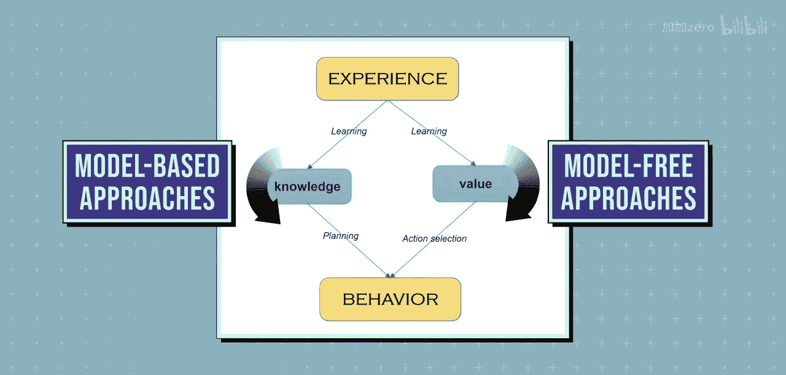
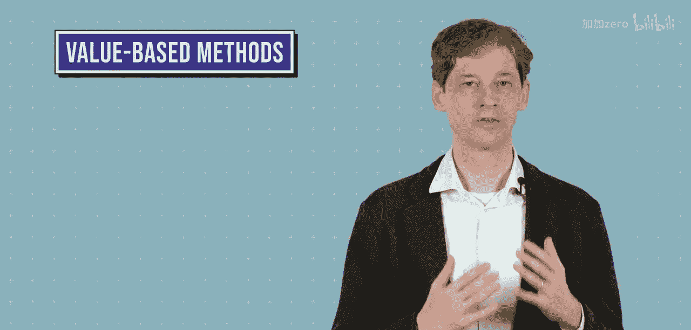
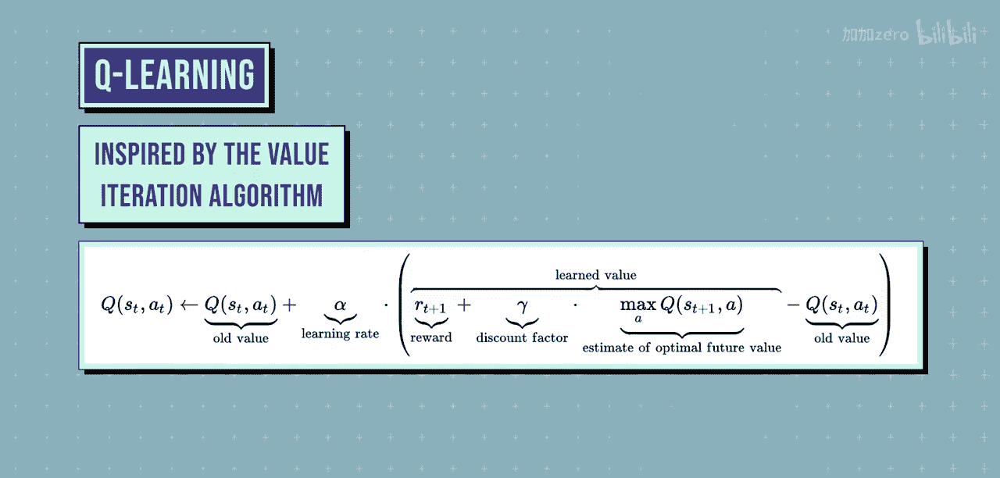
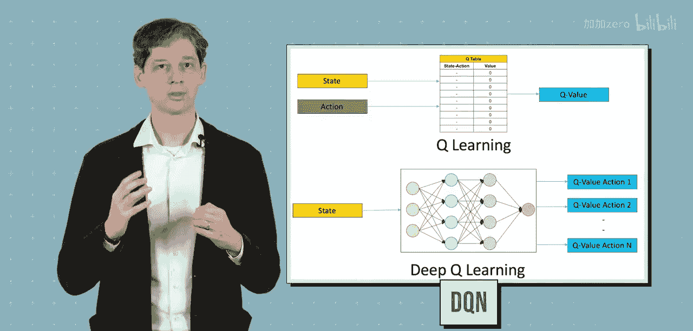
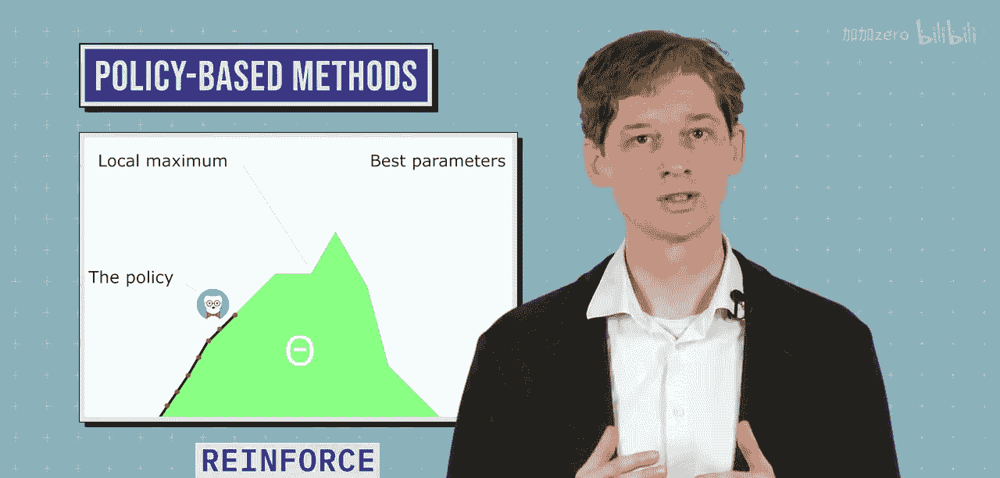
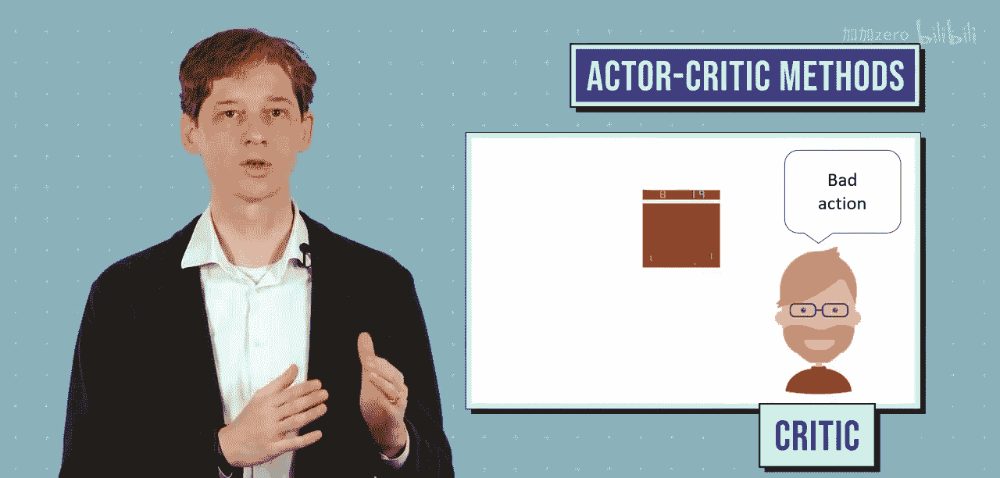

# 074：强化学习算法 🧠

在本节课中，我们将要学习强化学习算法的核心概念与分类。当面对环境动态未知或状态空间庞大的决策问题时，强化学习技术通过直接与环境交互来学习解决方案。

---

## 概述

在现实世界中，我们常常需要解决决策问题，但可能对环境动态知之甚少。即便拥有良好的状态转移模型，当状态和行动的数量过于庞大时，我们也无法使用动态规划等精确方法求解。在这些情况下，我们可以使用强化学习技术，它通过与环境或模拟器直接交互来学习解决方案。

在强化学习中，对转移模型的知识被替换为观察行动对环境的影响。我们将由**状态、行动、下一个状态和奖励**组成的序列称为**经验样本**。

---

## 强化学习技术的分类维度

强化学习技术可以从多个维度进行分类。一个重要的区分是**无模型**方法与**基于模型**的方法。

### 无模型 vs. 基于模型

在两种情况下，我们都不假设事先知道转移模型。

*   **无模型方法**：旨在通过直接评估策略的性能来学习最优策略。
*   **基于模型的方法**：首先观察智能体与环境的交互以估计环境动态模型，然后对该模型应用精确求解方法。

无模型方法比基于模型的方法计算效率更高，且不需要我们指定一个待估计的参数化模型。另一方面，基于模型的方法通常**样本效率**更高（即，它们可以用更少的经验样本进行学习），但如果所考虑的参数化模型不足以表示环境动态，则可能无法学习到最优策略。

---

## 按估计目标分类

另一个重要的分类维度与方法估计的目标有关。沿着这个维度，主要有三大类方法：**基于价值**、**基于策略**和**演员-评论家**。

### 1. 基于价值的方法

基于价值的方法使用经验样本来直接学习最优价值函数。

这些方法从动态规划算法中获得灵感，并将贝尔曼方程中包含的期望值替换为一个采样变量，该变量只考虑智能体选择的行动和到达的下一个状态。

其中，**Q学习**是最流行的强化学习算法之一，它是一种受**价值迭代**算法启发的、无模型的、基于价值的方法。

**Q学习更新公式**：
`Q(S, A) ← Q(S, A) + α * [R + γ * max_a‘ Q(S‘, a‘) - Q(S, A)]`

在执行状态`S`下的行动`A`后，Q学习会使用即时收集的奖励`R`和下一个状态`S‘`中最佳估计行动的价值，来更新与状态-行动对`(S, A)`关联的价值。

在假设每个状态-行动对被无限次访问，且学习率`α`按照适当的衰减计划降至0的前提下，Q学习保证收敛到最优价值函数。

基于价值的方法通常在马尔可夫过程中表现良好，但在具有部分可观测性或行动空间非常大的决策问题中会遇到困难。

2013年，Q学习与深度学习技术结合，诞生了**深度Q网络**算法。在DQN中，价值函数使用卷积神经网络进行近似，这使得算法能够在状态数量极其庞大的决策问题中学习。最初，DQN被用于训练智能体直接从像素输入玩57款雅达利游戏，并在大多数游戏中达到了人类水平。此后，DQN得到了许多改进，现在已有更深的强化学习算法在所有57款游戏中达到甚至超越了人类水平。

---

### 2. 基于策略的方法

上一节我们介绍了基于价值的方法，本节中我们来看看基于策略的方法。

这里的思路是定义一个参数化策略的空间，然后搜索能实现最佳性能的参数。此类中最流行的算法是**策略梯度**方法，例如REINFORCE和G(PO)MDP。

从一个初始策略开始，策略梯度方法对策略参数执行梯度上升优化，其中梯度方向是通过在当前策略下于环境中执行生成的轨迹来估计的。

以下是策略梯度方法的核心步骤：

1.  初始化策略参数。
2.  使用当前策略在环境中生成轨迹（状态、行动、奖励序列）。
3.  计算策略性能的梯度估计。
4.  沿梯度方向更新策略参数以提升性能。
5.  重复步骤2-4直至收敛。

基于策略的方法使我们能够处理具有高维和连续状态-行动空间的决策问题。此外，与基于价值的方法相比，它们对违反马尔可夫假设的敏感性较低，即使在部分可观测问题中也能学习到良好的解决方案。

因此，它们常被用于机器人应用中。此外，它们允许我们学习**随机策略**，这在多个智能体交互的问题中可能很有用。另一方面，它们需要大量数据来估计改进方向，并且通常可能收敛到局部最优解而非全局最优解。

---

### 3. 演员-评论家方法

第三类方法试图结合前两类的优点。在演员-评论家方法中，有两个主要组件：

*   **评论家**：目标是估计当前策略的价值函数。
*   **演员**：目标是实现智能体的策略，并根据来自评论家的建议进行更新。

通过这种方式，演员-评论家方法既能享受基于价值方法的样本效率，又能像基于策略的方法一样在维度和连续控制问题中操作。

流行的演员-评论家算法包括A2C、TRPO、PPO和DDPG。

---

## 探索与利用的平衡

强化学习研究正在许多方向上快速发展。其中一个核心问题是在**探索**与**利用**之间找到正确的平衡。

我们确实需要探索以理解我们行动的效果。但同时，随着我们的知识变得更加可靠，我们希望减少探索。找到从探索转向利用的最佳方式对于强化学习算法的成功至关重要。

---

## 总结

本节课中我们一起学习了强化学习算法的核心分类。我们了解了**无模型**与**基于模型**方法的区别，以及按估计目标划分的三大类算法：**基于价值**的方法（如Q学习）、**基于策略**的方法（如策略梯度）和结合两者优势的**演员-评论家**方法。最后，我们认识到在强化学习中平衡**探索**与**利用**是取得成功的关键。这些算法为解决环境动态未知或状态空间庞大的复杂决策问题提供了强大的工具。