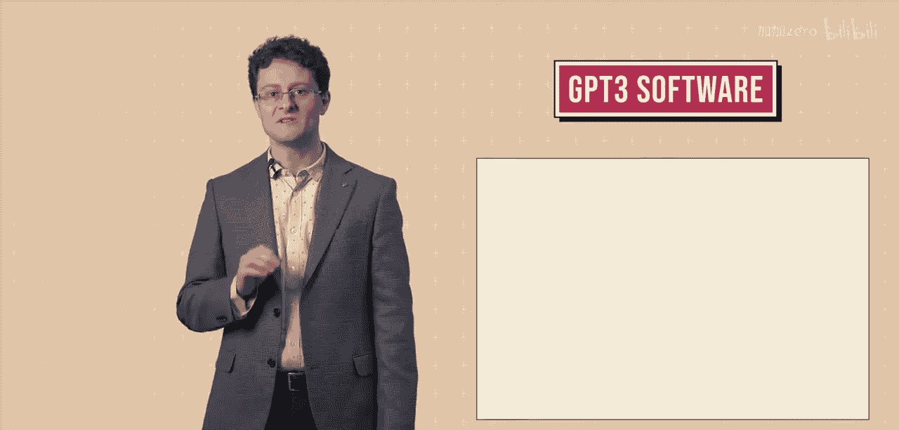
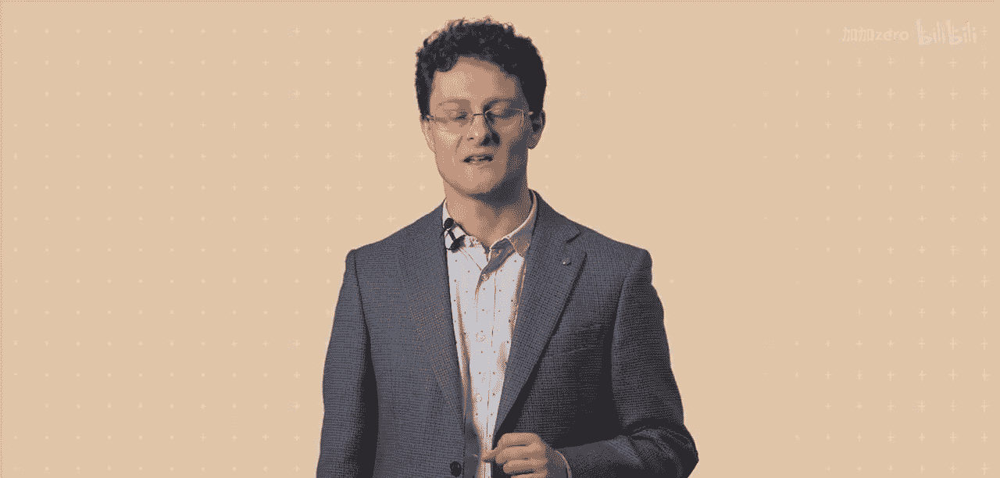
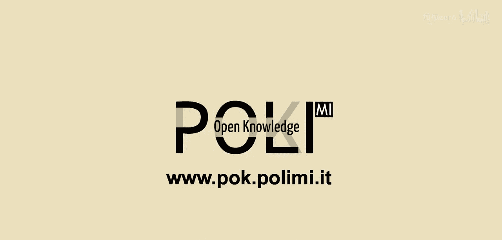

# 【人工智能：概述 专项课程】米兰理工大学—中英字幕 p01 p0_01_what-is-artificial-intelligence -BV1Er1PYhE9q_p1-

Artificial intelligence， or simply AI， is probably one of the most fascinating technologies available today。

And he's commonly believed that it will be dominant up to at least 2050。

Very recent major AI achievement are， for example， alphabot capable of predicting the physical properties of the proteins。

 the Google car capable of traveling millions of kilometers without making incidents。

GPT3 software capable of producing newspaper articles indinguishable from those written by humans。

And Priusbat， capable of beating the top five poker players of the International circuit of Texas poker hold no limits。

Even if today almost everybody speaks of AI， addressing the question。

 what is AI is not a simple task。During the following lectures。

 we will analyze and depth how the definition of AI evolved during time here our goal is just to provide a brief sketch of the concept of AI and then introduce the structure of the topics discussed later。

Intuitively， AI， his intelligence， demonstrated by machine and provided by humans to machine。

Unlike the natural intelligence displayed by humans and animals。

Since there is no clear definition of what his intelligence。

 the customer approach is to distinguish intelligent entities from those that are not according to the behavior they exhibit。

Such an approach requires the definition of some performance metrics that we usually aim at maximizing or minimizing。

These metrics need to be formally defined。Thus making the resort formal and scientific tools such as mathematics and logics natural。

For instance， when traveling from a city to another city， the metric is a time spent。

 and the goal is its minimization。😊，When playing checkers are chess。

 the metric is the victory probability， and the goal is its maximization。

Where define characters or images， the metric is the error probability。

 and the goal is its miniization。😊，Surprisingly， what they is today， it may not be tomorrow。

T just of the optical chapter recognition task。Since today it is a routine technology。

 it is not considered as an AI tool Ham。This phenomenon is known as AI fact。

The idea is that as machines become increasingly capable。

 tasks considered to require intelligence are often removed from the definition of AI。

According to the definition proposed by Larry Tesler， a computer scientist at the were for Heppo。

 Xerx， Yahoo， Amazon， AI his whatever hasn't been done yet。

For a better compression of how AI evolved during time。

 it is useful distinguishing four main time periods that we will analyze in the following lectures。

The first period is before the birth of AI that was in 1956 and is characterized by the AI precursors。

The second period is the birth of the eye。The third period is from immediately after the birth of A up to the hand of the previous century。

This period， thanks to the initial AI successes and failures。

 paved the way to the explosion of AI field in our century。

The third period is from the beginning of our century to today。

