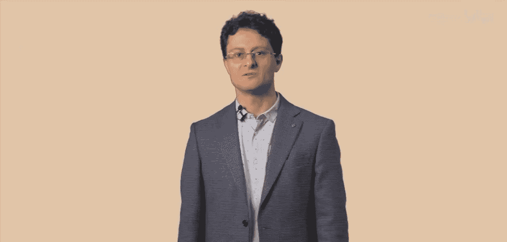
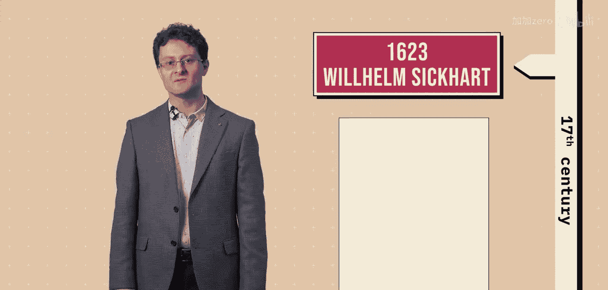
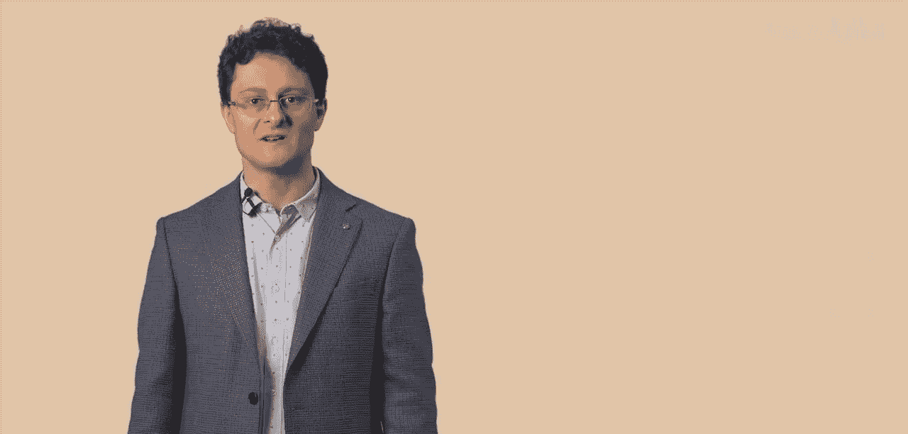
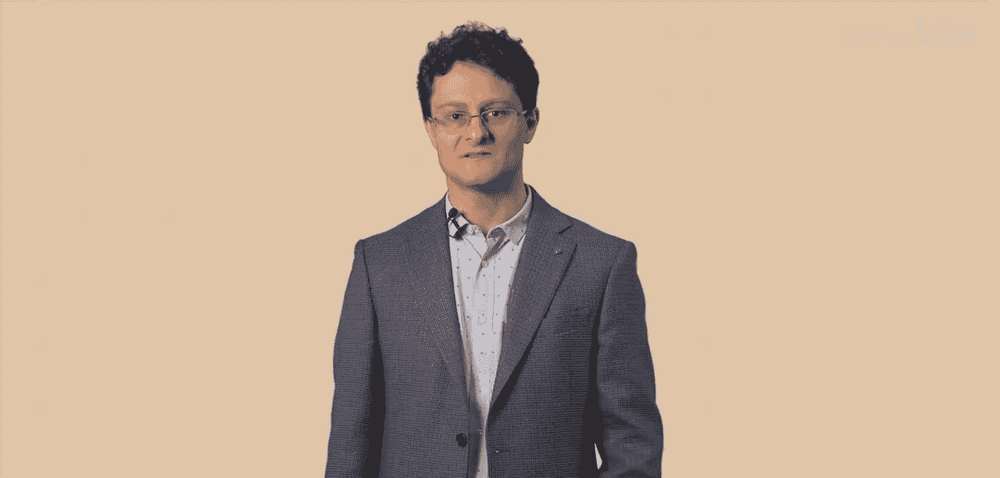

# 【人工智能：概述 专项课程】米兰理工大学—中英字幕 p02 p1_01_before-the-birth-of-ai-precursors -BV1Er1PYhE9q_p2-

The problem of making a machine to replicate human capabilities such as intelligence has fascinated many scientists for many centuries。

The measure head force were directed to the computing capabilities。

The first examples that are were being mentioned are related to the 17th century。In 1623。

 William Sicart， ancestor of the calculator， was able to carry out mathematical calculations with numbers up to six digits with machines。

 even if not autonomously。

In 1642， Blaze Pascal invented a mechanical calculator capable of adding and subtracting two numbers directly。

 and of performing multiplication and division through repeated addition and subtraction。In 1674。

 Godfred William Von Leibs invented a mechanical machine capable of performing the addition。

 subtraction and multiplication by exploiting recursion。When moving to the 19th century。

 we can mention Charles Beviage。It propose the model of differential engine。

A machine capable of solving polynomials by using the finite differences is metted。

This model was implemented by Gerg and Hidvat Shez in a working machine。Some years later。

 Charles Beber proposed the model of a general PPose computing machine capable of performing every kind of calculus beyond those performed by the differential engine。

This new model was called analytical Engine。The development of electronic calculators in the middle of the 20th century paved the way to the new ideasTS。

 in particular， Helenururing proposed a theory of computation。

 according to which a machine by shaling symbols has simple has0 and1 could simulate any conceivable hack of mathematical adapt。

This model known as the tuuring machine， is the main computation model among those adopted today。

In particular， alon surcharge and Halan Turing showed that digital computers can simulate any process and formal reasoning。

 and this was done by showing that the turing machine is the most general computing machine one can design。

Such a result， together with the last discoveries in neurobiology。

 information theory and cybernetics， led researchers to consider the possibility of building an electronic brain。

The first year result is the artificial nen called linear threshold unit。

Proposeded by War McCello and Walter Pis in 1943。The model was specifically targeted has a computational model of the nerve net in the brain。

It was noticed that any Boolean function could be implemented by neural networks。

Which is easily seen from the fact that one can implement the hand and the horror functions。

And use them in the disjunctive or the conjunctive normal form。

Researchers also soon realized that secret networks with feedback through neurons could define dynamical systems with memory。

These results raise a lot of questions in the scientific community on what intelligence is and when an entity can be considered intelligence。

🎼These questions will be central in the works of Valenturing。

