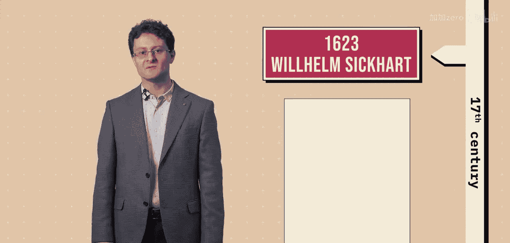

# 人工智能：01：人工智能诞生前的先驱

在本节课中，我们将学习人工智能诞生前，科学家们为模拟人类智能所做出的关键努力。我们将从早期的机械计算装置开始，一直探索到奠定现代计算机科学和神经网络基础的里程碑式思想。

---

制造一台能够复制人类智能等能力的机器，这个问题已经吸引了许多科学家数个世纪。

早期的努力主要集中在计算能力上。以下是17世纪至20世纪初期的一些关键先驱：

*   **1623年**：威廉·西卡德发明了计算器的前身，能够进行最多六位数的数学计算，尽管并非完全自动。
*   **1642年**：布莱兹·帕斯卡发明了机械计算器，能够直接进行加减法，并通过重复加减来实现乘除法。
*   **1674年**：戈特弗里德·威廉·莱布尼茨发明了机械机器，能够利用递归进行加法、减法和乘法。

---

上一节我们回顾了17世纪的机械计算雏形。进入19世纪，计算思想有了更重大的发展。

查尔斯·巴贝奇提出了差分机的模型。这是一台能够使用有限差分法求解多项式的机器。这个模型后来由乔治和爱德华·舍茨制成了可工作的机器。

几年后，查尔斯·巴贝奇提出了一个通用计算机器的模型，它能够执行差分机之外的各种计算。这个新模型被称为**分析机**。

---

20世纪中叶电子计算器的发展为新的思想铺平了道路。其中，阿兰·图灵提出了计算理论。

该理论认为，一台仅通过处理`0`和`1`等简单符号的机器，可以模拟任何可想象的数学推导过程。这个被称为**图灵机**的模型，是当今采用的主要计算模型之一。

具体来说，阿隆佐·邱奇和阿兰·图灵证明了数字计算机可以模拟任何过程和形式推理。这是通过证明图灵机是所能设计出的最通用的计算机器来实现的。

这一成果，连同神经生物学、信息论和控制论的最新发现，促使研究者们开始考虑建造一个“电子大脑”的可能性。

---

在探索“电子大脑”可能性的过程中，第一个重要成果是人工神经元，即线性阈值单元。

它由沃伦·麦卡洛克和沃尔特·皮茨在1943年提出。该模型明确地旨在作为大脑中神经网络的**计算模型**。

研究者们注意到，任何布尔函数都可以由神经网络实现。这一点很容易理解，因为人们可以实现**与**函数和**或**函数，并在析取范式或合取范式中使用它们。

研究者们也很快意识到，通过神经元具有反馈的神经网络可以定义具有记忆的动态系统。

这些成果在科学界引发了大量关于“智能是什么”以及“一个实体何时可被视为智能”的讨论。

---

这些由早期先驱们提出的问题，将在阿兰·图灵等人的工作中占据核心地位，并直接引领人工智能领域的正式诞生。

---

本节课中我们一起学习了人工智能诞生前的关键先驱思想。我们从17世纪的机械计算器开始，看到了19世纪巴贝奇的分析机如何构想通用计算。接着，我们了解了20世纪图灵机理论如何为现代计算奠定基石，以及麦卡洛克和皮茨的线性阈值单元如何首次尝试用计算模型模拟大脑神经元。这些探索共同提出了关于机器与智能的根本问题，为人工智能学科的正式出现做好了准备。