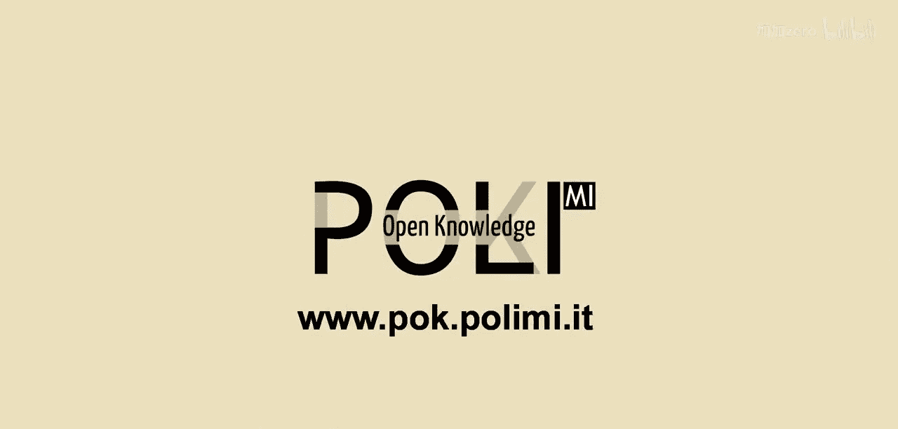

# 【人工智能：概述 专项课程】米兰理工大学—中英字幕 p04 p3_01_the-birth-of-ai -BV1Er1PYhE9q_p4-

In 1956， at the Dartt College in New Hampshire， United States， Marvin Miskey。

 John McCarthy and two other senior scientists， Clude Shannon and Na Rochester。

 organized the Dartmant Summer Research project on Artctic Intelligence。

The project lasted approximately six to eight weeks and was essentially an extended brainstorming session。

About 10 mathematicians and scientists attended。The participant included Ray Soloov。Oliver。

 sale freight。Transure Moore， Arthur Samuel， Alan Newwell and Herbert Simon。

This workshop is widely considered to be the founding event of artificial intelligence as a field。

The proposal for the conference included this assertion。

Every aspect of learning or any other feature of intelligence can be so precisely described that a machine can be made to simulate it。

The term artificialific intelligence was chosen by McCarthy to avoid associations with cyberbernetics and the connections with the influential area of cyberbernetics started by Norber Viner。

The first AI major achievement is probably by Helen Newell and Albert Simon in 1956。

They created a program called the Logic Theorist。This program proved 38 of the first 52 theorems in Ru cell and Whiteha Prince CPPia Mathematica。

And found new and more elegant proofs for some of them。

The second AI measure achievement is by Har Samuel in 1959。

It produced a checkers program with skills comparable to those of a respectable he。

On this research line， a huge number of AI hardf will let followed in the next few years。

