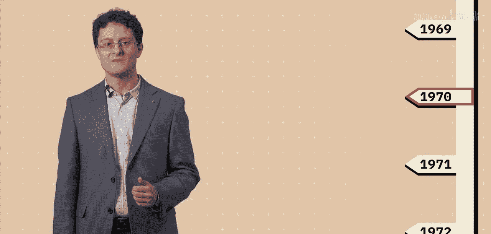

# 【人工智能：概述 专项课程】米兰理工大学—中英字幕 p05 p4_01_after-the-birth-of-ai-winters-and-springs -BV1Er1PYhE9q_p5-

The bird of Hai was an exciting event for both the scientific community and industry。

The first generation of AI researchers made very ambitious predictions。

 leading to very high expectations。For instance， in 1958。

 Albert Simon and Helen Newell claimed that within 10 years。

 a digital computer will be the world ches champion。And within 10 years。

 a digital computer will discover and improve an important new mathematical theorem。😊，In 1965。

 Albert Simon claimed that machines will be capable within 20 years of doing any work a man can do。

In 1967， Marvin Miski said that within a generation。

 the problem of creating artificial intelligence will be substantially solved。And again， in 1970。

 Marvin Miski said that in from three to eight years。

 we will have a machine with the general intelligence of an average human being。

However， the HiI researchers had failed to understand the difficulty of the problems they faced。

 and their tremendous optimism had raised expectations impos high。So after 1970。

 when the promised result failed to materialize， AI was subject to severe critics。

The main reasons for these first failure of AI were meaning。We cite just a few。

 the first was a wrong comparisonhenion of the nature of the problems。

Most AA problems suffer from combbinatory explosion。

The solution is easy when one studies store instances。

 but it is intractable with real world instances。The second was the limited computer power。

The third was the amount of data needed to specific fields such as computer vision and natural language processing。

No one in 1970 could build a database so large and no one knew how a program made learn so much information。

The agenciesies which founded AI research， such as the British government， the DARPA。

 the Han Her Sea， became frustrated with the lack of progress and eventually could have almost all funding for undirected research into AI。

By 1974， funding for AI project was hard to find。This is commonly called the first winter of AI。

This first winter concluded after 1980， when a new spring started thanks to expert systems。

 which were great success and were adopted by many companies around the world。

An expert system is a simple hiI heart fat composed of a nu base and an kneefr engine that can be used。

 for instance， for medical diagnosisosis。This spring lasted about 10 years and then a new winter cold has the second winter of AI started at about 1990 and lasted about 10 years up to 2000。

Since then， AI began to be used successfully through how to the technology industry。

Some of the success was due to the increasing computer power and some was achieved by focusing on specific isolated problems and pursuing them with the highest standards of scientific accountability。

Together， all these factors help to fragment AI into competing subfield。

 focused on particular problems or approaches。

