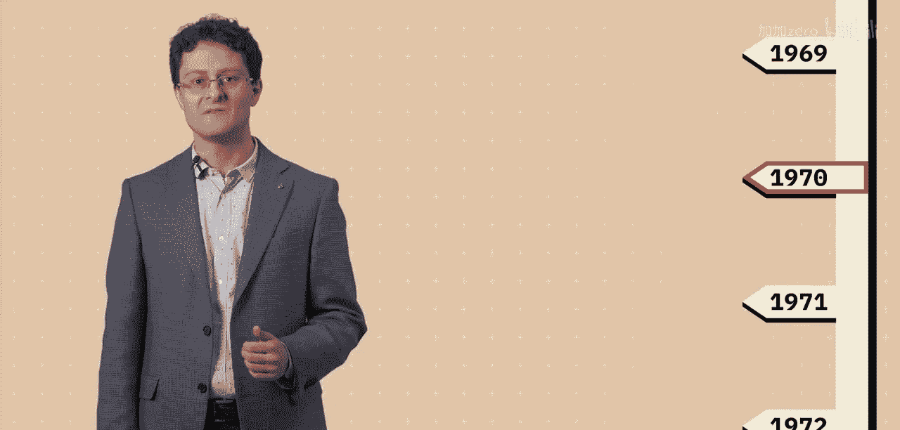

# 人工智能：05：AI的诞生之后——寒冬与春天 🌱❄️


在本节课中，我们将要学习人工智能（AI）发展初期，从充满希望的诞生到遭遇挫折的“寒冬”，再到技术突破带来的“春天”的完整历程。我们将了解早期研究者的雄心壮志、导致期望落空的原因，以及AI如何通过专家系统等技术重获新生。

---

## 早期的雄心与过高期望

上一节我们介绍了AI的诞生。在AI诞生之初，整个科学界和工业界都为之兴奋。

第一代AI研究者做出了非常雄心勃勃的预测，这导致了极高的期望。以下是几个著名的例子：

*   **1958年**：Albert Simon和Helen Newell声称，**在10年内，数字计算机将成为世界象棋冠军**。并且，**在10年内，数字计算机将发现并证明一个重要的新数学定理**。
*   **1965年**：Albert Simon声称，**机器将在20年内有能力完成人类能做的任何工作**。
*   **1967年**：Marvin Minsky说，**在一代人的时间内，创造人工智能的问题将基本得到解决**。
*   **1970年**：Marvin Minsky再次表示，**在3到8年内，我们将拥有一台具备普通人综合智能的机器**。

---



## 遭遇挫折与第一次AI寒冬 ❄️

然而，早期的研究者未能充分理解他们所面临问题的难度，他们过度的乐观将期望推向了不切实际的高度。

因此，在1970年之后，当承诺的成果未能实现时，AI受到了严厉的批评。以下是导致AI首次失败的一些主要原因：

*   **对问题本质的错误认知**：大多数AI问题都受到**组合爆炸**的困扰。在研究小型实例时解决方案看似简单，但在面对现实世界规模的实例时，问题就变得难以处理。
*   **有限的计算能力**：当时的计算机硬件无法支撑复杂的AI运算。
*   **数据量的匮乏**：在计算机视觉和自然语言处理等特定领域，需要海量数据。在1970年，没有人能建立如此庞大的数据库，也没有人知道程序如何学习这么多信息。

资助AI研究的机构，如英国政府、DARPA（美国国防高级研究计划局）等，对缺乏进展感到沮丧，最终几乎停止了对非定向AI研究的所有资助。

到1974年，AI项目的资金已很难获得。这一时期通常被称为 **“第一次AI寒冬”**。

---

## 专家系统带来的春天 🌱

第一次寒冬在1980年后结束，这得益于**专家系统**的成功，一个新的“春天”开始了。

专家系统是一种简单的AI程序，由**知识库**和**推理引擎**组成，可以用于诸如医疗诊断等领域。其核心逻辑可以简化为一系列规则：
```python
if condition_A and condition_B:
    then conclusion_X
```
这个春天持续了大约10年，专家系统被全球许多公司成功采用。

---

## 第二次寒冬与再次崛起

然而，大约在1990年，新的寒冬——**第二次AI寒冬**——开始了，并持续了大约10年，直到2000年。

自那以后，AI开始通过互联网技术在工业界成功应用。部分成功归因于计算能力的不断提升，部分则是通过专注于特定的孤立问题，并以最高的科学标准去追求而实现的。

所有这些因素共同作用，使得AI领域分化成多个相互竞争的子领域，每个子领域都专注于特定问题或方法。

---

## 总结


本节课中，我们一起学习了AI发展初期的起伏历程。我们看到了早期研究者过高的期望如何导致了“第一次AI寒冬”，也了解了**专家系统**如何带来新的发展“春天”。随后，AI经历了“第二次寒冬”，最终凭借计算能力的提升和更务实的研究方法，在21世纪初再次崛起，并分化成多个专门领域。这段历史告诉我们，技术的发展往往伴随着期望的膨胀与现实的修正，而脚踏实地解决具体问题是推动进步的关键。