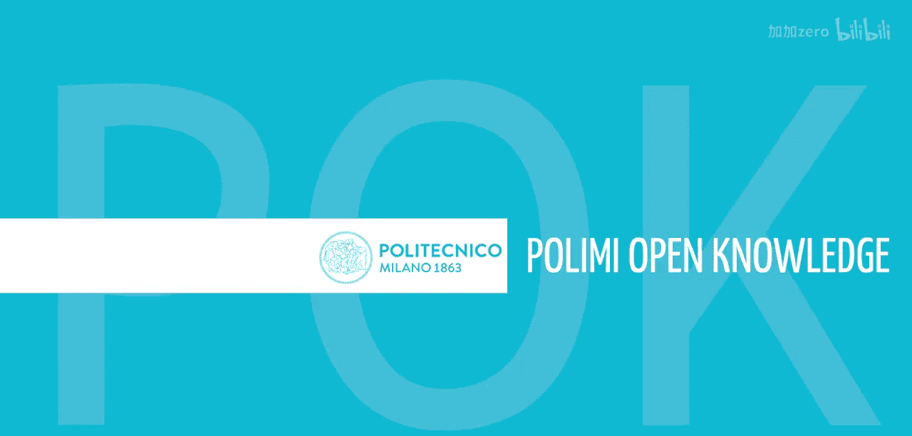
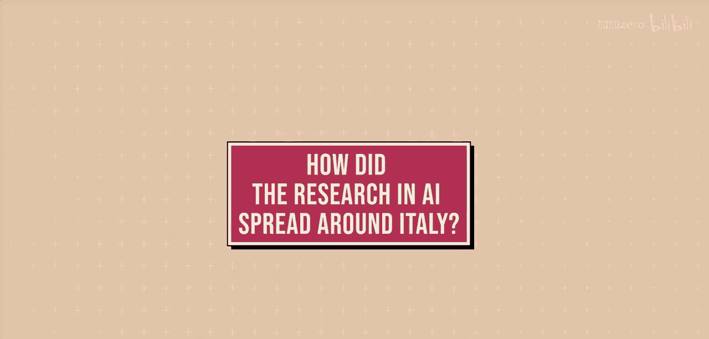
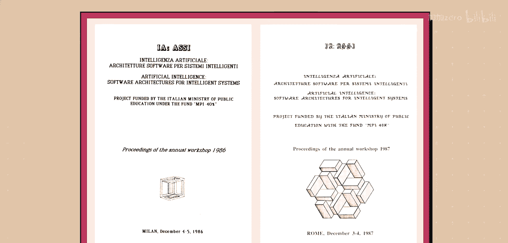
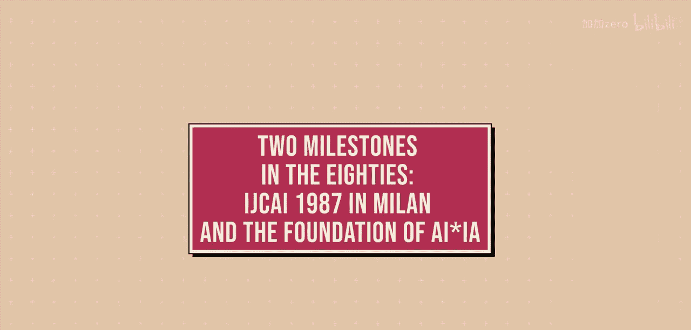
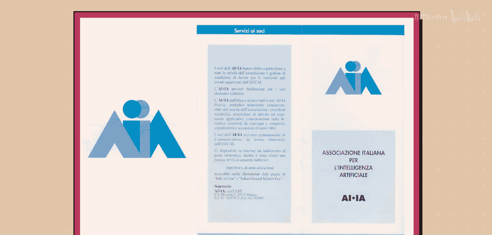
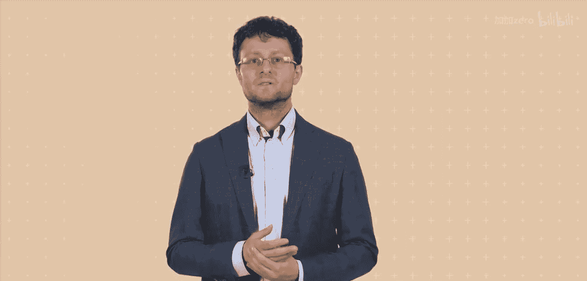
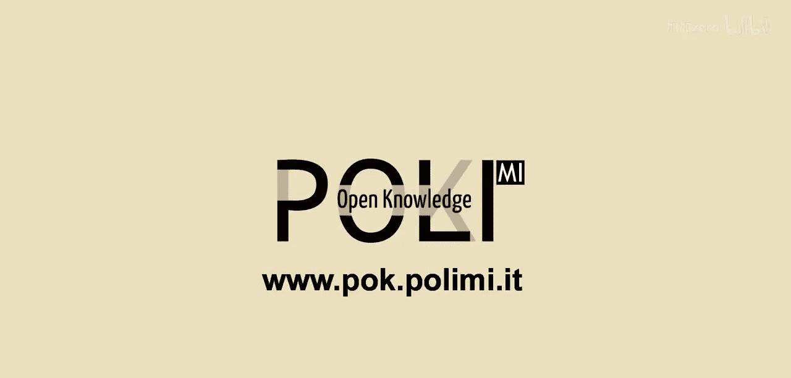

# 【人工智能：概述 专项课程】米兰理工大学—中英字幕 p07 p6_01_the-birth-of-ai-in-italy -BV1Er1PYhE9q_p7-

To provide a detailed description of the bird of Aya in Italy， we has Luigja Carucci Hala。

 She has been indeed one of the founders of AI research in Italy。

Luigja was professor in computer science at University Appance of Rome where she founded the AI Research group。

 she distinguished both horse scientific achievement and services to the AI community。In particular。

 I would like to mention that Luigia was one of the founders of the Italian Association for Artificial Intelligence in 1988。

 and she was the first president。She was also the first Italian Anpoier fellow in 1995。

Serga is today the most important international academic society for artificial intelligence。

She was the first Italian Aai fellow in 1999。 Ari is the most important European academiccade Society for Artific intelligencetelence。

When do you meet AI？I got lower degree in mathematics in 1968 in Pisa with a thesis on the semantics of programming Lagus。

 my thesis advisor has been Alonsoka A de Fuino， a pioneer in the study of programming languages at that time I became interested in proving properties of programs。

In 1969， when Uber Monttanari came back from a long visit for the United States。

 I knew from him about AI and what was going on in the leading US universities。

 Stanford Carnegie Mello and MIT， in particular， I was entreated by the research done at Sa。

 the Stanford artificialial intelligenceence Labor， founded and directed by John McCarthy。

In July 1970， I attended the summer school on AI in D Groick。

 where I got to know McCarthy and other renowned AI researchers。In that period。

 I decided that I wanted to go to sale， which I did in 1973 on an NATO grant。

I knew from about sale from Ugo Montanri， but also from Maccosso Mal Vigo who also had visited there。

 both of them were enthusiastic about it。So Narico was active at Polytechnical Di Millano。

 Monteri after his graduation at Polytechnical Di Millano had moved to Pisa。

 along with a group of newly graduated guys attracted by the possibility of doing research and starting at curriculum in computer science at the University of Pisa。

Which were your research interests at that time？My background was in mathematics and in what we now call theoretical computer science。

My interest was improving program correctness and machine checking these proof。

So my research field was automated or improvingroving， automated reasoning。

I didn't dare to say that my research was in AI too ambitious， I was tackling a subpro。

 the full problem sound to big to me。From reasoning about programs。

 I moved to reasoning about mathematics and considered mathematics as a subpro with respect to the idea of building an intelligent artifacts。

If a machine cannot reason about simple mathematical problems， how can we consider it intelligent？

Then my interest moved to systems to represent and reason about knowledge。

 not only mathematical and knowledge。Only then I had the courage to qualify myself as a researcher in artificial intelligence。

 and I also understood that reasoning about mathematics is not sufficient for a machine to show intelligent behavior。

Can you depict the Italian situation in those years？In the 60s。In Italy。

 nobody mentioned theI as the research area。Don't forget that Alan Turi spoke about machine intelligence and this name was used in the United Kingdom till the 70s。

But let's consider research connected with AII， the places in Italy that come to my mind are Nas where Du Argo Carlo。

 the Institute of Physic at start a group that did outstanding research in cybernetic and neural networks。

Gennovava， where Antonio Bceino at the Institute of Physics and started a group in bioiophysics and cyberdernes。

In Pisa， where a lot of research had started around the construction of the first Italian computer named CEP。

Certainly， research on topics related to AI was also carried on in Milan by Se Chicago and in Rome by Victoria Soenszi。

 both philosophers。Not to be forgotten， the Jesuit Roberto Bua。

 who from the late 40s early 50s in collaboration with IBM。

 started the creation of the index to mysticos， that to say the digitization of the operaomia of St Thomas。

 thus starting the computational linguistic and the strong tradition of natural language understanding in Italy。

Where and when did researchers start to speak of ahi in Italy。To the best of my knowledge。

 the first researchers that used the name artificial intelligence in Italy at the beginning of the 70s were Marco Somervico and Polytechnicri Millano and the group where I belonged at the Institute of Information Proing of PISa。

The Institute of Information processing and the section of non numaticic information processing a will name indeed。

 we could call it symbolic processing。Its original research agenda was in pattern recognition and image processing。

The section of non numerical American information processing included Hugo Monteanari， Giorgio Levy。

 Alberto Marteli， Carlo Montejero， Franco Siroic， Maria Ylo and myself。

All but me were electrical engineers that graduated at Polytech Nego Millano。

When Montenari returned to Pisa from the US， where in 1969 he had attended the first in guy in Washington。

 DC， we proposed a research program in artificial intelligence。In the following years。

 we all went to the United States as visiting scholars。

 thus establishing research relations that we maintain over the years。

Which were the major research topics of that time。No surprise the Italian researchers concentrated on theoretical problems in addition to our inclination。

 the fact was that our laboratories were extremely poor in terms of hardware where AI software could be developed and run。

Of course， I know better the research carried on in Pi。From those years。

 it's worth mentioning the linear unification algorithm proposed by Martion Monteanay。

Pioneering work on constraint programming by Monteanay and work on and orgraphs by Levy and Siroic。

In addition， a very innovative programming language named the MagMlis book， a dialect of Li book。

 was developed by Montegerro Paciian Tinni and used for a long time for applications in computational linguistics at the Institute of。

Compunational linguistics of the National Researchsource Council。Finally， let me mention PPC。

Pace proof checker， a the improver based on Landda Carlculuus implemented in L with a technique that later on became famous as object oriented。

 developed by Maria Lo Joseph Pradi Ja Racorini and myself。How did the surge inI spread around Italy？

AI spread around Italy in the 80s first， the group of researchers activeed in Pisa became full professors and moved to several Italian universities and in each of them they started a research group in AI。

The Italian Ministry of University and Research launched the program of research projects on national interested。

 the idea was to focus the research of several groups around a common the。At that time。

 Maccoom Mal Vicon myself decided to apply with two distinct projects。

 robotics coordinated by him and AI coordinated by me。

 both of them were funded even though with very little money。

These projects constituted an incentive to coordinate our research and form a national community。

In my project， I coordinated units in 12 universities in the first application， 17 in the second one。

AI was attracting attention and this was very positive。

 we had year meeting exchange results and go to know each other。Two milestones in the Hads。

 HK 1987 in Milan in the foundation hub A Perria， the Italian Association for Tsion Intelligence。

Our national projects were hardly perceived in Italy conversely we strengthened our good reputation in the international AI community this certainly counted when the board of eachK。

 the most prestigious AI conference worldwide choose Milan and Somal Vico to organize its 87 edition Marco did a great job in organizing a memorable event and prepared it with many initiatives to promote the conference and the attention on AI and robotics in our academia and industries。

After the success of the national projects and mainly of HK 87。

 the time was ripe for the foundation of the National Association， which we did in 1988。

The Italian Association for Artificial Intelligence。

And through it， we connected Italy to the other European association within Ekai now called U。

The Italian Association for Artificial Inligence is still very active。

 it publishes an international journal and promotes research in Italy and abroad。

With the newly created association， we felt ourselves also ripe for the proposal of a big project of finalzato from the National Re Council。

 a big national project to foster the cooperation of Academic Research and Indutries。

We worked eagerly and put together a very good project for the time。

 but the time was not ripe for the National Re Council and the Italian academia。

Our proposal was never rejected， but without any explanation。

 it was lost in some drawer and never approved。A real p。Luckily enough。

 the European Union was launching the first round of XP projects and we got in Brussels and the recognition we didn't receive in Italy。

And survive the winter。嗯。What about teaching AI。When the first academic courses onI started。

At the end of the '80s， our ministry was in the process of approving the institution of E in in January and Formaticica。

 Marcosomal Wgo and I proposed through our universities to include the class in AI。

This was approved sovavico in 1990 at Portte Rio de Millano and I in 1991 at the School of Engineering at the Laap Pienza in Rome and started the first classes in artificial intelligence in Italy the first year my class was attended by 19 brave students then quickly it attracted more than 100 students。

AII and Italian industries during the 8s and the 90s。

The attention to AI has always been very high in Italian industries and in research laboratories of Italian companies。

 the industrial involvement has been instrumental in the foundation of the Italian Association for Archificicial Intelligence。

 even though it has not been uniformly high over the years， it may be considered odd nowadays。

 but at that time， while a number of startups were blooming abroad， in particular in the USA。

 in Italy academic startups were considered very badly a betraytrial of the purity of the mission of Academic Research。

 the times of the entrepreneurial University had yet to come。

The comparison between AI in the whole days and nowadays。

Today it's really a period of high tide for AI， the results obtained in the solution of real life。

 socially relevant， complex problems have attracted a lot of attention and created many expectations。

The results are due to the advancement of research in AI。

 the development of specific models and methods， and the impressive advancement of the digital and communication technologies different from the past when researchers in AI were considered more or less a minority of weird and eccentric nerves now everybody claims to do research in AI to use aI or to apply AI。

In a word， AI is very fashionable， even too fashionable and over its coast maybe。

This may be dangerous if the fashion is not accompanied by increased knowledge and by investments in research。

 development and experimentation in the usage and acceptance of artificial intelligence systems in our work and living and biomas。

Thank you， Lija for having shared with us your memories and experiences and your valuable contribution to the YaI community。

