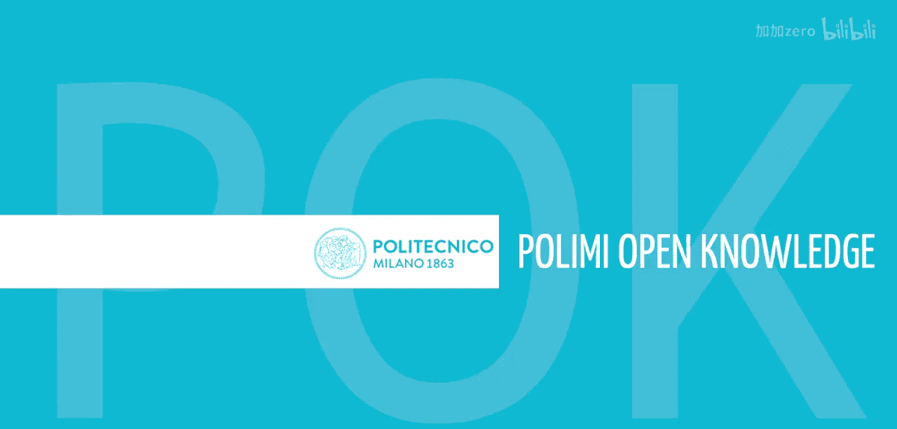
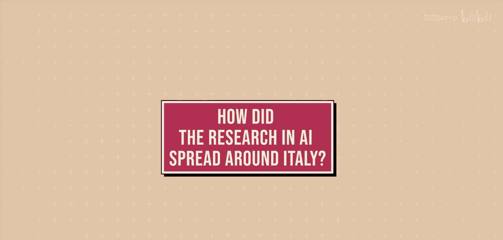
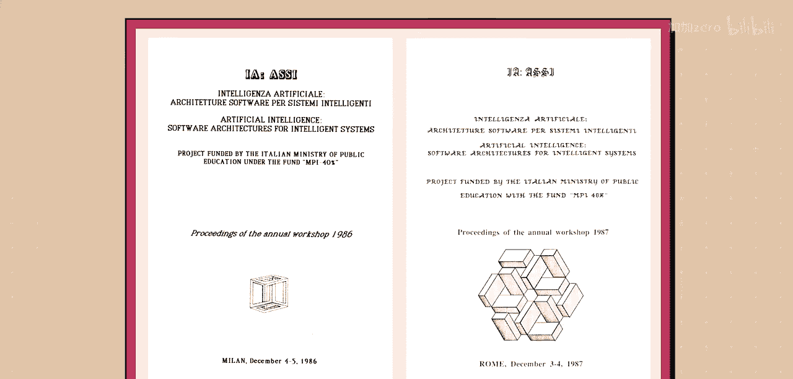
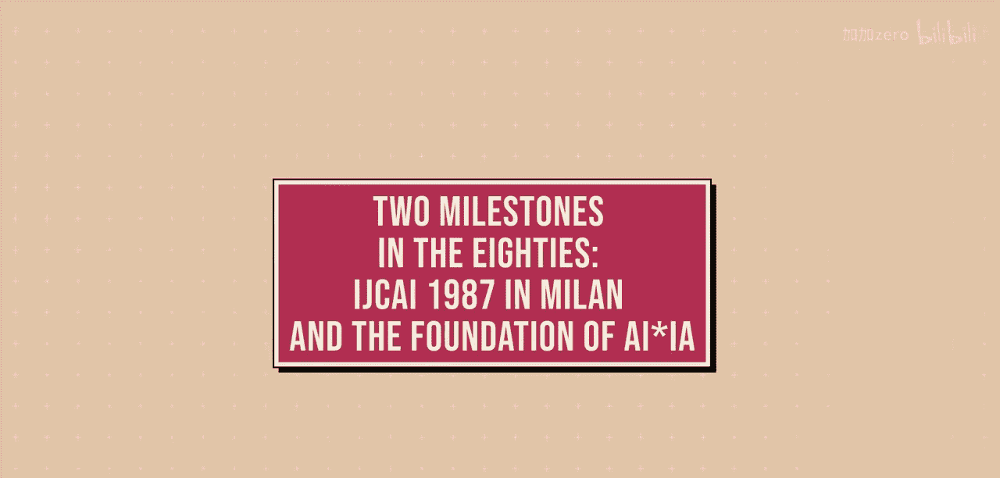
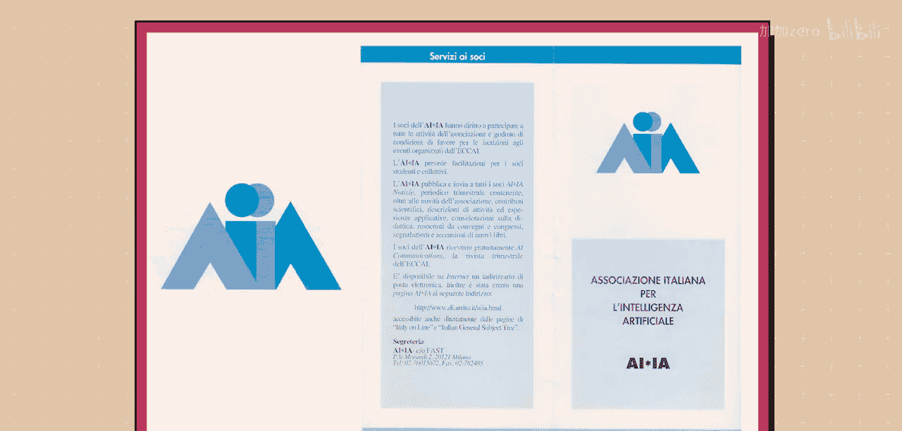

# 人工智能：概述 专项课程：P07：意大利人工智能的诞生 🧠

在本节课中，我们将跟随Luigia Carlucci Aiello教授的讲述，了解人工智能研究在意大利的起源与发展历程。我们将回顾早期研究者的背景、关键研究领域、学术组织的建立以及人工智能在意大利学术界和工业界的演变。

---

## 意大利人工智能的奠基人

Luigia Carlucci Aiello是意大利人工智能研究的奠基人之一。她在罗马大学担任计算机科学教授，并创立了人工智能研究小组。她在科学成就和为人工智能社区服务方面都做出了杰出贡献。

特别值得一提的是，Luigia是1988年意大利人工智能协会的创始人之一，并担任首任主席。她于1995年成为首位意大利AAAI会士，AAAI是全球最重要的人工智能学术组织。她于1999年成为首位意大利EurAI会士，EurAI是欧洲最重要的人工智能学术组织。

## 与人工智能的结缘

Luigia于1968年在比萨大学获得数学学位，论文主题是编程语言的语义学。她的导师是当时编程语言研究领域的先驱Alonzo Church。她由此开始对程序验证产生兴趣。

1969年，当Ugo Montanari从美国长期访问归来时，Luigia从他那里了解到了人工智能以及美国顶尖大学（如斯坦福大学、卡内基梅隆大学和麻省理工学院）的相关研究。她尤其被约翰·麦卡锡创立并领导的斯坦福人工智能实验室的研究所吸引。

1970年7月，她参加了在Dagstuhl举办的人工智能暑期学校，结识了麦卡锡和其他知名人工智能研究者。在那段时期，她决定前往斯坦福人工智能实验室，并于1973年凭借北约资助成行。

她通过Ugo Montanari和Marco Somalvico（后者也曾访问过该实验室）了解了斯坦福人工智能实验室，两人都对那里充满热情。当时，Somalvico在米兰理工大学活跃，而Montanari从米兰理工大学毕业后，与一群被研究机会和比萨大学新开设的计算机科学课程吸引的毕业生一起搬到了比萨。

## 早期的研究兴趣

Luigia的背景是数学和我们现在所说的理论计算机科学。她的兴趣在于提高程序正确性和机器验证这些证明。因此，她的研究领域是**自动推理**或**定理证明**。

她当时不敢称自己的研究属于人工智能，认为这个领域过于宏大，她只是解决其中的一个子问题。从程序推理开始，她转向了数学推理，并将数学视为构建智能体这一宏大目标下的一个子问题。她认为，如果一台机器不能推理简单的数学问题，我们如何能认为它是智能的？

随后，她的兴趣转向了**知识表示与推理系统**，不仅限于数学知识。直到那时，她才有了将自己称为人工智能研究者的勇气，同时也明白了仅靠数学推理不足以让机器展现出智能行为。

## 意大利早期的人工智能相关研究

在60年代的意大利，没有人将“人工智能”作为一个研究领域提及。需要记住的是，艾伦·图灵使用的是“机器智能”一词，这个名称在英国一直使用到70年代。

但考虑与人工智能相关的研究，意大利当时有几个重要的地点：
*   **那不勒斯**：Duilio Ago和Carlo在物理研究所建立了一个小组，在控制论和神经网络方面做出了杰出研究。
*   **热那亚**：Antonio Borsellino在物理研究所建立了一个生物物理学和控制论研究小组。
*   **比萨**：围绕建造意大利第一台计算机CEP，开展了大量研究。

当然，与人工智能相关主题的研究也在米兰（由哲学家Sergio Cotta进行）和罗马（由哲学家Vittorio Somenzi进行）展开。此外，不能忘记耶稣会士Roberto Busa，他从40年代末50年代初开始与IBM合作，启动了《托马斯·阿奎那著作索引》的创建，即对圣托马斯著作的数字化，从而开启了意大利的计算语言学和自然语言理解研究的深厚传统。

## “人工智能”一词在意大利的兴起

据Luigia所知，意大利最早在70年代初使用“人工智能”一词的研究者是米兰理工大学的Marco Somalvico，以及她所属的比萨信息处理研究所小组。

比萨信息处理研究所的非数值信息处理部门（可以称之为符号处理）最初的研究方向是模式识别和图像处理。该部门包括Ugo Montanari, Giorgio Levi, Alberto Martelli, Carlo Montangero, Franco Sirovich, Maria Iori和Luigia本人。除她之外，其他人都是米兰理工大学毕业的电气工程师。

当Montanari从美国（他于1969年在华盛顿特区参加了第一届IJCAI会议）回到比萨后，他们提出了一个人工智能研究计划。在随后的几年里，他们都作为访问学者前往美国，建立了持续多年的研究联系。

## 当时的主要研究课题

意大利的研究者专注于理论问题并不奇怪，除了个人倾向，另一个事实是我们的实验室在硬件方面极其匮乏，难以开发和运行人工智能软件。

Luigia更了解在比萨进行的研究。那些年值得提及的成果包括：
*   Martelli和Montanari提出的**线性合一算法**。
*   Montanari在**约束规划**方面的开创性工作。
*   Levi和Sirovich在**与或图**方面的工作。

此外，Montangero、Pacini和Tini开发了一种非常创新的编程语言，名为**Micro-Magma**（一种Lisp方言），并在国家研究委员会的计算语言学研究所长期用于计算语言学应用。

最后，Luigia提到了**PPC**，这是一个基于λ演算、用Lisp实现的定理证明器，采用了一种后来被称为面向对象的技术，由Maria Iori、Joseph Peraldi、Ja Racozzini和她本人开发。

## 人工智能在意大利的传播

人工智能在80年代开始在意大利传播。首先，在比萨活跃的研究者们成为了正教授，并前往多所意大利大学任职，在每所大学都建立了人工智能研究小组。

意大利大学与研究部启动了国家利益研究项目计划，旨在将多个小组的研究围绕一个共同主题集中起来。当时，Marco Somalvico和Luigia决定申请两个不同的项目：由他协调的机器人技术和由她协调的人工智能。两个项目都获得了资助，尽管资金非常少。

这些项目激励了研究协调，并促成了一个全国性社区的成形。在Luigia的项目中，她协调了第一轮申请中的12所大学单位，第二轮中的17所。

人工智能吸引了关注，这是非常积极的。他们每年举行会议，交流成果，增进了解。80年代有两个里程碑事件：1987年在米兰举办的IJCAI会议，以及意大利人工智能协会的成立。

他们的国家项目在意大利国内几乎未被察觉，相反，他们在国际人工智能社区中加强了良好声誉。这无疑影响了IJCAI董事会（全球最负盛名的人工智能会议）选择米兰和Somalvico来组织其1987年的会议。Marco在组织这一令人难忘的活动方面做了出色的工作，并通过许多举措来宣传会议，并促进学术界和工业界对人工智能和机器人技术的关注。

在国家项目（主要是IJCAI 87）取得成功之后，成立全国性协会的时机已经成熟，他们于1988年成立了**意大利人工智能协会**。通过该协会，他们将意大利与欧洲其他协会（当时称为ECCAI，现称为EurAI）联系起来。意大利人工智能协会至今仍非常活跃，出版国际期刊，并在意大利国内外推动研究。

随着新协会的成立，他们也感到时机成熟，可以向国家研究委员会提议一个大型的“最终项目”，这是一个旨在促进学术研究与工业合作的大型国家项目。他们热情地工作，为当时制定了一个非常好的项目，但时机对国家研究委员会和意大利学术界来说尚未成熟。他们的提议从未被正式拒绝，但在没有任何解释的情况下，被遗忘在某个抽屉里，从未获得批准。这是一个真正的遗憾。

幸运的是，欧盟正在启动第一轮ESPRIT项目，他们在布鲁塞尔获得了在意大利未曾获得的认可，从而度过了“寒冬”。

## 人工智能教学的开端

关于人工智能教学，第一批学术课程何时开始？在80年代末，意大利教育部正在批准设立信息工程和计算机科学学位。Marco Somalvico和Luigia通过各自的大学提议将人工智能课程纳入其中。这获得了批准：Somalvico于1990年在米兰理工大学，Luigia于1991年在罗马大学工程学院，开设了意大利首批人工智能课程。第一年，Luigia的课程有19名勇敢的学生参加，随后很快吸引了超过100名学生。

## 80年代和90年代的人工智能与意大利工业界

意大利工业界和公司研究实验室对人工智能的关注度一直很高。工业界的参与对意大利人工智能协会的成立起到了重要作用，尽管多年来这种参与度并不均衡。如今看来可能有些奇怪，但在当时，虽然国外（尤其是美国）涌现了许多初创公司，但在意大利，学术界的初创公司被视为对学术研究纯粹使命的背叛。创业型大学的时代尚未到来。

## 过去与现在人工智能的对比

Luigia认为，今天确实是人工智能的高潮期。在解决现实生活、社会相关的复杂问题方面取得的成果，吸引了大量关注并创造了许多期望。这些成果归功于人工智能研究的进步、特定模型和方法的发展，以及数字和通信技术的惊人进步。

与过去不同，当时的人工智能研究者或多或少被视为少数古怪偏执的怪人，现在每个人都声称在研究人工智能、使用人工智能或应用人工智能。总而言之，人工智能非常流行，甚至可能过于流行，超出了其实际成本。如果这种流行没有伴随着知识的增长，以及在对人工智能系统在工作、生活和环境中的使用和接受度方面的研究、开发和实验的投资，那可能是危险的。

---

本节课中，我们一起学习了人工智能在意大利的诞生与发展。我们回顾了奠基人Luigia Carlucci Aiello教授的学术历程，了解了早期研究者的背景与兴趣，看到了关键研究领域如自动推理、约束规划的兴起，以及意大利人工智能协会的成立如何凝聚了全国的研究力量。课程还对比了人工智能过去与现在的境遇，指出了当前热潮背后的机遇与挑战。这段历史展示了学术坚持、国际合作以及社区建设对于推动一个前沿领域发展的重要性。