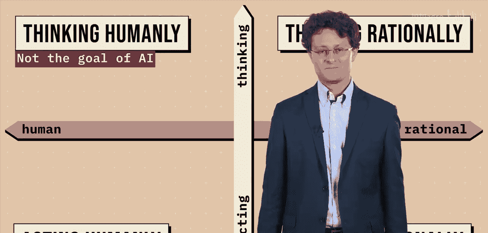
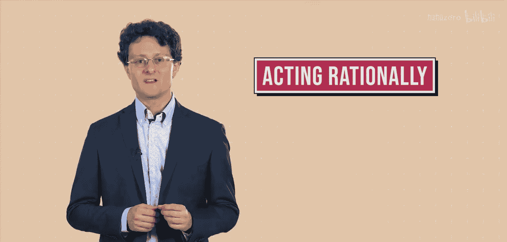

# 【人工智能：概述 专项课程】米兰理工大学—中英字幕 p08 p7_01_definition-and-goals -BV1Er1PYhE9q_p8-

Our goal is now to elaborate on the definition of AI in the recent years。

 many different perspective have been explored and the dec classificationification provided by Suar Russellll and Peter Norvi can help us to summarizemar the main ideas。

In particular identified two dimensions， the first is thinking versus heing。

 and the second is human versus rational， so we have four cases thinking humanly。

 thinking rationally， actinging humanly and acting rationally。

Thinking humanly is well ascribed by the definition of Bellman in 1978。

In which AI aims at automating the activities associated with human thinking。

 such as decision making， problem solving， learning。

This notion is currently related to a field that it is known today as cognitive science and neuroscience。

 and replicating the processes under hin and Hualli is not the goal of AI。

Moreover， thinking humanly is different from the study of mental faculties。

Through the use of computational models。That goes instead under the name of Tin Kingrationly。

 as suggested by Chanak and McDort in 1985。Tining rationally was very related to the field of computational logics。

 in which the goal is to provide the rigorous rules driving the reasoning， however。

 not all the intelligent behavior is mediated by logical deliberation and therefore thinkinging rationally cannot capture entirely the he field。

Acummali is associated with the study of how to make computers do the things that at the moment people do better。

 as suggested by Rich and Knight in 1991。Notice that activehuly is strictly connected to the Turing test and therefore to exhibit the behavior that is as close as possible to the behavior of a human being。

Notice also that acting includes activities different from thinking in some sense。

 we are interested in observing the behavior without the need to understand how such a behavior has been chosen。

However， replicating human behavior is not necessarily what AI aims to do。Finally。

 as suggested by Lugar and Staubfield in 1993， AI is the branch of computer science that is concerned with automation of intelligent behavior。

Where intelligence is measured with some formal metrics。

Acting rationally is different from acting humanly。For instance。

 a human being may make mistakes while instead a computer program could not make mistakes to use the case of some bots。

 for instance， Tikttoe， checkers and aerruobic cube。

The most common definition of AI is based on the idea of rational agent that takes inspiration from acting rationally。

A rational agent is a function that maps perceptions to actions in order to maximize a given objective function。

A rational agentnt applies to a specific narrow problem， such as plain shas， identifying images。

 and sohan。Usually we speak of perfect rationality when an entity always does the best actions。

However， acting rationally does not mean that an agent always perform best actions and tea can happen due to computational limitations。

So acting rationally is associated with the best behavior that is achievable with available resources。

The goal of the eye is the design of rational agentsants。🎼。

