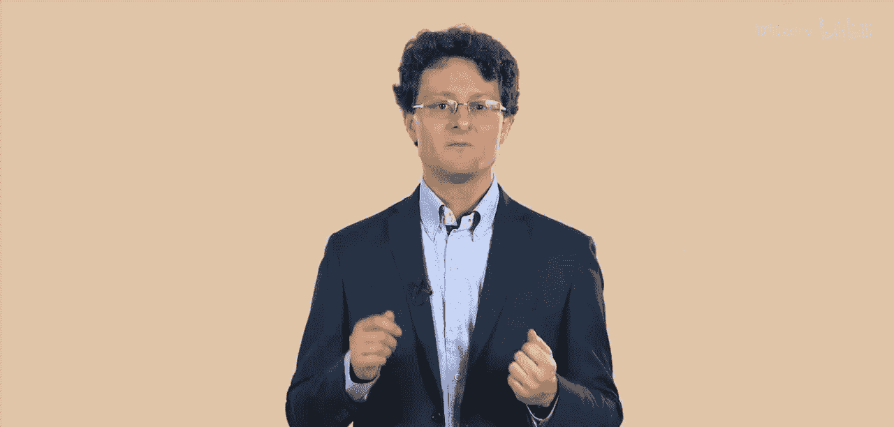
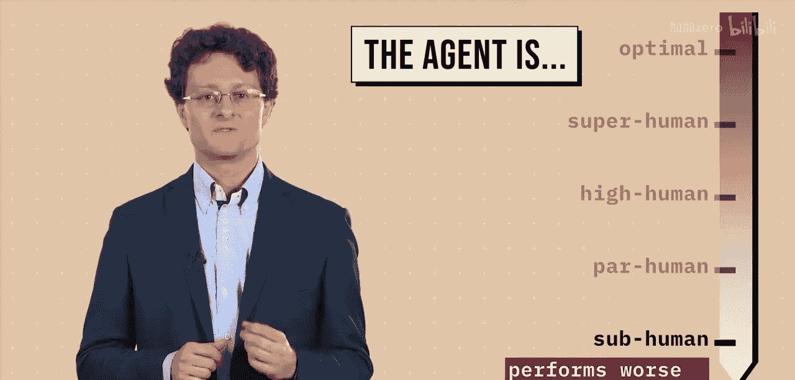
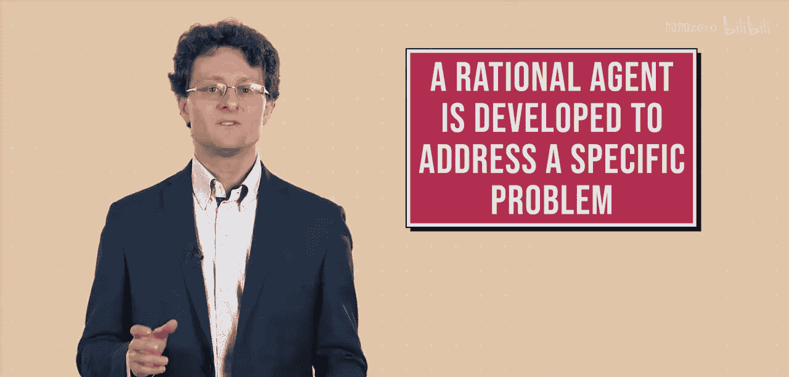
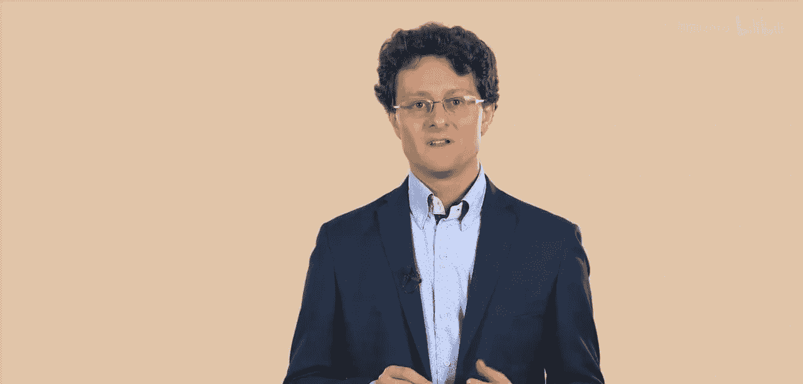
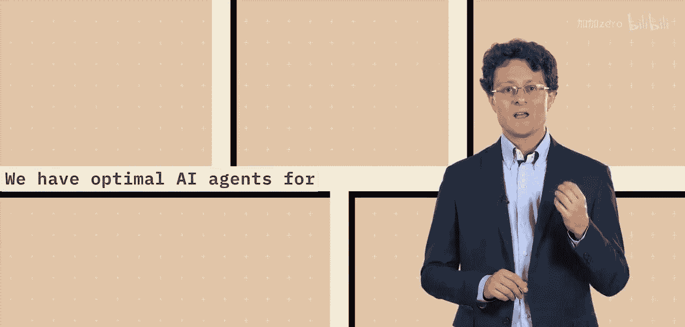
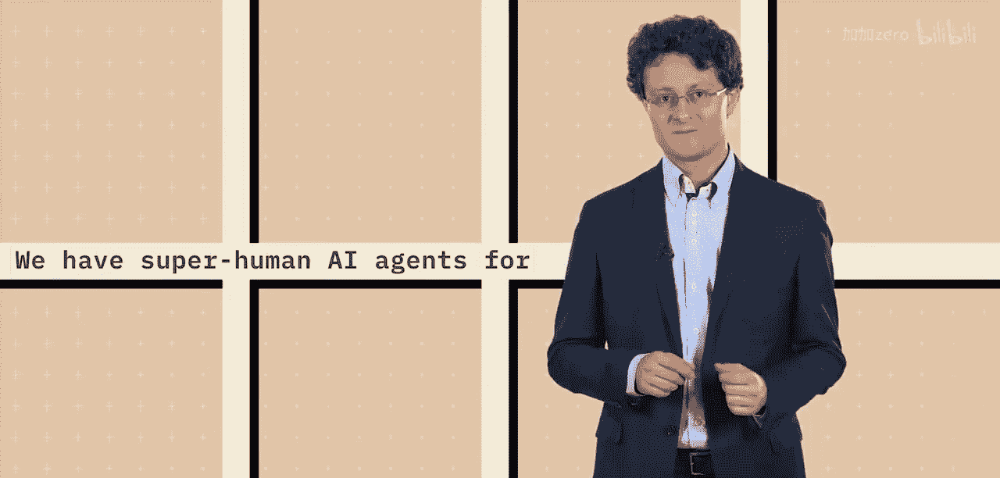
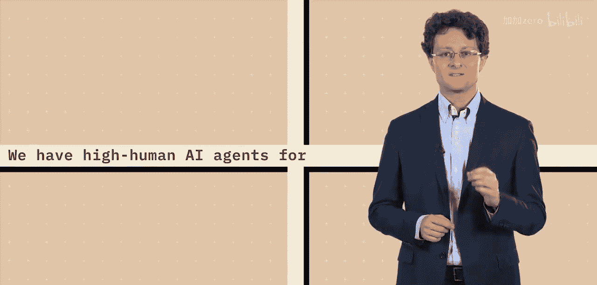
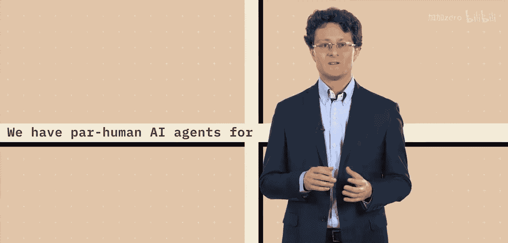

# 【人工智能：概述 专项课程】米兰理工大学—中英字幕 p09 p8_01_problems-and-progresses -BV1Er1PYhE9q_p9-

Starting from the idea of rational agentnt in which the goal is the maximization or minimization of symmetricsymmetric。

 when we compare an agent with humans， we can distinguish five cases depending on how agent performs with respect to humans。

We say that the agent is optimal when it is not possible to perform better。

In agent he is a superhuman when it performs better than all humans。

Is high human when the hant performs better than most humans？

Is parhuman when the agentin performs similarly to most humans and finally is a subhuman when the agentin performs worse than most humans？

Remember that according to the NA AI approach， a original agent is developed to address a specific problem。

What we can do is to give a picture of the capabilities of the best AI techniques for every specific problem。

 and we can monitor the progresses of the AI technique during time。

Now we provide some examples。Almost all the problems that we can solve with optimal。

 superhuman and eye human agents are well structured and can be easily described in terms of mathematical tools。

For reasons， we have optimal AI agentsions for TTac toe notice that this game can be played optimal or even by humans。

 Cont4， checkers， Ruby Cube adds up limit a Holen poker Not that a poker game is a sastic game in which the outcome depends on the cars each player draws。

Optimal play in these games means that if a game is repeated a very large number of times。

 there is no way of getting a larger value。When the performances are not optimal。

 but better than most humans， we can have superhuman agentsants。

To use the case Hob Olo， Scrabble， Leganon， Jeopardy， go adds up Nolim old and poker。

 six player Nolim old and poker chess remember that in 1966 one of the first AI headf was exactly chessbot with subhuman capabilities。

Notice that in these cases， we can imagine new agentsians stronger than those available today。

 but it is unlikely that human beings will beat these agentsians in future。

Then we have problems that the best AI heons can face as well as high humans。

 for instance for crosswords， dota 2， bridge car playing Sacro。

While moving to par or subhuman， we observe that the problems have some form of connection with perception or physical activationctuation。

For reasons， for per human， optical character recognition。

 classification of images and bright and recognition。

And for subhuman， optical charter recognition， for printed text， optical recognition。

 facial recognition， stable， bipedal， locomotion， speech recognition。

The evolution of the techniques and of the computational capabilities of the machine make the performance of AI he increase。

However， there is no guarantee that for a problem that we can address today with， for instance。

 subhuman performance， we will solve tomorrow with par human or high human performances。That is。

 we can imagine that for some problems， we could not design even in future agents better than humans。

🎼。

