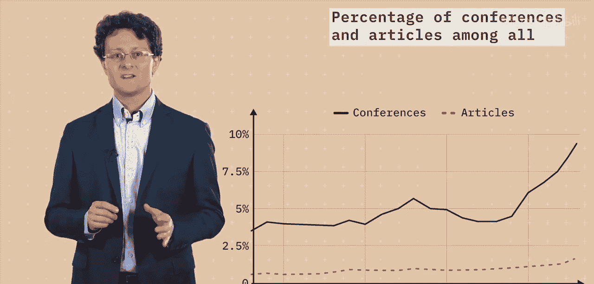
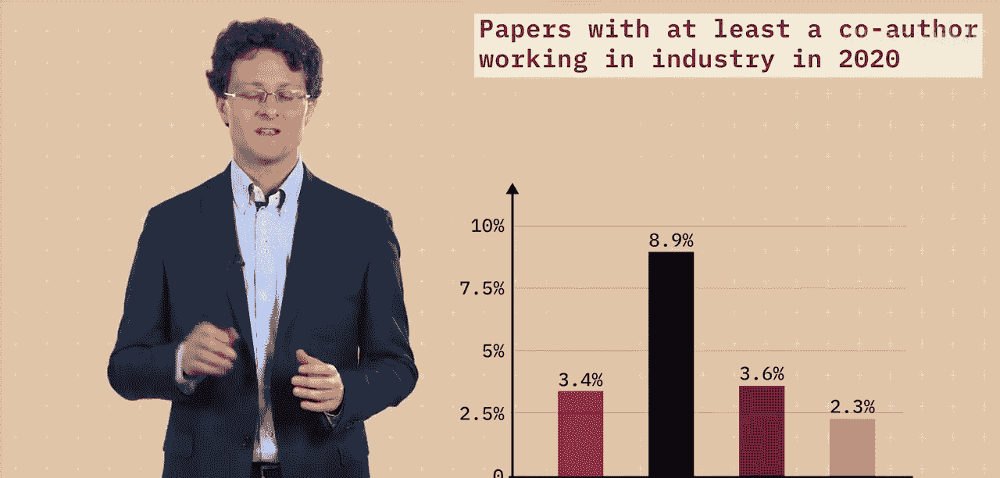

# 【人工智能：概述 专项课程】米兰理工大学—中英字幕 p11 p10_01_scientific-community -BV1Er1PYhE9q_p11-

The bird of the Yai field in 1956， the number of researchers in the eye was just the1。

Today， the scientific community is growing exponentially。

A clear picture can be inferred by analyzing several dimensions。

The first dimension is the number of scientific papers on AI published per country。

This dimension is commonly used to measure re gen production。

 and it aggregates information such as the number of researchers and funding spent for AI。

Probably the most impressive data is the increase in the number of the papers。

Consider that the increase between 2000 and 2019 is more than 600%。

And almost a one third of these papers date from 2017 to 2019。

Another interesting dimension is the number of papers presenting works in collaboration with companies。

This dimension shows how industries and academiaians work together。In the case of Ab U has。

 in almost 10% of the papers， at least the one coter works in industry。

Showing that there is a very strict collaboration between academics and industry。

The last dimension we analyze refers to teaching。In particular。

 how the number of classes increases and the number of student increases。

The number of classes is a good measure of the level of specialization a student can achieve。

The number of classes at Stanford University in 2020 is really impressive， for instance。

 almost 80 classes per year。The number of students attending AEI courses provides a good measure of the capabilities of a country to adopt and develop new AI technologies。

Also in this case， the number of students attending the basic courses and AI in the top US universities is impressive。

 they are more than 1，000 per university。🎼。

