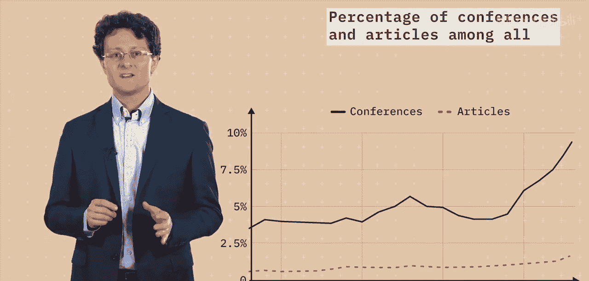
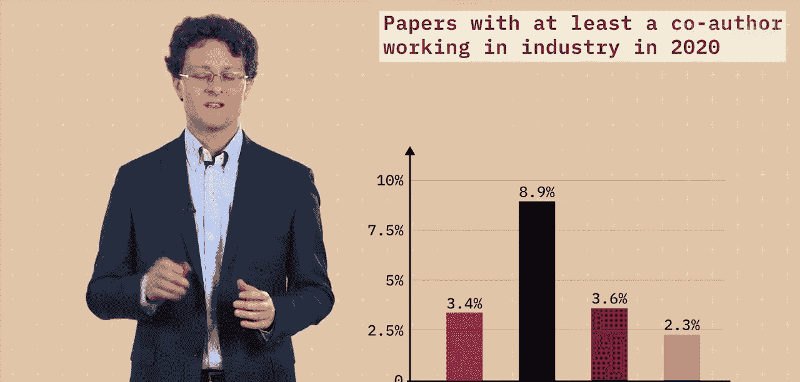

# 人工智能：概述 专项课程：第11章：科学社区的发展 📈

在本节课中，我们将学习人工智能科学社区的发展历程，通过分析多个维度的数据来了解其规模、增长趋势以及与产业的互动情况。

---

## 概述

人工智能领域的科学社区自诞生以来经历了显著的增长。我们将通过分析科研论文数量、产业合作情况以及教育规模这三个关键维度，来描绘这一社区的现状与发展趋势。

---

## 科学社区的早期规模

上一节我们回顾了人工智能的起源，本节中我们来看看其科学社区的初始规模。

1956年达特茅斯会议时，人工智能领域的研究人员数量仅为个位数。

---

## 指数级增长的科学社区

如今，科学社区正在呈指数级增长。通过分析以下几个维度，我们可以获得清晰的图景。

### 维度一：各国发表的AI科研论文数量

这个维度通常用于衡量研究成果的产出，它综合了研究人员数量和资金投入等信息。

最令人印象深刻的数据是论文数量的增长。数据显示，2000年至2019年间，论文数量的增长超过了 **600%**。

并且，这些论文中几乎有三分之一是在2017年至2019年间发表的。

---

### 维度二：与公司合作的论文数量

这个维度显示了产业界与学术界如何协同工作。以下是关于产业合作的情况：

在人工智能领域，近 **10%** 的论文中，至少有一位合著者在产业界工作。这表明学术界与产业界之间存在着非常紧密的合作关系。

---

### 维度三：教学规模

最后，我们分析教学相关的维度，特别是课程数量和选课学生数量的增长。

课程数量是衡量学生所能达到的专业化水平的一个良好指标。例如，斯坦福大学在2020年开设的课程数量非常惊人，每年接近 **80** 门课程。

选修人工智能课程的学生数量，则很好地衡量了一个国家采纳和发展新AI技术的能力。同样，美国顶尖大学中，选修人工智能基础课程的学生数量也非常庞大，每所大学都超过 **1000** 人。

---

## 总结

本节课中，我们一起学习了人工智能科学社区的发展。我们了解到，该社区从最初寥寥数人的规模，已发展成为通过**科研论文数量**（增长超600%）、**产业合作**（近10%的论文有产业界参与）和**教育规模**（顶尖大学年开课近80门，学生超千人）等多个维度都显示出强劲增长活力的庞大网络。这些数据清晰地展示了人工智能领域的蓬勃生机与广泛影响力。