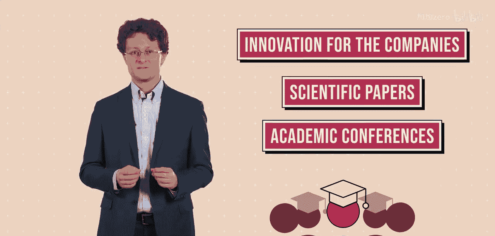

# 【人工智能：概述 专项课程】米兰理工大学—中英字幕 p12 p11_01_research-in-industry -BV1Er1PYhE9q_p12-

Since 2010， many companies have established AI and machine learning laboratories with researchers recruited from academics who collaborate together with the engineers of the companies themselves。

These researchers attend academic conferences， publish scientific papers。

 present their works and at the same time use their results to innovate the products and services of the companies Shatiular research in AI is therefore central in the technological development of many companies and at the same time industry has an important role in scientific research。

For instance， many EH milestones have been deployed by private laboratories。

So fostering a synergical cooperation between the scientific community and companies is now of paramount importance for every country。

The main private AI laboratories are those of Google， Microsoft， Amazon， Apple， Ibiham， Facebook。

On average， each of them has more than 1，000 researchers and support academic researchers with their awards and grants。

The impact on research on AI is so strong that these companies founded partnership on AI。

A consortium devoted to the society AI interface。In particular。

 the goal of the consortium is the responsible use of artificial intelligence。In October 2018。

 Baidu became the first Chinese firm to join the partnership。In 2019。

 more than 100 partners from academia， civil society。

 industry and nonprofits are members of partnership on AI。

In addition to the Big tech， many other companies open AI labs supporting research in AI。

 for instance， Adobe， Creto， Uber， Intel， McKinsey， Sony， Samsung， BBC Accenture。

Data drivenn approaches together with artificial intelligence tools are nowadays commonly considered the key for development of new and innovative products and services。

 as demonstrated by the major companies， such an innovation cannot be achieved without a deep contamination between industry and research。

🎼Oh。

