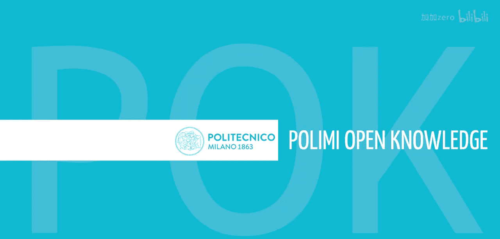
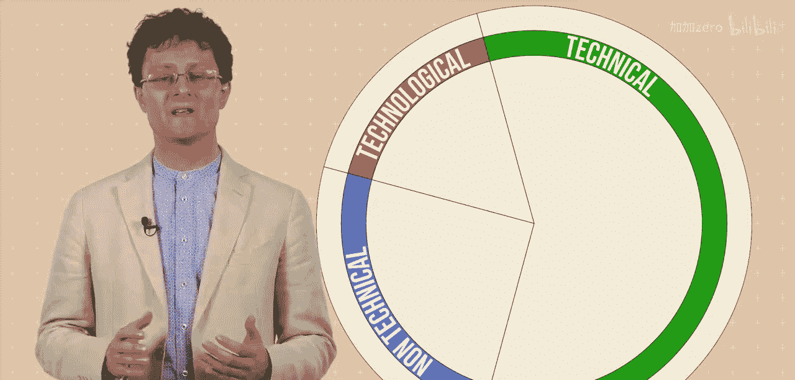
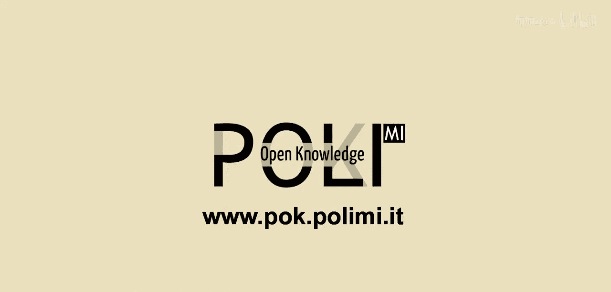

# 【人工智能：概述 专项课程】米兰理工大学—中英字幕 p13 p12_01_ai-field -BV1Er1PYhE9q_p13-

The goal of this week is to provide an overview of the subfi related to artificial intelligence。

We will investigate which are the subfis， which is their peculiarity and how these subfi are related to each other。

Other courses have the goal to discuss in detail every subfield。

The first distinction is between techniques， technologies， and regulation and organization issues。

Techniques include theory， models and algorithms。Surprisingly。

 these techniques may be extremely heterogeneuous， and it is actually useful to make a farther distinction。

In particular， we can distinguish between three main subclasses。

 according to the human capabilities they mimic。

Perception， action and cognition。The first subclass includes techniques for perception tasks。

Such as computer vision to mimic all the activities involved in the human vision。

And natural language processing to mimic instead all the activities involved in language。

The second subclass includes the techniques for cognitive tasks。

Such as machine learning to learn from data and perceptions。

 knowledge representation and reasoning to model and knowledge and to reason on that in a fashion。

Planning and scheduling to plan activities and schedule them in time， and finally。

 multihaion systems， which include techniques to deal with situations where many he high entities social interact cooperatively or strategically。

The T sub class enclos the techniques to tackle actions in a physical world。

E the main subfield is robotics。Moving from techniques to technologies。

 they can be software or hardware and are directed to support the development of AI artifacts。

We distinguish methods that support a design of AI artifacts from AI platforms。

 which provide software libraries that can be employed to develop artifactacts。In particular。

 the rationale behind platforms is that big tech providers develop libraries that small medium companies can employ without the need for important investments。

Thisse comes under the name of democratization of AI。Finally。

 we have regulation and organization issues。 These includes ethics。

 legal issues and the impact on the labor market and how public or private organizations can structure best their management processes to develop an AI project。

🎼In the next lectures， we will provide a brief introduction to them。

