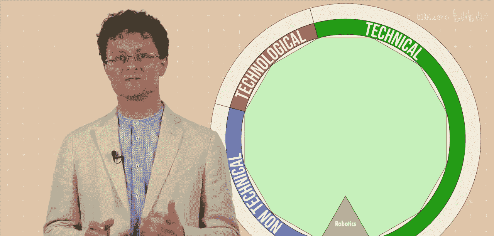

# 【人工智能：概述 专项课程】米兰理工大学—中英字幕 p14 p13_01_techniques-perception-and-action -BV1Er1PYhE9q_p14-

Perception and action allow humans to interact with a physical world。

This is what happens also in artificial intelligence。

Perception allows computer to get information from the world， to process and to understand it。

Actions allow the computer to perform physical tasks。

Computer visionion known as a CV is an interdisciplinary AI subfield studying how machines can get high level understanding from digital images or videos。

Possible tasks include methodss for acquiring， processing， analyzing。

 and understanding digital images。And extracting high dimensional data from the real world to produce numerical or symbolic information。

In other words， the computer transform images into a NA description that can be used by algorithms。

This image understanding can be seen as a disentangling of symbolic information from image data using models constructed with the aid of a geometry。

 physics， statistics， and learning theory。Some domains of computer vision include biometrics， face。

 gesture， and pose。Imagine video synthesis， imagine video retrieval。

 video understanding and activity analysis， motion and tracking。

 vision for robotics and autonomous driving， aver attacks and robustness。😊。

Some very common applications are automatic detection of cancer from nuclear magnetic resonance images。

Vision for autonomous car images transformation formation using generative aver networks。

 automatic detection for social distancing。Another perception task of paramount importance is artificial intelligence related to language。

Natural language processing， known as NLP， is a sub field of linguistics。

 computer science and artificial intelligence directed to the interaction between computers and human language。

In particular， the goal is to program computers to process and analyze large amounts of natural language data。

A computer can become capable of understanding the content of documents。

The technology can then accurately extract information and insights contained in the documents。

 as well as categorize and organize the documents themselves。😊。

Sub domainomains of natural language processing include conventional AI dialogueog systems。

 text generation， information extraction， machine translation， question answering。

 speech processing and synthesis， text classification and sentiment analysis。

A few very common applications are smart and virtual assistance。Language translation。

 information retrieval from documents， email filters。While moving to action。

 the main of feel is robotics。Robotics is an interdisciplinary field that integrates computer science and engineering。

It involves the design， construction， operation， and use of robots。

The goal of robototics is to design machines that can help enhance the humans Robotics integrates among others the fields of mechanical engineering。

 electrical engineering， information engineering， mechatronics， electronics， bioengineer。

 computer engineering， control and software engineering。

Robotics develops machines that substitute for humans and replicate human actions。

Robots can be used in many situations and for many purposes today。

 many of them are used in dangerous environments， including inspection of radioactive materials。

 bonded action and activation， manufacturing processes。They also use the where humans cannot survive。

 for instance， in space， underwater and high heat。And for cleanup and containment of hazardzaardous materials and radiation。

Robots can take on any form， but some are made to resemble humans in appearance。

This is set to help in the acceptance of a robot in certain replicative behaviors usually performed by people。

Such robots attempt to replicate walking， lifting， speech， cognition， and any other human activity。

Many of today's robots are inspired by nature， contributing to the field of bioinpir robotics。

Subdomains or robotics include a human robot interaction， localization， mapping and navigation。

 manipulation， motion and path planning。While very common applications are manufacturing。

 robotic surgerygery and for cleaning。

