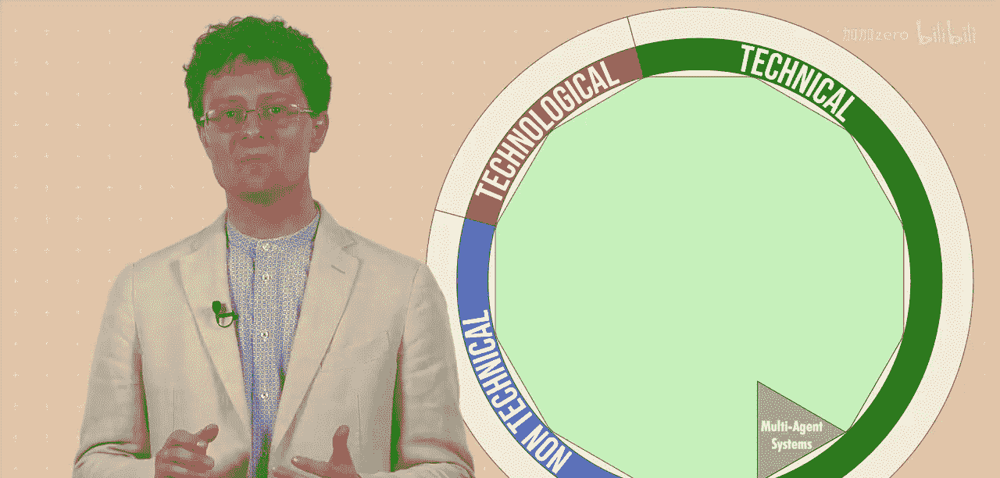

# 【人工智能：概述 专项课程】米兰理工大学—中英字幕 p15 p14_02_techniques-cognition -BV1Er1PYhE9q_p15-

Cognition encompasses many aspects of intellectual functions and processes such as， for instance。

 formation of knowledge， memory and working memory， judgment and evaluation， reasoning。

 problem solving and decision making。The four AI sub fields related to cognitive tasks are machine learning。

 knowledge representation and reasoning， planning and scheduling， and multihasion systems。

Machine learning known as M is the study of computer algorithm that improve automatically to experience and by the use of data。

Machine learning algorithm build a model based on sample data。

 known as training data in order to make predictions or decisions without being explicitly programmed to do so。

These data are usually generated by AI perception systems such as computer vision or natural ragged processing tools。

Moreover， a subset of machine learning is closely related to computational statistics。

 which provide the main theoretical groundings。But not all machine learning in statistical learning data mining is a related field of study focusing on exploratory data analysis through unsupervised learning。

Let me mention that when applied to business problems。

 machine learning is also referred to as predictive or advanced analytics。

Someub domainomains of machine learning include unsupervised learning， supervised learning。

 reinforcement learning， classificational regression， clustering， deep neural networks。

 evolutionary learning， online learning and bandits， quantum machine learning。

Very common applications are prediction in forecast for instance。

 sale and demand forecasting in markets， recommender systems， predictive maintenance。

 anomaly detection systems。We move from learning knowledge to reasoning on this knowledge in particular。

 knowledge representation and reasoning known as KRhar is the field of AI devoted to representing information about the world in form that a computer system can use to solve complex tasks。

Knowledge representation incorporates findings from psychology about how humans solve problems and represent knowledge in order to design formalism。

That will make complex systems easier to design and build。

Knowledge representation and reasoning also incorporates findings from logic to auto tomate various kinds of reasoning。

Such as the applicational rules or the relations of sets and subsets。

Sub domainomains on knowledge representation and reasoning include description logics。

 knowledge and engineering， logic programming， ontologist， automated reasoning， and tier improving。

Very common applications are semanti web and expert systems。

Once knowledge has been processed and some form of reasoning has been performed。

 we can move to planning。In particular， automatic planning and scheduling is a branch of AI directed to the realization of strategies or action sequences。

Typically， for execution by intelligent agentsants， autonomous robots and unmanned vehicles。

Planning is also related to decision theory。Planning requires organizing a set of tasks to achieve a given goal。

In known environments， with available models， planning can be done offline。

Solutions can be found and evaluated prior to execution。In dynamically unknown environments。

 the strategy often needs to be revised online。Solutions usually resort to iterative trial and hero processes commonly seen in artificial intelligence。

 even exploiting learning tools。Someub domainomains of planning and scheduling include deterministic planning。

 optimization hub， special temporal systems， plan execution and monitoring， planning。

 scheduling and learning， scheduling， temporal planning。Finally。

 we move to the scenario in which multiple AI entities interact。

 and therefore every AI entity needs to explicitly take into account the presence of other AI entities。

In particular， a multi agent system。M he has our self organized system is a computerized system composed of multiple interacting intelligent agentsants。

Multi agent systems can solve problems that are difficult or impossible for an individual agent or a monolit system to solve。

Intelligence may include method， functional， procedural approaches。

 algorithmic search or enforcement learning。Subcomomains of mount agent systems include adversarial agents。

 agreement， argumentation and negotiation。Coordination and collaboration。

 distributed problem solving mechanismchan design。Very common applications are automatic economic transactions by means of microconconomic models。

 versus location for physical security， decentralized control。

🎼。

