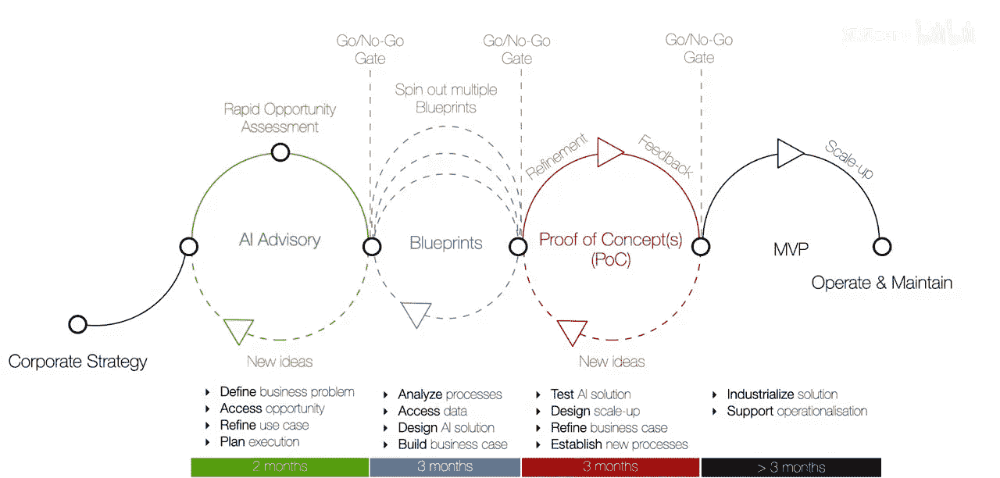

# 【人工智能：概述 专项课程】米兰理工大学—中英字幕 p16 p15_01_technologies -BV1Er1PYhE9q_p16-

While techniques focus on the functioning of an AI heart fact。

 technologies focus on how the AI hard fact can be developed。And deploy it。

Meethodologists deal with project， development and management。

Many AI projects are risky and need rigorous development processes starting from the idea to the development of a blueprint and its evaluation。

 the development of a POC， and finally the deployment of the MVP。😊。

Approaches inspired from software engineering have been started to support。

 specifically the development of AI technologies。Meethodologies also include software infrastructures for big data and to implement AEI algorithms。

Meethodologies also cover hardware infrastructures， many A algorithm。

 especially deep learning techniques， dealing with millions of data。

 require huge computing capabilities。Ardware acccierators， for recent graphics， processing units。

 known as GPUus， play a crucial role in making the computation of several AI algorithm affordable in practice。

😊，A very special flask of methods mixing software and hardware is that of AI platforms。In particular。

 faced with this shortage of technical talents， big tech companies such as Microsoft。

 Amazon and Google have released premade， drag and drop or no code AI tools that allow people to integrate AI into applications without needing to know how to build machine learning models。

These tools are available by the platforms of DSB companies。

Most of these platforms today provide well suited tools for computer vision and natural language processing applications。

By the way， the big companies are widely investing to enrich the algorithm provided by their platforms。

Platforms are commonly considered the main way for the democratization hall AI。Basically。

 the idea is that only big companies can recruit talents and develop autonomously AI projects。

While small， medium companies cannot。So the possibility of access to building blocks。

 to develop a high application without the need for talent。

Allows even small and medium companies to start their AI projects。In practice。

 democratization reduces entry barriers for individuals。

 as well as organizations to start experimenting with AI。

They can leverage publicly available data and algorithm to start experimenting。

 building AI models on cloud infrastructures。Decommocratization reduces the overall cost of building AI solutions as communities of programmers and users start using an extending data algorithm and tools to build more powerful solutions。

The openness of democratization where data or H are made freely available to others。

 also helps in building the necessary talent。And finally。

 the democratization allows to increase the speed of the adoption of EI in academic and business world。

Interestingly， democratization applies to several sources according to a precise time program。Data。

 storage and computing capabilities， algorithms， model deployment， and even the marketplace。

The effectiveness of democratization will be crucial for the success of theI at large。

