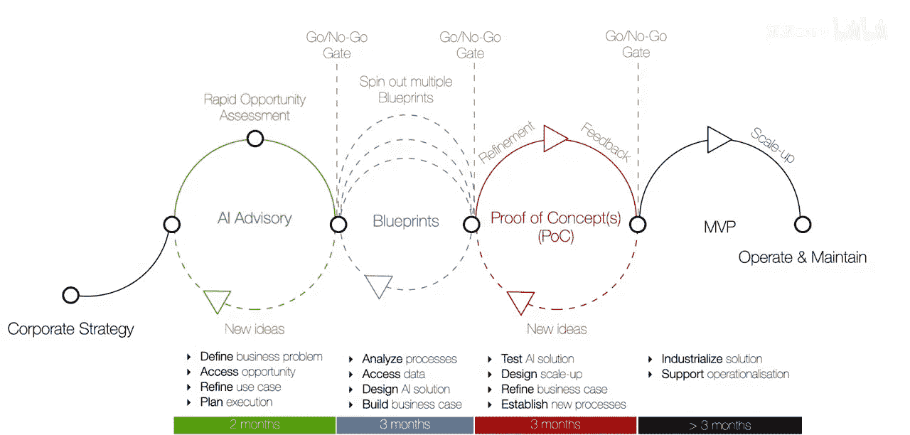

# 人工智能概述专项课程：1.6：技术与方法论

在本节课中，我们将学习人工智能的技术与方法论。我们将了解技术如何关注AI系统的开发与部署，而方法论则涉及项目的规划、开发与管理流程。课程还将探讨AI民主化的重要性及其实现路径。

## 技术与方法论概述

上一节我们介绍了人工智能的核心技术。本节中，我们来看看支撑这些技术实现与应用的开发流程与基础设施，即**技术**与**方法论**。

*   **技术**关注AI硬件如何被**开发**与**部署**。
*   **方法论**则处理项目的**开发**与**管理**。

## AI项目开发流程

许多AI项目具有高风险性，因此需要严谨的开发流程。这个过程通常从构思开始，逐步推进。

以下是AI项目从概念到落地的典型阶段：
1.  **构思与蓝图**：从想法出发，制定详细方案并进行评估。
2.  **概念验证**：开发一个**POC**以验证核心想法的可行性。
3.  **最小可行产品**：最终部署一个**MVP**，投入实际使用。

## 方法论的具体构成

受软件工程启发的方法论开始被专门用于支持AI技术的开发。方法论涵盖多个层面。

以下是方法论包含的主要组成部分：
*   **软件基础设施**：用于处理大数据并实现AI算法。
*   **硬件基础设施**：许多算法，特别是处理海量数据的深度学习技术，需要巨大的计算能力。以**GPU**为代表的硬件加速器，在实践中使得多种AI算法的计算变得可行。
*   **AI平台**：一种融合软硬件的特殊方法论。

## AI平台与民主化

面对技术人才短缺的问题，大型科技公司推出了预制的AI工具，降低了AI的应用门槛。

以下是关于AI平台的关键信息：
*   **平台功能**：像微软、亚马逊和谷歌这样的大公司发布了**拖放式**或**无代码**的AI工具，使人们无需懂得如何构建机器学习模型，就能将AI集成到应用中。
*   **应用领域**：目前这些平台主要提供适用于计算机视觉和自然语言处理应用的工具。
*   **持续发展**：大公司正大力投资以丰富其平台提供的算法。

平台通常被认为是实现AI**民主化**的主要途径。其核心理念是，只有大公司能招募人才并自主开发AI项目，而中小型企业则难以做到。因此，提供无需专门人才即可利用的构建模块来开发AI应用，使得中小企业也能启动自己的AI项目。

在实践中，民主化降低了个体和组织开始尝试AI的门槛。他们可以利用公开的数据和算法，在云基础设施上开始实验并构建AI模型。

## 民主化的影响与路径

民主化通过社区的力量降低了构建AI解决方案的整体成本，并加速了AI的采纳。

以下是民主化带来的具体益处：
1.  **降低成本**：当程序员和用户社区开始使用并扩展数据、算法和工具时，构建强大解决方案的整体成本得以降低。
2.  **培养人才**：将数据或硬件**开源**，使其能被他人自由使用，有助于培养必要的人才。
3.  **加速采纳**：民主化提高了AI在学术界和商业界的应用速度。

有趣的是，民主化按照一个明确的时间表，逐步应用于多个资源领域。

以下是实现民主化所涉及的资源路径：
1.  **数据**
2.  **存储与计算能力**
3.  **算法**
4.  **模型部署**
5.  **市场**

民主化的有效性将对AI的整体成功至关重要。

---

本节课中，我们一起学习了人工智能的技术与方法论。我们明确了技术聚焦于开发与部署，而方法论涵盖了从项目蓝图到MVP部署的完整流程。我们重点探讨了AI平台作为关键方法论，如何通过提供易用工具来推动AI的民主化，降低应用门槛，并最终加速AI技术在各个领域的普及与发展。理解这些支撑体系，对于全面认识AI生态至关重要。