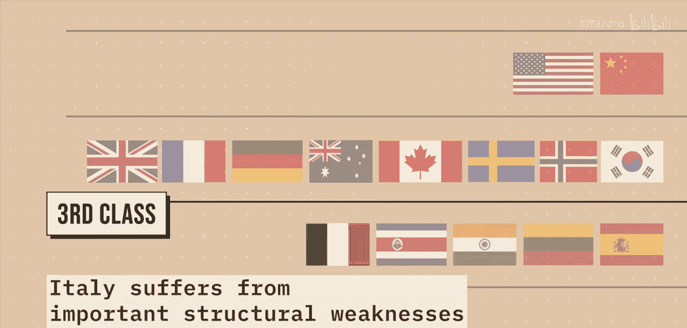
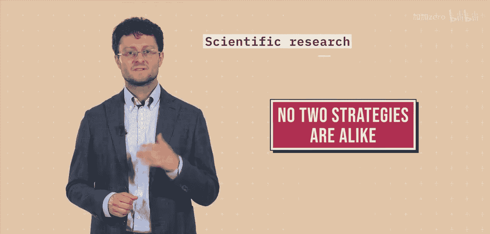
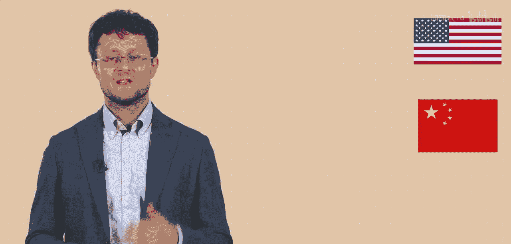

# 【人工智能：概述 专项课程】米兰理工大学—中英字幕 p18 p17_01_the-need-for-national-strategies -BV1Er1PYhE9q_p18-

During the wide agreement that artificial intelligence will affect our future in many ways。

 just to cite a few examples， economic development， national defense， people security and privacy。

Several reports published by McKinsey in 2018 estimated that a worldwide market value that will be unlocked by AI will be larger than 15 trillion US dollars per year。

However， as underlined by these reports， the value unlocked in every single country will depend on its readiness level。

Well the radiiness level depends among the other on the investment in AI， research activities on AI。

 human capital， labor market structure。

In the ranking we have four classes， the first class includes the USA and China。

 while the second class includes several countries， including the UK， France， Germany， Australia。

 Canada， Sweden， Norway， South Korea。Italy is classified in the tu class together with Costa Rica。

 India， Lithuania， Spain。According to this report， Italy suffers from important structural weaknesses。

 in particular， related to the labor market。

AI development is now considered so crucial for a country that national strategies are needed。

Where national strategy should define the steps necessary to improve the level of readiness and to promote the development and adoption of AI in companies。

 public administration and education。economicconomic development coordination to lead benefits to citizen is just one of the task a national strategy has to deal with。

Another crucial task is how to protect the citizen from potential unintended consequences。

These fast pushes for the need for regulations， also including ethical and legal issues。

The first nation to develop a national strategy was Canada in 2017。

The name was Penn Canadian Art intelligence Str。And it focused on investment for scientific。

 technical research and talents。Four were the main goals。

 increasing the number of researchers identifying excellence clusters。

 supporting the leadership on economics， ethical and legal issues。

Supporting the scientific research community。After Canada。

 many other countriesies develop their home strategy。Interestingly。No two strategies are alike。

 with each focusing on different aspects of AI policy。Stent research， talent development， skills。

 education， public and private section adoption， ethics and inclusion， standards and regulation。

 and data and digital infrastructure。

Among all the national strategies developed so far， the strategies of a USA。

 China and Europe are surely the most important。

And most interestingly， they adopt completely different perspective。For instance。

 in the USA and in China， the regulation problem is postponed to the next five， ten0 years。

 and therefore currently the development is largely deregulated。

While in the USA the development is mainly driven by big tech companies in China。

 it is mainly driven by government。Instead， Europe pose the regulation problem as the primary problem to address before massively developing AI technologies。

🎼In the next three lectures we will analyze and depth these three strategies。

