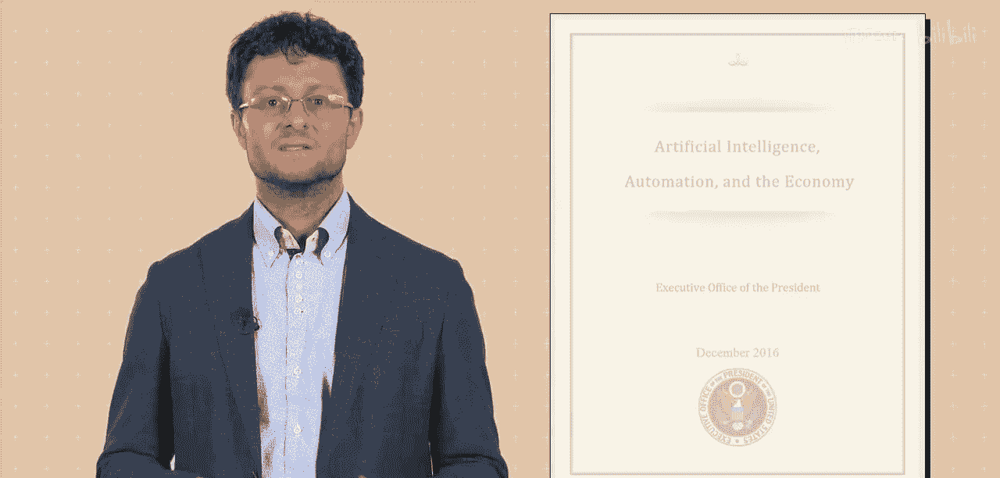

# 【人工智能：概述 专项课程】米兰理工大学—中英字幕 p19 p18_01_ai-strategy-in-usa -BV1Er1PYhE9q_p19-

The USA approached a II during the presidency of Barack Obama。 In particular。

 the goal was to understand the EI potential impact and risk。

So has to elaborate a strategy to drive aI development in the future。To do that。

 three reports on aI were produced。The first report was titled Preparing for the Fu of Art Intelligence and Fo on ethical issues and regulations。

Probably the most crucial suggestions are three。The first suggestion， con data。

Data is considered by almost all national strategies as the main enabler of AI technologies。

The report prescribed that federal agencies should prioritize open data training and open data standards in AI。

This is because data are considered the most important fo for artificial intelligence。

So opening data and defining standards for data will be crucial to facilitate its deployment。

Furthermore， the report suggests that special committees should monitor developments in AI and report regularly to the administration。

Finally， the report suggests that the federal government should prioritize basic and long term EI research。

The second report was titled National Artificial Intelligence Research and Development Strategic Plan。

This report suggested priorities for assignment of public findings to scientific search。

In particular， it suggests making long term investment in AI search。

 developing effective methods for human AI collaboration and ensuring the safety and security hub AI system。

This document was updated in 2019 and prescribed the current US National strategy。

The third report was titled Artrtificial intelligencetelligence， Autoation and Economy。

This report evaluated the impact of automation in every process， industry， administration， commerce。

 education， and so on。And I will optimize the trade off between benefits and costs。In particular。

 he focused on how AI will affect the market level and how the market should be reorganized to facilitate the development of AEI technologies。

These reports place AI development at the center of the government agenda。

Pushing for the nail for regulations。However， during the presidency of Donald Trump。

 the U strategy for AI dramatically changed。

Specifically in 2017， President Trump deregulated the development of AI。

And let big tech companies develop AI technology。In 2018。

 during a summit with the big tech companies， the White House defined four goals。Keeping you as。

 the world leader in AI。Supporting the human workers。

Promoting our research and development with public funding。Removing barriers to the innovation。

To address these points， the White House activated an advisory committee on Act intelligencetelence for the priorities in AI。

Created federal partnership between industry and academics。Remove regulations。In 2021。

 the White House planned to invest more than8 billion US dollars in aI related research and development project。

With an increase of about 50%， with respect to 2020。However。

 the priorities of the government are national defense and security。

 leaving the development of AEI applications for harder domains to be directly driven by companies。

