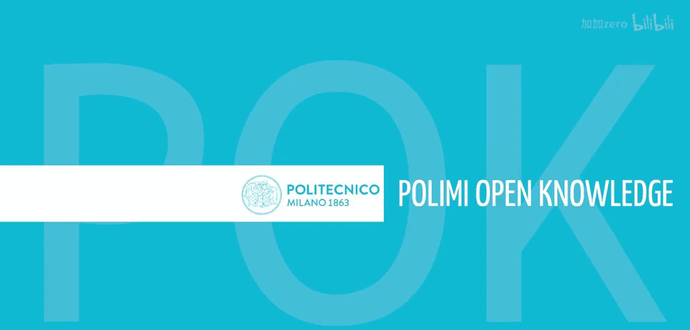
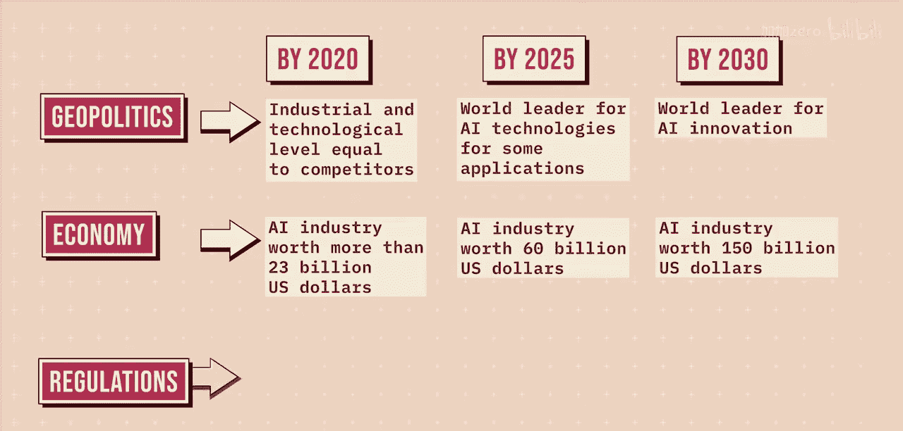
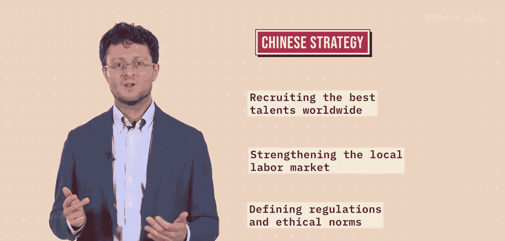
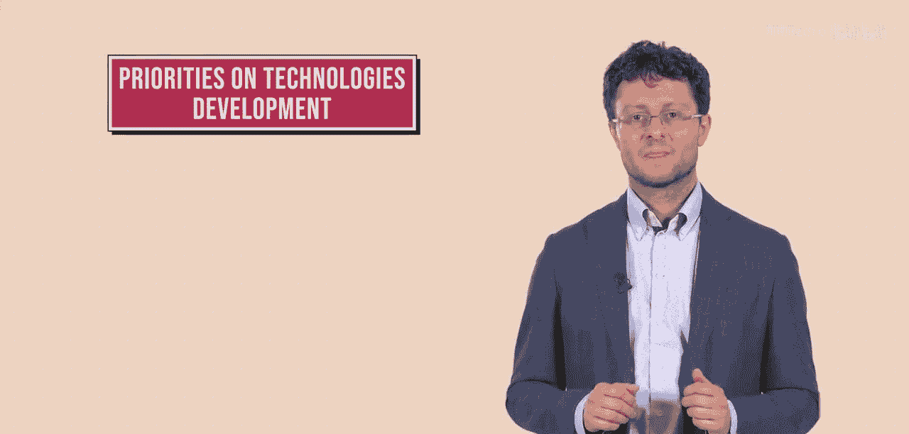
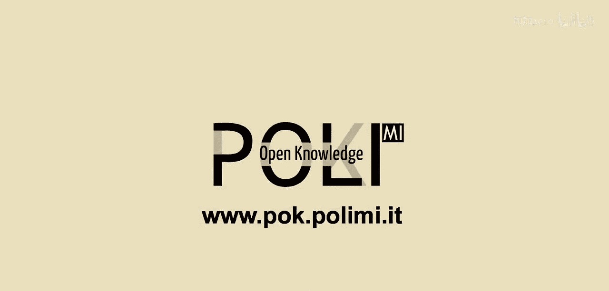

# 【人工智能：概述 专项课程】米兰理工大学—中英字幕 p20 p19_01_ai-strategy-in-china -BV1Er1PYhE9q_p20-

In 2017， the Chinese government claimed that it aimeded at becoming the worldwide AI leader。

His strategy is named a next Gene Art intelligenceence Development Plan and defined a clear agenda for geopolitics。

 economy and regulation by three milestones， 2020， 2025 and 2030。In terms of geopolitics。

 China aims at having an industrial technology level comparable to that of their worldwide competitor by 2020。

Becoming the world leader for Hai Technologies for some applications by 2025。

Becoming the world leader for AEI Inno by 2030。In terms of economics。

 the strategy estimated that the market value unlocked byEI will be $23 billion US dollars by 2020。

60 billion by 2025 and 150 billion by 2030。In terms of regulations。

 the strategy established a clear journey directed to the codification of norms and rules by 2030。

The Chinese strategy remarks the need for recruiting the best talents worldwide has。

 according to a very recent report for more than 50% of the companies that implemented an AI project the greatest challenge to face was the lack of qualified personnel。

Strengthening the local labor market， supporting training in AI with companies。

Defin regulations and ethical norms to promote the development and the adoption of VI technologies。

Interestingly， the Chinese strategy also clearly identifies the priorities on the technologies to develop。

In particular， the strategy focuses on intelligent and connected objects such as autonomous vehicles。

 robots and identification systems。Furthermore， he focuses on intelligent sensors。

 neural network chips and intelligent manufacturing。

The Chinese government also decided to open an Excel technology park for in industrial research at Peing。

 with an investment of 2。1 billion U dollars。More in general。

 the total amount of public funding for AEI scientific and industrial search amounts to8 billion U dollars per year。

🎼Oh。

