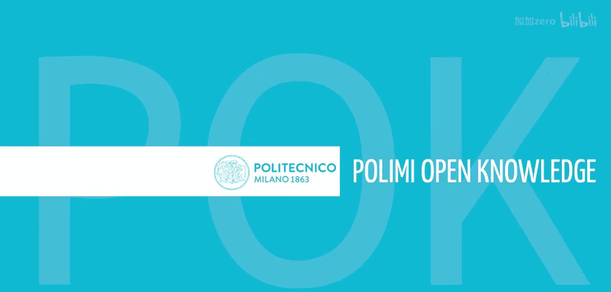
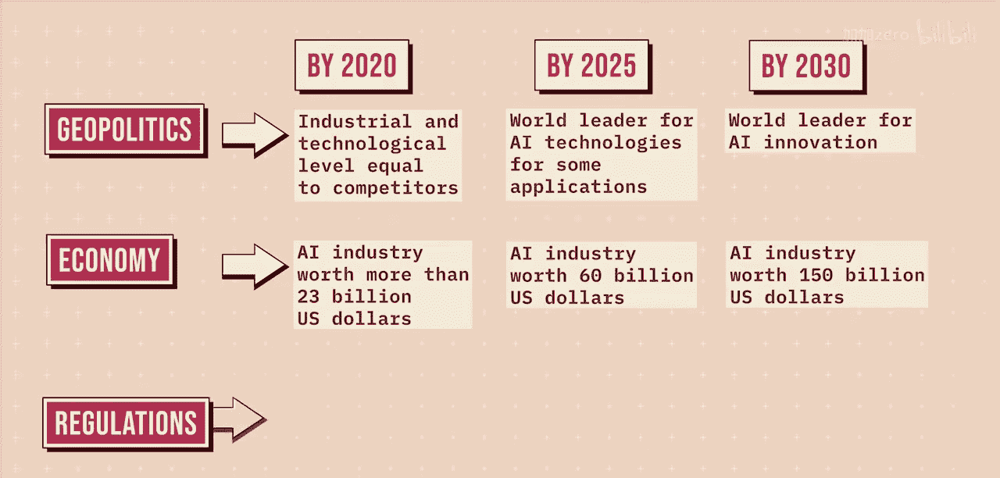
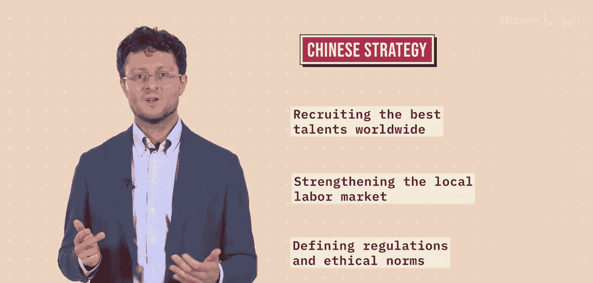
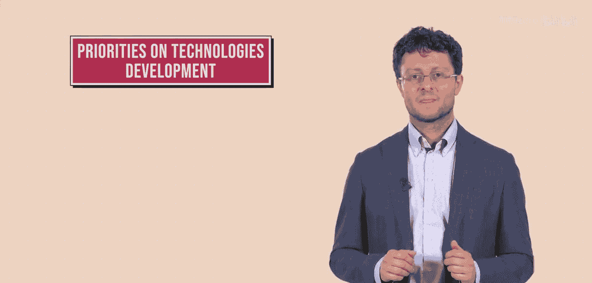

# 人工智能：概述 专项课程：20：中国的AI战略

在本节课中，我们将要学习中国政府在人工智能领域的国家战略。我们将了解该战略的核心目标、具体里程碑、以及为实现这些目标所规划的重点技术领域和资源投入。

---

2017年，中国政府宣布其目标是成为全球人工智能领域的领导者。

其战略名为《新一代人工智能发展规划》，并通过三个里程碑年份——2020年、2025年和2030年——为地缘政治、经济和监管制定了清晰的议程。

在地缘政治方面，中国的目标是到2020年，其产业技术水平能与全球竞争对手相媲美；到2025年，在某些应用领域成为世界领先者；到2030年，成为全球人工智能创新的领导者。

在经济方面，该战略估计，到2020年，人工智能解锁的市场价值将达到230亿美元；到2025年达到600亿美元；到2030年达到1500亿美元。

在监管方面，该战略确立了一条清晰的路径，旨在到2030年完成相关规范和规则的编纂。

---

中国的战略强调了在全球范围内招募顶尖人才的必要性。根据一份最新报告，对于超过50%实施了人工智能项目的公司而言，面临的最大挑战是缺乏合格的人员。

该战略旨在加强本地劳动力市场，支持企业与机构合作进行人工智能培训，并制定法规和伦理规范，以促进人工智能技术的发展和应用。

---

有趣的是，中国的战略还明确指出了需要优先发展的技术领域。

以下是战略聚焦的核心技术方向：
*   **智能互联物体**：例如自动驾驶汽车、机器人和识别系统。
*   **智能传感器与神经网络芯片**。
*   **智能制造**。

此外，中国政府决定在北京开设一个专注于工业研究的人工智能科技园，投资额为21亿美元。更广泛地说，中国每年为人工智能科学与工业研究提供的公共资金总额高达80亿美元。

---

本节课中，我们一起学习了中国的人工智能国家战略。我们了解到该战略设定了分阶段的地缘政治、经济和监管目标，强调了人才的重要性，并明确了智能互联物体、智能芯片与智能制造等关键技术发展重点，同时辅以大规模的资金投入。这为我们理解全球人工智能竞争格局提供了一个重要视角。