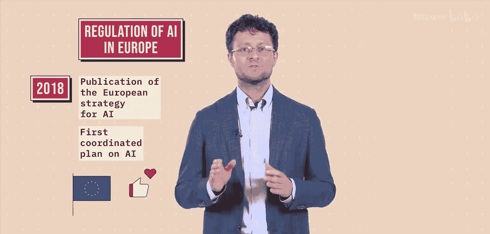

# 【人工智能：概述 专项课程】米兰理工大学—中英字幕 p21 p20_01_ai-strategy-in-eu -BV1Er1PYhE9q_p21-

The European approach to AI is human centered， that is AI should be developed only if it is beneficial for humans。

Obviously， this approach needs a careful analysis of benefits and risks before authorizing every specific class of EI applications。

Therefore， this approach is strongly based on regulations defined by central authorities。

In particular， the key word that better characterizes the European strategy is trustworthy AI。

The activities directed to the regulation of AI in Europe started inanhain。

 specifically into2anthain， we saw the publication of the European strategy for AI。

Then the first coordinated plan on AI that was signed by every state member。After 2015。

 we have a number of steps undertaken by the European Commission。

In 2019， we have the publications of the guidelines for Trustworthy AI。In 2020。

 we have the publication called the AI Well Book， which as the European vision for AI。

 Excel and Transworthness。This book paves the way to the regulations published in 2021。In 2020。

 we also have the publication of the report on the safety and liability implications of artificial intelligence。

 internal things and robotics。In which the European Commission identified a number of open inses that need to be addressed in order to guarantee the safety of several products。

 in particular machines。In 2021， we have the publication of the proposal for a regulation laying down harmonized rules on artificialctican intelligence。

Arivial Italians Act。In which a strict regulation is provided。

The European approach is well summarized by the statements issued in 2021 by two members of the European Commission。

According to Margaret Vetaager， executive Vice president of a European Commission for a European fit for a digital H。

 trustiness is not an option。It is a strict requirement。Meanwhile， Tre Breon。

 European Commissioner for the Inter Market， approaches AI as a tool and therefore it should be used only if it is beneficial for humans。

The central idea behind European strategy is that the regulatory framework can enhance the uptake of AI。

First， it will increase users' trust and in this way it will increase the demand for AI used by companies and public authorities。

It will also increase the legal certainty and harmonizing rules。

 giving AI providers access the bigger market with products that users and customers appreciate and purchase。

In other words， the European Commission does not see any possibility to allow an effective development of AI technologies without avoiding risk。

 guaranteeing trustiness and ruling legal issues。

The European Commission identifies several levels of risk。The first one is an acceptable risk。

The EU will ban a very limited set of particularly harmful uses of the eye that contravene European values because they violate fundamental rights。

Some examples are social scoring by government。Expitation of vulnerabilities of children use of subliminal techniques and subject to narrow exceptions live remote biomatic identification systems in publicly accessible spaces used for law enforcement purposes。

We have then high risk this level corresponds to a limited number of hub AEI systems creating an adverse impact on people safety。

Or on their fundamental rights。As protected by the EU Charer of fundamentalamental Rights。

The European Commission produced a list of high risk AI systems which can be reviewed to align with evolution of AI use cases。

In order to ensure trust， a high level safety and fundamental rights。

 mandatory requirements for whole high risk A systems are proposed。

Those requirements cover the quality of the use data sets。

 technical documentation and record keeping， transparency and the provision of information to users。

 human hoide， ronessness， accuracy and cybersecurity。

We have then limited risk for certain AI systems where specific transparency requirements are imposed。

For example， where there is a clear risk of manipulation。For instance， via the use of chocolates。

Users should be aware that they are interacting with the machine。Finally， we have minimal risk。

 all the other AI systems can be developed in used according to the existing legislation without additional legal obligations。

The vast majority of AI systems currently used in the EU fall into this category。Voluntarily。

 providers of those systems may choose to apply the requirements for taskworthy AI and adhere to voluntary codes of conduct。

Member states， all decay role in the application and enforcement of these regulation。In this respect。

 each member state should visit any1 or more national competent authorities to supervise the application and implementation。

 as well as carry out market surveillance activities。

In order to increase efficiency and to set an official point of contact with the public and other counterparts。

 each member's state should designate one national Superory Authority。

 which also represents the country in the European Artific Inance Board。

In addition to a severe and accurate regulational AI。

 the European community defined a clear program for the AI development and adoption。

Foundings will be assigned by European programs such as Digital Europe and Horizon Europe。

The span of funding for digital transformation will be about 20%。Furthermore。

 the European community incentivized strategic information exchange。

 data and computational infrastructure sharing。It also promotes AI excellence and the mobility of talent from laboratories to market by creating partnerships between private and public entities for digital innovation。

🎼。

