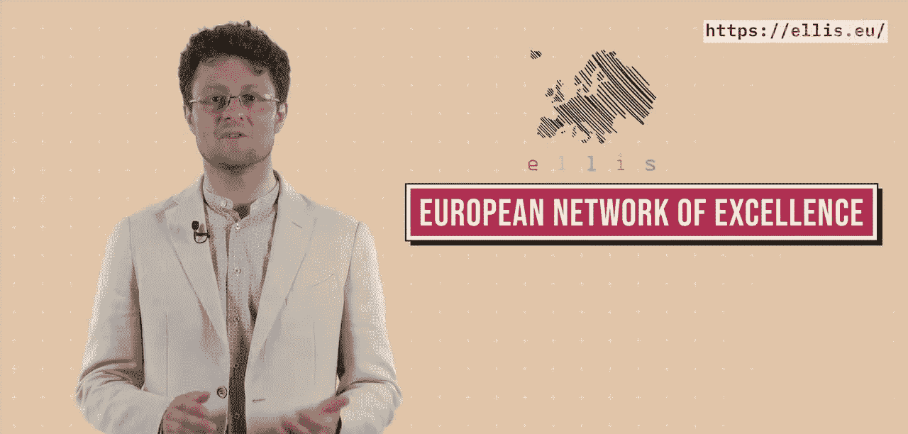
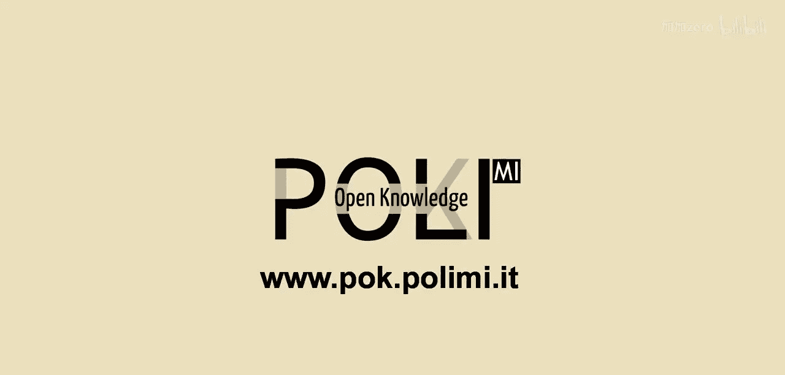

# 【人工智能：概述 专项课程】米兰理工大学—中英字幕 p22 p21_01_a-summary-of-the-main-players -BV1Er1PYhE9q_p22-

Italy， there are multiple institutional players for AI。Even if these players have close relationship。

They play different roles at different levels。Our goal here is just to introduce these players。

In the following lectures， we will have several interviews that provide additional details on the mission and activities of those players。

😊，The first player in chronological orderard is the Italian Association for Artificial Inalence。

Is araranim， he is AI for Hahi。And it was founded in 1988。It groups most of Italian scientists in AI。

 however， AI for Hai is not the only academic Italian association in AI。

Other Italian AI associations or Italian chapters of international associations are group for Lo programming。

 AI HealthC for Natural Laguage Proing， AI has C for Cognitive Sciences。

 CVPL for Computer Viion and pattern recognitionognition。

 and IN N has International Neural Network Society。In 2017， the Agency for Digital Italy Ed。

 activated a task force studying how the dissemination of artificial intelligence solutions and technologies can affect the evolution of public services to improve the relationship between public administrations and citizen。

The task force was composed of30 hacks and produced a white book titledArtificial Intelligence at the Service of Citizen。

In July 2018 was founded the laboratory Scine， Consorts Italiano and Ce， Painformatica。

Artificial intelligence and intelligence systems。It is basically a network of all the Italian universities and research centers working in the AI field。

In October 2018， the Italian Ministry of Economic Development activated a group of 30 AI experts。

Called high level hacks per group on artificial intelligence。Including people from academics。

 industries and civil society。In 2020， this group produced a report with several recommendations for the Italian AI strategy。

In parallel to the activities of the Italian Ministry of Economic Development in 2019。

 the Italian Ministry of University Research formed a group of academics to variety the national program of research in AI。

Which was published in 2021。Furthermore， in 2021， the Italian Ministry of University and Research activated the national doctorade in AI。

The academiccades associations and the Seni laboratoryatory，IEAS。

 are closely connected to the European Association and Academic networks to facilitate collaborations。

 share computing infrastructures， and plan the next research steps together。In particular。

 we mentioned Arye， Heas and Claire。AI is the European Association for Arts Intelligence， formerly E。

It was established in July 1982 as a representative body for the European Art intelligence community。

Its aim is to promote the study， research， and application of artificial intelligence in Europe。

AlIS is in a European network of excellence that groups the many European labs in interview intelligence and machine learning。

It was founded in 2018， and its mission is to benefit Europe in two ways。

The first one is strengthening the best basic research in Europe。

To enable Europe to shape how machine learning and modern AI change the world。

The second one is to have an economic impact and create jobs in Europe thanks the outstanding and free basic research independent of industry hinters。

Claire is an European Network of excellence and was founded in 2018。

It is the confederation of laboratories for intelligence。

Claire seeks to strengthen European excellence in AI research and innovation。

The network forms upon European configurationfederation of laboratories for tissue intelligence research in Europe。

Its member groups and organizations are committed to working together towards realizing the vision of Claire。

🎼European excellence across all HawaiiI for all of Europe with a human centered Fox。

