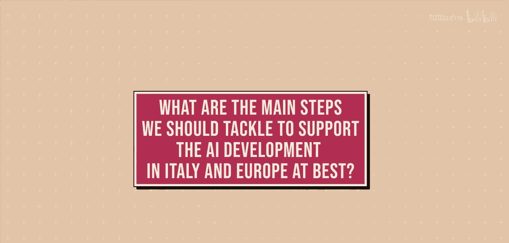

# 【人工智能：概述 专项课程】米兰理工大学—中英字幕 p23 p22_01_interview-aixia -BV1Er1PYhE9q_p23-

。Popochanantti has worked in the field of computer science since 1974。

He has carried out project for the Monte de Paquena in the field of artificial intelligence。

Knowledge your presentation systems for documentation and training。

 applications for interpreting the language of changers。

 query answering and genes and ontologies on company regulations。Since 2000。

 he has been a board member of the Italian Association for Tual Intelligence。

 and since December 2017， he has been his president。Welcome Pierro， thank you for being here with us。

 what is AI for Hahei？The Italian Association for Artificial Intelligence is apro scientificific association founded in 1988。

With the aim of promoting the research and dissemination of the techniques related to artificial intelligence。

Is the Italian member of U， the European Association， with member in many European countries。

Is the most important association for artificial intelligence in Italy with more than 1000 men person。

Including both academics and industrial members。And we are supporting Clive and the Alice initiative at the European level。

What activity is conducted by AI for HaA。The association his at increasing the knowledge of artificial intelligence。

 fostering its teaching and promoting both theoretical and applied research in the field。

Through seminars。Targeting each and event sponsorship。Within the association。

 there are several working groups focused on specific research topics。

8 working groups are ti at the moment， focusing on an agent and beauty agent system。

Artificial intelligence and the ageginger。Artificial intelligence fall co， a， roboticser。

 machine learningingger and datainger， knowledge representation and automatic reasoninger。

 natural language processing and argumentation。The association organizes a annual national scientific event。

As well as other initiative directed to the repa and to industrial worlds。

It teach award and scholarship to encourage the participation of student and younger research in the event that are held in。

Since 2014， the association has promoted meeting and debates to analyze the economic and social impact of artificial intelligence。

 also involving high school and undergraduate students。For the students。

 we also promote training activities with peer to peer methodologies。

Where they teach students from other classes and institutions。Since 2019。

 we are promoting an annual event dedicated to companies I forum。

With the aim of bringing together the communities of research and industries。We believe。

 indeed that we cannot have an effective eye development and adoption without a strict contamination between these two communities。

What are the main steps we should tackle to support theI development in Italy and Europe at best。

The Italian and European social economicomic scenario。

Is dramatically different from that of China and America。In particular。

 Italy and Europe are rich in small， medium metal prices。

And the business and developed models adopted by big companies do not apply to the small medium case。

This pushes for the need， for new models。Using basic research to overcome some of the issue that drive big business cloud。

Enabling interoperable cloud infrastructure， fogger and edge computing。To bring solutions to micro。

 small and medium size business as well。To achieve this goal。

 we also need to integrate symbolic and subsymbolic models and equip machine with abstraction skill to optimize their behavior。

Adapt to contest and explain their action and suggestions。

This is of paraum importance when the amount of available data is not sufficient to adopt a deep learning approach。

But first of all， we are promoting a cross disciplinary and multidisciplinary contribution。

That pushes artificial intelligence and the entire economic models towards the sustainability of humanity and the planet。

Reules are not enough。We need a profound social cultural change when。

 and we are convinced that artificial intelligence。Can be a valuableable tool。To change course。🎼。

