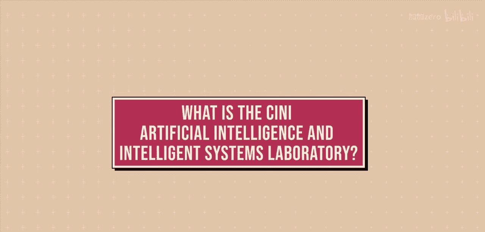
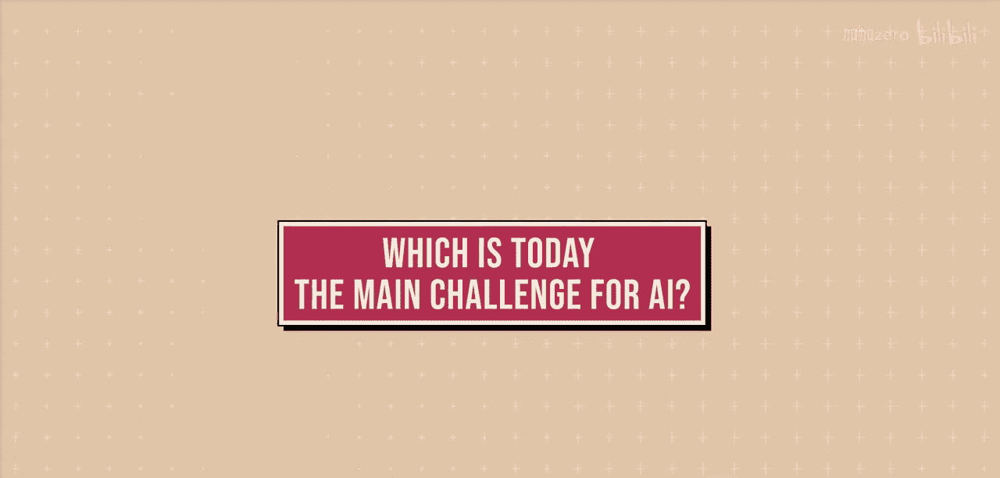

# 【人工智能：概述 专项课程】米兰理工大学—中英字幕 p24 p23_01_interview-laboratorio-cini -BV1Er1PYhE9q_p24-

Victor Carra is full professor of Comp engineeringer and Science within the Department of Engineering and Safarari at the University of Modna and Red Amelia in Italy。

 She has I H La， which is active in computer vision， pattern recognition and multimedia。

 She is the director of the Scni laboratory artificialific intelligence and In System since toant Hahen。

And she is also one of the 30 members of the high level expert group on artificial intelligence of the Italian government。

Welcome， Rita， thank you for being here with us。 Which is the Scni artificial intelligencetelligence and intelligenceligence System Laboratory。

😊。

Cinni is the Italian Consortium of Informatics that is in a house body of more than 50 university in Italy acting in computer science and engineering under the supervision in Italian and Ministry of University research in 2018 with endorsement of Italian Presidents of Ministry Council。

 Cinni spilled over the IceE La that is the lab of artificial intelligence and In System which is a very large network because it's a network of 57 notess。

 among the 54 universities， CNNR Italian Institute of Technology and for the T Blo Kesler in Tto。

 we have more than 101 under0 the affiliated Research in Italy that joined together and worked together in this lab。

What is the mission of the laboratory。The aims of the Ch lab eyes are different。

 so the first one is to strengthen the Italian research in all topic of AI intelligence system and promote Italian AI research around the world the second is to boost the collaboration between Italian research in AI and Italian industry in all the sectors specifically with the IT industries。

 SMEa and startups we have more than 100 startups connected with the university of the research center then to bring the benefits of AI technology for the AI society for many society challenges in a wide range of areas such as public administration。

 health， mobility， Agrifo space， cultural heritage and national security and to coordinate an Italian academic research system in AI with Italian institution。

International initiative in practicectic at the end。

 we are working in three different direction so the first is to create a structure interface with the Italian institution like the Minister of Research the Minister of Eomic Development。

 the Foreg offices the second is to create a bilateral international contact。

 we worked a lot with the UK with Israel， with U Canada South Africa France just only to give some example and then to create a large community of European research center also around Italy promoting the participation in a project and actually after two years and a half of real activity we presented for European project for Excel and Center industrial cooperation with 100% of a sector R with at least clear and human AI network。

How can the laboratory support the development of Hai technology in Italy？

The lab is a network of labs and creating a network of research。

 I think is the first necessary point， absolutely important。

 especially in Italy when we have many different labs。

 many different center deficitused in all the nation it's not a network of individual indeed but it's a network of institution。

 so this is very important because we don't represent Australia ourselves but we represent our universities and our research center and we have a very large survey of research in Italy that is available for all institution and for the companies in history where we know at the end what this 57 labs are doing in AI we have projects with a large Italian industries such as Leonardo or forvie de Losstato Italian railway system。

Insitution like the Department of security Information and the Italian Israel Kund project and project for the public Administration。

 but most important I think is the support of the Italian institution in the Str of technology development such as for instance the document called the AI for future Italy that we presented last year with some recommendation that we presented to all Italian In and the industrydu and we believe that had already a good impact of that and so due to the pervasivity of AI in all sectors we are。

As sort and we would like to be a sort of Renaissance after the pandemic period and certainly the Ya Chini lab。

 so we have an important role and important impact in this Italian Renaissance tool。

Which is today the main challenge for AI。

Challenges are so many that is very difficult to give a comprehensive list of them there are some theoretical challenges I believe are real important for the II of the future。

 as for instance to design sustainable and federated the deep learning techniques or now the topic like continual learning or explainable AI typical of the European vision of human centric AI and together many other technical issue。

 like for instance to create a privacy awareness of the network I give an example。

 if you like to work as the human do in order to understand the human behavior analysis。

 you needed to understand what the people are doing but you don't need to understand who the people are so you can do the same thing with a new training and new architecture capable to work just。

with the shape of the people but without the identity of all of them and these kind of things。

 a privacy aware computer vision system could have a lot of application in industry， in e-commerce。

 in media analysis in medicine， in cultural heritage and in many high risk system that now are so important in AI we are doing this kind of things in our modern labs and in the modern image lab and us in the new European center of AI and vision we are creating in modern thanks to the regional national funds together also with NVdia。

 so this is just only one example of what we are doing but I think that the new challenges also in the connection between computer vision。

 natural language processing and robotics， for instance， computer vision to understand environment。

 NLP to understand the interact。🎼With humanman to understand language， but also to generate language。

 planning and memory for robot navigation， I think that putting together all this different field in just a single deep learning architecture should be something that now is only research。

 but could be the basis of many future application and system that also we could create also in Italy。

