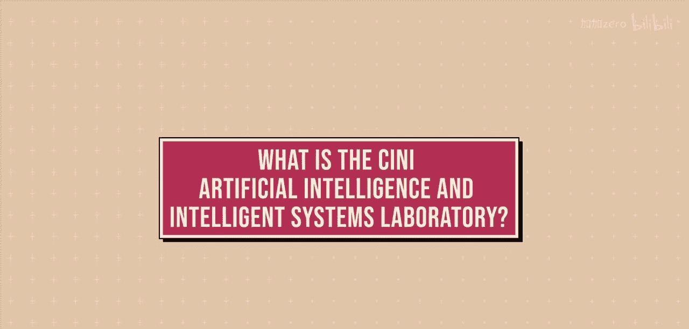
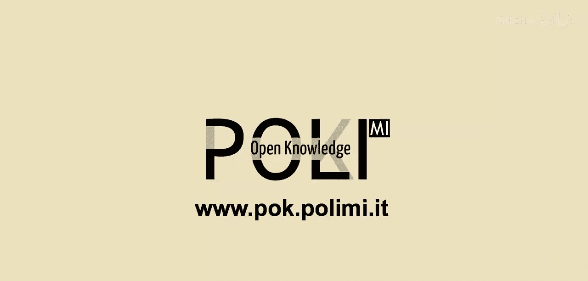

# 人工智能：专项课程：第24讲：CINI人工智能与智能系统实验室访谈

在本节课中，我们将了解意大利CINI人工智能与智能系统实验室的使命、结构与主要挑战。本次访谈由米兰理工大学的Victor Carra教授主持，嘉宾是意大利摩德纳和雷焦艾米利亚大学的Rita Cucchiara教授。

## 受访者介绍

Rita Cucchiara是意大利摩德纳和雷焦艾米利亚大学工程与物理系计算机工程与科学领域的全职教授。她领导着IH实验室，该实验室活跃于计算机视觉、模式识别和多媒体领域。自2018年起，她担任CINI人工智能与智能系统实验室的主任。同时，她也是意大利政府人工智能高级专家组的30名成员之一。

## 实验室概况与使命

上一节我们介绍了受访者，本节中我们来看看她所领导的实验室。

CINI是意大利信息学联盟，这是一个由超过50所意大利大学组成的机构，在意大利大学与研究部的监督下，从事计算机科学与工程研究。2018年，在意大利部长会议主席的认可下，CINI成立了人工智能与智能系统实验室。这是一个非常庞大的网络，因为它连接了57个节点，包括54所大学、意大利国家研究委员会、意大利技术研究院以及的里雅斯特的Abdus Salam国际理论物理中心。我们有超过1000名附属研究员在意大利共同在这个实验室中工作。

该实验室的目标是多方面的。

以下是其主要使命：
*   **加强研究**：加强意大利在人工智能与智能系统所有主题上的研究，并在全球范围内推广意大利的人工智能研究。
*   **促进产学合作**：推动意大利人工智能研究与意大利各行业，特别是IT产业、中小企业和初创公司的合作。目前已有超过100家初创公司与大学研究中心建立了联系。
*   **造福社会**：将人工智能技术的好处带给社会，应对公共行政、健康、交通、农业食品、太空、文化遗产和国家安全等广泛领域的诸多社会挑战。
*   **协调国内外倡议**：协调意大利学术研究系统与国内外机构的人工智能倡议。

最终，实验室的工作主要围绕三个方向展开。

以下是其工作方向：
*   **对接国内机构**：创建与意大利国内机构（如研究部、经济发展部、外交部）对接的接口结构。
*   **建立国际双边联系**：建立双边国际联系，已与英国、以色列、加拿大、南非、法国等国家开展了大量合作。
*   **构建欧洲研究社区**：在意大利周边创建一个庞大的欧洲研究中心社区，促进项目参与。经过两年半的实际运作，实验室已提交了关于卓越中心、产业合作以及人类中心人工智能网络的欧洲项目申请。

## 实验室对意大利AI发展的支持

了解了实验室的使命后，我们来看看它是如何具体支持意大利人工智能技术发展的。

实验室是一个由多个实验室组成的网络，而创建一个研究网络是首要且绝对重要的一点，尤其是在意大利。我们拥有许多不同的实验室和研究中心，分散在全国各地。这不仅仅是一个个人网络，更是一个机构网络，这一点非常重要，因为我们代表的不是个人，而是我们的大学和研究中心。我们拥有覆盖意大利全境的庞大研究资源，可供所有机构和公司使用。我们清楚地知道这57个实验室在人工智能领域正在做什么。

我们与许多大型意大利企业（如莱昂纳多公司、意大利国家铁路公司）以及机构（如信息安全部门）开展了项目合作，还有意大利-以色列联合项目以及面向公共行政部门的项目。

但最重要的是，我们认为实验室支持了意大利机构在技术发展战略制定方面的作用。例如，去年我们提交了一份名为《人工智能助力未来意大利》的文件，其中包含我们向所有意大利机构和产业界提出的建议。我们相信这已经产生了良好的影响。

鉴于人工智能在所有领域的渗透性，我们希望并致力于成为疫情后复苏时期的一种推动力。毫无疑问，CINI实验室在这场“意大利复兴”中扮演着重要角色并产生重要影响。

## 人工智能面临的主要挑战

最后，我们来探讨当前人工智能面临的主要挑战。

挑战如此之多，很难给出一个全面的列表。我认为有一些理论挑战对未来人工智能的发展至关重要。

以下是一些关键的理论挑战：
*   **可持续与联邦深度学习**：设计可持续和联邦式的深度学习技术。
*   **持续学习与可解释AI**：研究持续学习或可解释人工智能等课题，这符合欧洲以人为中心的人工智能愿景。
*   **隐私保护**：创建具有隐私意识的网络。例如，如果你想模仿人类工作来分析人类行为，你需要理解人们在做什么，但不需要知道他们是谁。因此，你可以通过新的训练和新的架构来实现同样的功能，仅处理人的形状信息而不涉及个人身份。这种具有隐私意识的计算机视觉系统可以在工业、电子商务、媒体分析、医学、文化遗产以及许多现在对人工智能至关重要的高风险系统中得到大量应用。

我们在摩德纳的实验室以及新的欧洲人工智能与视觉中心（得益于地区和国家资金以及英伟达的支持）正在从事这类研究。这只是我们工作的一个例子。

我认为新的挑战还在于计算机视觉、自然语言处理和机器人技术之间的结合。例如，计算机视觉用于理解环境，自然语言处理用于理解与人类的交互并生成语言，而规划与记忆则用于机器人导航。我认为，将所有不同领域整合到一个单一的深度学习架构中，目前还只是研究阶段，但可能成为许多未来应用和系统的基础，这些系统我们也可以在意大利创建。

## 总结

本节课中，我们一起学习了意大利CINI人工智能与智能系统实验室的核心信息。我们了解了实验室作为全国性研究网络的结构，其加强研究、促进产学合作、造福社会及协调国内外倡议的多重使命。我们还探讨了实验室通过项目合作和战略建议支持意大利AI发展的具体方式。最后，我们审视了人工智能领域当前面临的主要理论挑战，包括可持续与联邦学习、可解释AI、隐私保护技术以及多模态AI的融合。这些内容为我们理解欧洲，特别是意大利在推动以人为本、负责任的人工智能发展方面的努力提供了重要视角。