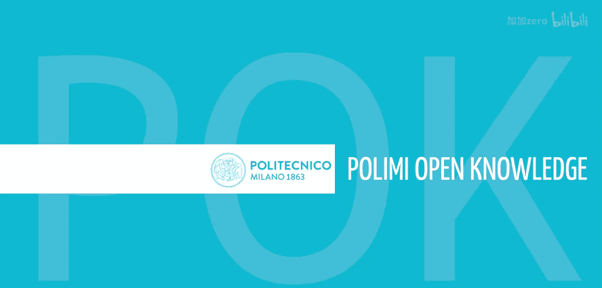
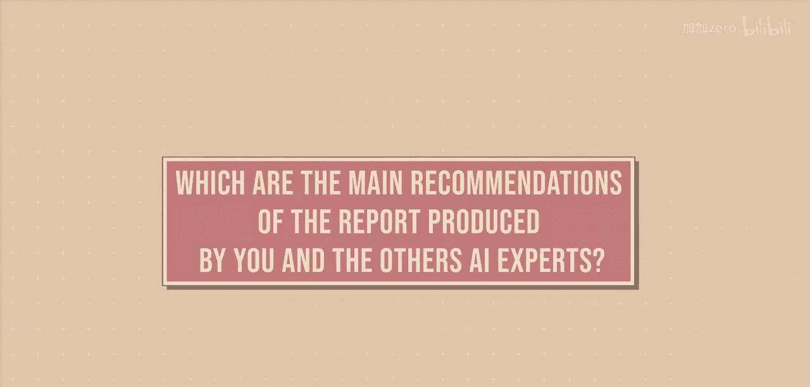
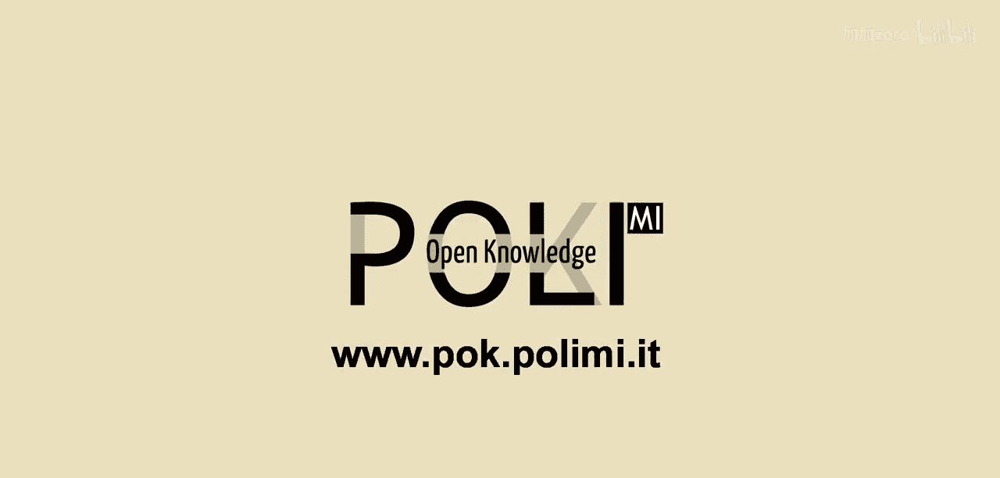

# 【人工智能：概述 专项课程】米兰理工大学—中英字幕 p25 p24_01_interview-italia-high-level-experts-in-ai -BV1Er1PYhE9q_p25-

。After having worked for several international telecommunication companies in 2018。

 Imanuelgiard founded P AI。Popular artificial intelligencetelligence Association。

Poppii investigates the impact that AI has on people's daily hives and raises awareness among the general public。

She is a member of Claire and AI for Hai， and she' is one of the 30 members of the high level Haxburg group on artificial intelligence of the Italian government。

Welcome， Emmamanuela， thank you for being here with us。

You are one of the 30 Italian high level hatssps in the eye of Mia。In April 2018。

 the European State signed the Dec of Cooper on AI Technologies identifying three main areas of cooperation first。

 promoting the investment in research and innovation in AI to booster the adoption of AI by European companies Second prepared to face the such economical changes the AI technologies will bring particularly focusing on updating the education and training systems third ensure a legal ethical and regulatory framework aligned with European valuess and fundamental rights。

 the European Commission presented the coordinated plan in December 2018 and thus each member state to develop a national AI strategy。

 so the Italian Ministry of E development selected 30 AI experts from industry。

 a and civil society and them to develop an Italian strategy for AI according to the priorities set up by European Commission so we started working。

😊，Beginning of 2019， and the final strategy was published in July 2020。

 which is the readiness level of Italy in terms of AI。😊。

Italy presents a dual situation we have on one side excellence in AI in the academic world。

 Italian scientists， researchers are among the best in the world。

 and on the other side we have some very successful AI startup in several very innovative companies。

But if we look at the average level of adoption of AI technology， it is still quite low actually。

 according to the data presented in a recent study from the Potechnical Milan。

 about 50% of medium and large Italian companies already implemented AI projects and another 40% declared that they are planning to do it this year。

 so today the total Italian market for AI is about 300 million and the main investments are for project in intelligent data processing。

 chatbot and virtual system， however， the main challenge is still bringing a AI technologies to small and microcompanies which represent the largest part of the Italian business system and which currently do not have access to the necessary expertise to start using these innovative technologies so I believe that supporting Italian companies in developing AI project is key to improving the competitiveness of Italian businesses。

And should be a top priority for our government。Which are the main recommendations of the report produced by you and the other AI experts。

The starting point of our strategy is that AI technologies alone are not enough。

 we need to develop an entire technological ecosystem which includes connectivity， blockchain。

 infrastructure to collect and share data， supercomputers to elaborate this data， contents。

 data up services， and entire technological stuff。

So starting from these folks， we defined three pillars on which to build the development of AI technologies and the AI policy in Italy。

 The first one is AI for the human being。 The second AI for trustworthy and productive digital ecosystem and the third one is AI for sustainable development Let's start with the first pillar。

 The first pillar is perfectly aligned with the European strategy we need to promote the adoption of AI technologies to increase the welfare of the entire population So the Italian AI strategy aims to educate citizens。

 users， consumer laborers to provide them with the necessary skills to use AI technologies。

 This needs to be able to enjoy on one side the great benefits of AI and on the other side to be able to manage the risk and being able to actively participate in the new digital society。

 So the second pillar is also aligned。😊，with the European strategy to build an ecosystem of trust and excellence with universities。

 research centers， company， public administration and citizens so in particular。

 the strategy highlights the need to develop data economy and to support SMEs in collecting stocking and sharing their data in a safe competitive way。

🎼And the third pillar AI for a sustainable development so this is really the most innovative one the Italian vision is that human centric transformy approach to AI is definitely fundamental approach but it is not enough so we must use AI technologies to reach the sustainable development goals of the 2030 United Nations agenda and with the support of AI technologies I believe that we can realize the ultimate goal of leaving no one behind。

😊。

