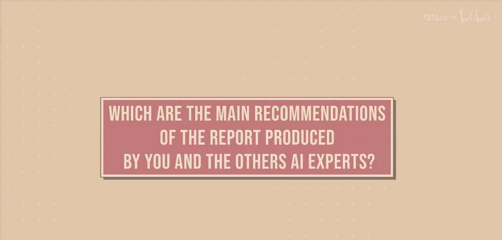
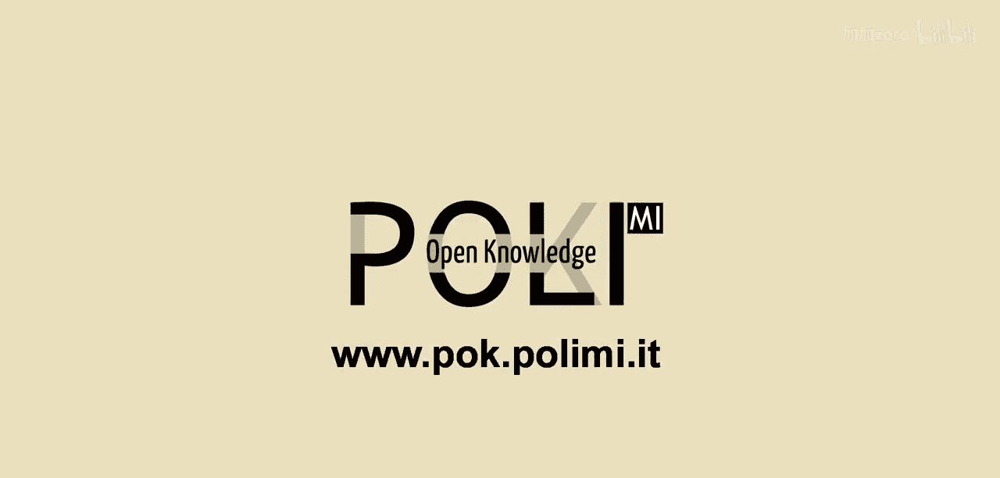

# 人工智能：概述 专项课程：P25：意大利人工智能战略访谈

## 概述
在本节课中，我们将学习意大利人工智能专家Emanuela Girardi关于意大利国家人工智能战略的见解。内容涵盖意大利的人工智能发展现状、面临的挑战以及国家战略的核心支柱。

---

## 意大利人工智能专家背景介绍

Emanuela Girardi在2018年之前曾为多家国际电信公司工作。

2018年，她创立了“大众人工智能协会”。

该协会研究人工智能对人们日常生活的影响，并提高公众对此的认识。

她是“Claire”和“AI for Hai”组织的成员，同时也是意大利政府人工智能高级别专家组的30名成员之一。

欢迎Emanuela，感谢您与我们分享。

## 意大利人工智能战略的制定背景

您是意大利30位人工智能高级别专家之一。

2018年4月，欧盟各国签署了《人工智能技术合作宣言》，确定了三个主要合作领域。

第一，促进人工智能研究与创新投资，以推动欧洲公司采用人工智能。

第二，准备应对人工智能技术带来的社会经济变革，特别关注更新教育和培训体系。

第三，确保建立一个符合欧洲价值观和基本权利的法律、伦理和监管框架。

欧盟委员会于2018年12月提出了协调计划，并敦促每个成员国制定国家人工智能战略。

因此，意大利经济发展部从工业界、学术界和民间社会中遴选了30位人工智能专家，请他们根据欧盟委员会设定的优先事项，制定意大利的人工智能战略。

我们于2019年初开始工作，最终战略于2020年7月发布。

## 意大利的人工智能发展水平

意大利在人工智能方面的准备水平如何？

意大利呈现一种双重局面。

一方面，我们在学术界拥有卓越的人工智能成就，意大利的科学家和研究人员位居世界前列。

另一方面，我们拥有一些非常成功的人工智能初创公司和几家极具创新性的公司。

但是，如果我们观察人工智能技术的平均采用水平，实际上仍然相当低。

根据米兰理工大学最近一项研究的数据，大约50%的意大利大中型公司已经实施了人工智能项目，另有40%的公司宣布计划在今年实施。

因此，目前意大利的人工智能市场总额约为3亿欧元，主要投资方向是智能数据处理、聊天机器人和虚拟系统项目。

然而，主要的挑战仍然是将人工智能技术引入中小微企业，它们构成了意大利商业体系的最大部分，但目前缺乏启动这些创新技术所需的专业知识。

因此，我相信，支持意大利公司开发人工智能项目是提高意大利企业竞争力的关键，这应该成为我们政府的首要任务。

## 战略报告的主要建议

您和其他专家撰写的报告有哪些主要建议？

我们战略的出发点是，仅有人工智能技术是不够的。

我们需要发展一个完整的技术生态系统，这个系统包括：**连接性**、**区块链**、用于收集和共享数据的**基础设施**、用于处理这些数据的**超级计算机**、**内容**、**数据服务**以及整个**技术栈**。

基于这些重点，我们定义了三个支柱，用以构建意大利人工智能技术的发展和人工智能政策。

第一个支柱是 **“以人为本的人工智能”**。

第二个支柱是 **“构建可信赖、高生产力的数字生态系统的人工智能”**。

第三个支柱是 **“促进可持续发展的人工智能”**。

## 三大战略支柱详解

上一节我们介绍了战略的三大支柱，本节我们来详细看看每个支柱的内涵。

首先是第一个支柱。

第一个支柱与欧洲战略完全一致，我们需要推广人工智能技术的应用，以提高全体人口的福祉。

因此，意大利的人工智能战略旨在教育公民、用户、消费者和劳动者，为他们提供使用人工智能技术所需的必要技能。

这需要让人们一方面能够享受人工智能的巨大益处，另一方面能够管理风险，并能够积极参与新的数字社会。

接下来是第二个支柱。

第二个支柱同样与欧洲战略一致，旨在与大学、研究中心、公司、公共管理部门和公民共同构建一个信任与卓越的生态系统。

具体而言，该战略强调了发展数据经济，并以安全、竞争的方式支持中小企业收集、存储和共享其数据的必要性。

最后是第三个支柱。

第三个支柱是关于人工智能促进可持续发展，这确实是最具创新性的部分。

意大利的愿景是，以人为本的变革性人工智能方法绝对是根本性的方法，但这还不够。

因此，我们必须利用人工智能技术来实现联合国《2030年议程》的可持续发展目标。

我相信，在人工智能技术的支持下，我们可以实现“不让任何人掉队”的最终目标。

---

## 总结
本节课中，我们一起学习了意大利人工智能专家Emanuela Girardi分享的意大利国家人工智能战略。我们了解了意大利在人工智能领域“学术卓越”与“产业应用不足”并存的双重现状，以及该国战略围绕 **“以人为本”**、**“构建可信数字生态”** 和 **“促进可持续发展”** 三大支柱所制定的具体路径。该战略强调技术、生态系统与社会目标的结合，旨在全面提升国家竞争力并确保包容性发展。