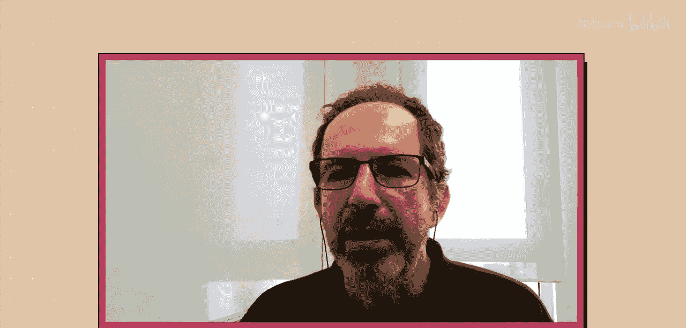

# 【人工智能：概述 专项课程】米兰理工大学—中英字幕 p26 p25_01_interview-ellis -BV1Er1PYhE9q_p26-

。Nicolachozeianki is a professor of computer science at the University of Milan， Italy。

His major research interests are the design analysis of machine learning hazards。

Nicolala is cohour of the monographs， prediction， learning and gamess。

 and regret analysis of stochastic and nonstochastic matta bandit problems。

He served as president of the Association for Computal Learning and could chair the program committees of NRIs and CAD。

 he is the recipient of a Google Search Award， Excels Foundation Award， a Curretail F Award。

 and a Google Focus Award。He is a hellless Fel and co director of the HeLless Program on Inter learning and Interal representations。

Welcome， Niicola， thank you for being here。 You are an El fellow。 What is hellas。😊。

EIS is the European Laboratory for Learning and Intelligence systems。

 it is a European grassroots initiativeni in AI focused on scientific excellence。

 innovation and societal impact。EIS builds upon machine learning which is the driving force of modern artificial intelligence virtually all of the dramatic recent progress and impact of artificial intelligence in today's world is fueled by machine learning El least looks at a new generation of talented young students who will help us advance the field using deep learning。

 reinforcement learning， causal inference and other machine learning technologies。

Which activities does the haveless conduct？EIS is based on a three pillar strategy with the goal of maintaining and fostering European technological dominance in artificial intelligence。

These trip pillars will help us invest in existing talent， foster new talent。

 and build a network of outstanding European ecosystems for innovation。

The first pillar is built around the 13th HO programs dedicated to topics ranging from basic research in theory and algorithms to application in health and climate sciences and human centric elements of AI。

Within these programs， thematic workshops of schools and other scientific and educational events are organized。

The second pillar attracts and connects the best PhD students in Europe through the LS PhD program。

 the PhD program offers plenty of options for younger talents looking to conduct cutting edge research in machine learning and related areas。

Candidates rely on the fellow network to choose whom they like to work with PhD and postdocs are based at their supervisor institution but also spend at least six months in exchange at a different location in the network。

To engage the local ecosystem， the program is also encouraging internships at European companies and startups。

The first call of the program had more than 800 students who applied from all over the world。

The third pillar consists in a network of Lides located at leading existing European institutions or created from scratch。

Rather than just building a virtual network among institutions。

 ElIS aims at creating new working environments for outstanding researchers to enable them to combine cutting edge research with the creation of startups and industrial impact。

As a stepping stone towards Civic's goal， ElIS started establishing smaller LS units based on a call for proposals carefully reviewed by an international selection committee。

These units bring together the best AI researchers and fulfill a set of criteria to ensure excellence and to be maximally competitive at the international level。

As of now， there are 30 Ls units， each with an annual budget of at least 1。5 million euros。

How can hells contribute to the development of AEI technology in Europe？

Europe is facing major barriers when it comes to retaining top talent in European institutions。

 lack of competitive salaries， stiff environments that do not support the fluid relationship with industry and the lack of critical mass due to a fragmented situation with separate islands of excellence at least once to address these issues with the goal of having the best basic research performed in Europe。

 attracting top international industry research labs and spawning start ups that will become major players in the future。

EIS wants to be a world class venue to get trained in the field in conjunction with universities it will strive to retain the best graduates within ats to groom them into the next generation of senior scientists。

This means that Europe will be able to play a major role in the scientific and societal revolution that is underway。

The first and second industrial revolution not only transforming technology。

 but also led to fundamental societal changes， these changes were managed by European democracy and values。

The current revolution may be equally significant， Europe should benefit from it and European values should help shape its impact。

Which is today the main challenge for AI。

One of artificial intelligence' main challenges is to be understandable。

 data efficient and trustworthy new AIs must be able to interact with environment with humans and with other artificial intelligences。

And they have to do so in the presence of scars and uncertain information while operating in a highly noationational environment。

In order to assist human activities and artificial intelligence should understand humans and be understood by them。

 these are complex goals and they should be pursued by integrating all the available technologies from data driven approaches to knowledgebra approaches。

