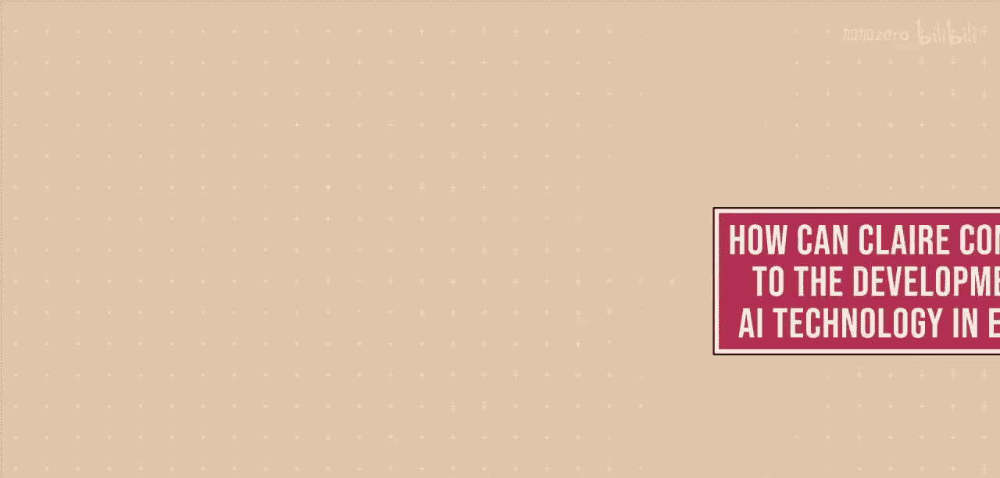
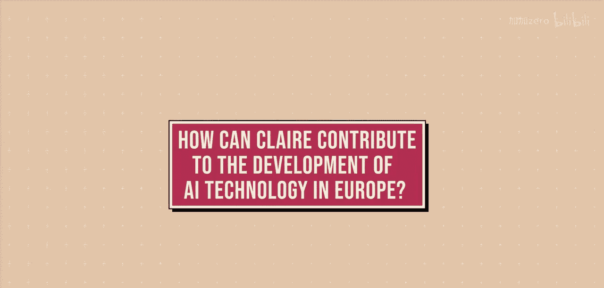
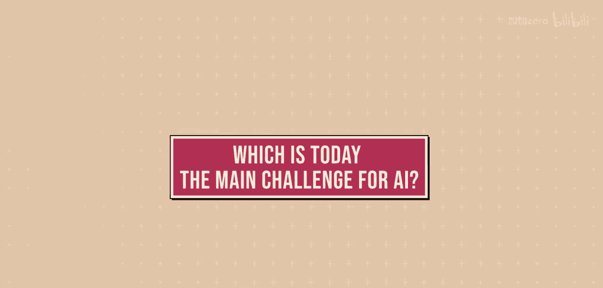
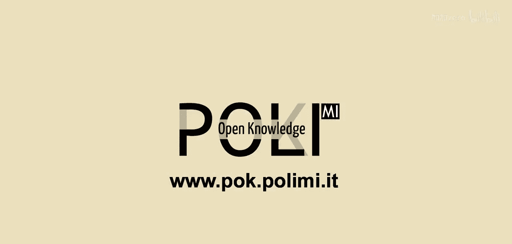

# 【人工智能：概述 专项课程】米兰理工大学—中英字幕 p27 p26_01_interview-claire -BV1Er1PYhE9q_p27-

Ja de Jacomo is full professor of Comp Engineing and Science within the Department of Computer Control and Management Engineering at Senza University of。

E research topics are acknowledge or presentation and automatic reasoning。He is WA fellow。

 Hishan Fel， and AI F。Welcome， Joppe， thank you for being here with us， What is Claire。

Thank you very much， Nicola Claire stands for Confederation of Laboratories for Artificial Intelence Research in Europe。

 it is an extensive network of Pan European artificial intelligence Laboratories。😊。

Which seek to strengthen European excellence in AI research and innovation。

Clear is inparted inspired by the extremely successful model of CEN。

 where research activities relies on distributed collaborative effort of many laboratories across you where they jointly define the research question。

 discuss how to address them， and then they collaboratively develop the experiment and publish the result。

😊，One of the most qualifying features。Of the Cla initiative is that the vast majority of AOI fellows。

 including myself support this initiative， AI fellowels are distinguish with scientists inI that be recognized by the European Association for A AOI。

Which activities does Claire conduct？I cannot describe all the activities that Claire is carrying out。

 instead I like to focus on the principles。Claire believes that AI will fundamentally change the way we live and walk and the AI will become crucial in addressing society's gun challenges such as climate。

 energy， mobility， food， natural resources， health， and inclusive and secure society。

Clie's AI is a global game changer and thinks that AI has become a major driver of innovation。

 future growth and competitiveness。Clear is the visual that Europe is in an excellent position to progress AI because of its existing strength across all areas of advice。

Any strong universities， research institutions and companies Europe can ensure that many of more advanced technology products system and services reflect European needs and democratic values Clairere focuses on transport AI that remains compatible and augments human intelligence rather than replace。

Claire works for major increasing funding to existing scientific strength in AI and other research opportunities。

Claire walks with key stakeholdersholder to find mechanism for citizen engagement。

 industry and public sector collaboration。Claire defines and address challenges in values use sector across a wider range of applications。

 including health， manufacturing， transportation， scientific research， sustainable agriculture。

Financial services， public administration and entertainment。

How can Claire contribute to the development of HaI technology in Europe？

嗯。Well， ClaireIA supports a wider range of application。

 ClaireI supportsI research that is expected to have major short medium and long term impact across a wider range of application areas。

 including efficient， safer transportation， advanced healthcare care， smart industry。

 effective and sustainable agriculture， accelerated scientific research。

 next generation learning and education in others。Claire aims at having social impacts。

 Claire conducts AI research that aims at reso some of the open issue regarding the social impact of AI。

 such as fair and transparent explainability in value alignment。

With have a clear focus on building transport AI that is beneficial to people。

Claire wants to attract talent， support attractive fellowship for masters student。

 PhD candidates and postdoal researchers， as well as exceptional junior mid career and senior researcher using efficient lightweight but solid scientific reviewing for India location pulses。

The aim should be to attract in Europe， the best talent from all over the world。

Clear sense at fostering talent。Aims at running summer school seminar。

 public outreach activities and worship at the eye scientific level and from all areas of AI。

Cl want to support collaboration， Claire aims at stopping the current level。

Of brain trained and attracting the best talent ClH provide considerable support for exchange and interaction of research at all level of seniority across all areas of AI Claire provides support for developing and running high quality study programs focuseding AI。

Also， recognizing the top research to produce excellent result with high consistency is important。

A significant part of real funding should be allocated based on track hack。Of course。

 substantial funding opportunities also need to be provided to talent junior researcher without longstanding track record。

Claire thinks that a researcher need to enjoy full academic freedom and to study whatever they are interested in。

As has often happened in the past， the most important results came from areas that were considered marginal with no expectation to deliver and instead they changed the world。

Claire promotes scientific discussion that offer unique opportunity and strength to focus and coordinate European AI research while offering a solid pay for developing guideline for industrystate politics and general public。

Which is today the main challenge for AI。

There are mainly challenges。But I like to focus on one， build systems that can act in the real world。

 possibly in a controlled environment such a factory is smart factory。

They can take inform decision and understand the consequence of their interaction accordingly。

And acting according to such decisions。In other words， system can program themselves on their own。

In a contour andclassable way， however， this involves several sub disciplines of AI。

 including knowledge representation， planning， autonomous agent， logical reason， publicisticism。

 fulfill learning。This is also related to an area could be a science called formal methods where techniques for automatically verify programs are studied。

These techniques can indeed be used to analyze program。

 but also to a automatically synthesize program and automated synthesis is quite related to this kind of cell programming。

Then we have to consider that their system are basically super efficient optimizer。

That super optimization can be a problem， especially if the objective for which the system optimizes are not fully understood。

S is the case of most of the human matters。The result is that this super optimizetimizer can become a sort of fanatic doing more than what we expected to achieve the goal we gave them we humans know from history that fanatics had never been good。

A lot could be said about this issue and indeed there is a nice book by Stuart Raa called a human Comible that is entirely dedicated to this issue。

🎼E commanded reading。

