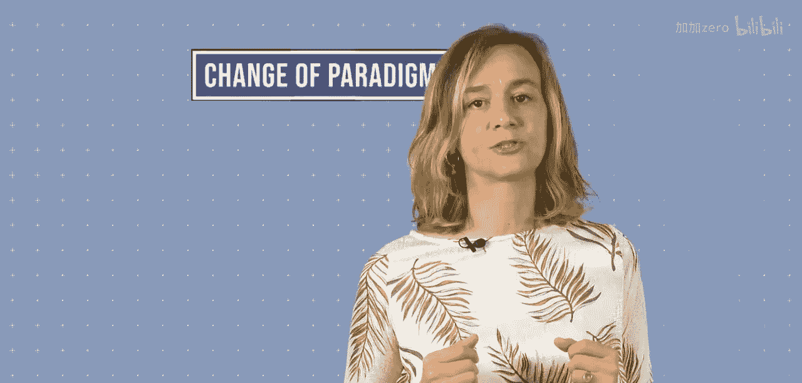
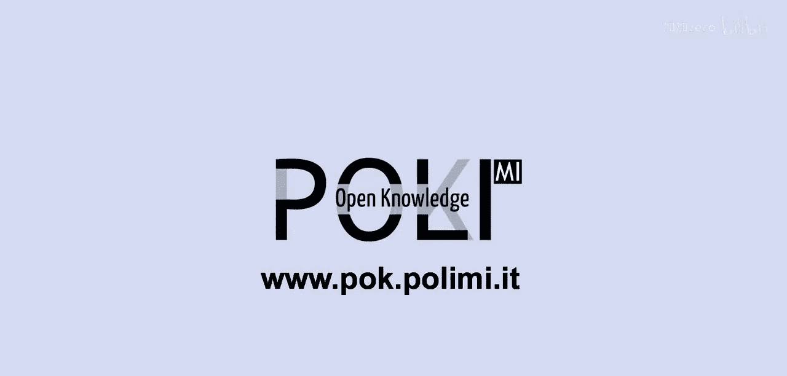

# 【人工智能：概述 专项课程】米兰理工大学—中英字幕 p28 p0_01_introduction-to-ethics-of-ai -BV1Er1PYhE9q_p28-

Artificial intelligence is promising to revolutionize our world。 In a sense。

 we already live in a world that has been revolutionized by the advent of AI。

How do automated decision systems powered by AI affect human decision？

What about the autonomy of people who are surveilled by collecting their personal data and using them in various recommender systems？

Why is privacy important not only as an individual good， but also as a common one。

What is the moral responsibility of AI designers in order not only to avoid negative effects of technologies。

 but also to promote positive ones？If autonommal systems。

 either weapons or vehicles are designed to decide about the life and death of people。

 what about human dignity？What is the impact of these tools on the notion of governance and without the effects of algorithmic governance on individuals and societies？

How has the very notion of sustainability been reshaped with the advent of AI？How furace。

 equality and justice should be included in these AI systems and how should they be managed by them？

These questions will be discussed during this course。

 more precisely well analyze ethical issues in the design， development and use of AI。

I'll be your instructor。 My name is Vios Cafernati。

 and I'm a professor of philosophyphy at Polytechnco Di Miliano。

The power of AI resides not only in its enormous computational power。

 but also in the unprecedented collection of data。Moreover。

 AI technologies are ubiquitous and broadly accepted。Many new opportunities are emerging。

 and the promise is to accelerate science and boost innovation。At the same time。

 several people are worried and feel new problems are emerging。

So if it is true that AI solves old problems， it is also true that it raises new ones。

In this context， a change of paradigmody is required because AI technologies impact individual lives and societies。

Technology cannot be the only focus， and a wider perspective should be included where ethical analysis can play a major role。

But what is ethics， ethics is difficult to define in nuts shell we can say that it is the systematic reflection on what is moral in the sense。

 ethics is a branch of philosophy where morality is the whole of opinions， decisions。

 and actions with which people individually or collectively express what they think is good or right。

What is important to remember is that ethics is not a set of rules。In other words。

 ethics is not a manual with answers， nor a checklist， rather。

 ethics is a process and a complex one indeed， it reflects on questions and arguments concerning the moral choice people make。

 and for this reason it cannot be determined once and for all。

In this course we'll consider several examples and case studies at the same time we'll introduce the main ethical frameworks that can help shape these problems and suggest possible solutions。

