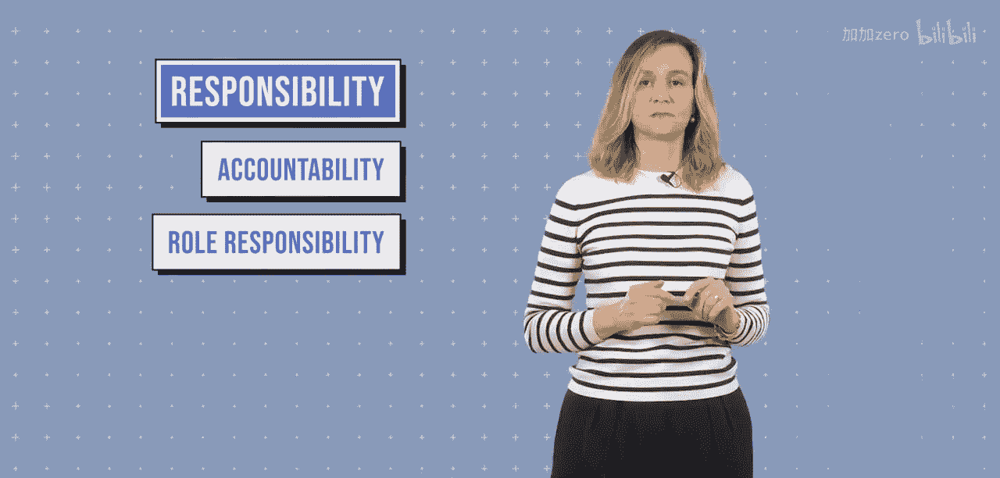

# 【人工智能：概述 专项课程】米兰理工大学—中英字幕 p29 p1_01_responsibility-in-the-ethics-of-technology -BV1Er1PYhE9q_p29-

The ethics of AI is deeply connected with the concept of responsibility。AI is a powerful technology。

 and whenever something goes wrong， the question of who is responsible for it quickly arises。

Moreover， as we will see later in this course， the very notion of responsibility has to be reconsidered when artificial systems such as those of AI possesses increasing autonomy and decisional power。

But what is responsibility a responsibility means in general to be accountable for our actions and the effects of these actions Furthermoremore。

 responsibility is often linked to the role that we have in a particular situation。

And this is called role responsibility。People have different roles in life。

 so they have variousresponsibilities， such as the responsibility of being a parent or those responsibilities written in a contract。

 so we can say that rules define responsibilities。However。

 moral responsibility is not confined to these roles， but is wider。In general。

 we can say that moral responsibility is that based on the obligations。

 norms and duties arising from moral considerations。😊。

Professional responsibility is that based on one's role as a professional。

 in as far it stays within the limits of what is morally allowed。😊，In the ethics of technology。

 responsibility can be conceived as passive responsibility and active responsibility。

Pasive responsibility is applicable when something undesirable as accord。

Active responsibility is applicable before something has happened。

Let's discuss passive responsibility first。Passive responsibility is a form of backward looking responsibility。

 which is relevant after something undesirable occurredccord。For example。

 when an autonomous vehicle is involved in a collision。

 then it's plausible to ask who is responsible for this？

Is it the owner of the vehicle or the designers of it or the company that commercializes it？

Two elements play a key role in assessing responsibility。The first one is accountability。

The person who is held responsible must be able to provide an account of his or her choices。

Such as why he or she took some decisions。The second element is blame worthiness。

 the person who is held responsible must be a proper target of blame。

Let us better analyze blame worthiness。In order for someone to be blameworthy。

 usually some conditions need to be applied。The first condition is wrongdoing。

To blame a person or an institution， it is necessary that they did something wrong。This is the case。

 for example， of a team of software engineers who did not test enough the software used for the object recognition system in an autonomous vehicle。

The second condition is causal contribution。The person who is held responsible must have made a causal contribution to the action for which he or she is responsible。

Casal contribution refers not only to action， but also to a failure to act。For example。

 the team of software engineers can make a causal contribution to the collision of antonnesbo vehicle if they don't stop the company to commercialize the vehicle without a proper testing of the object recognition system。

The third condition is foreseeability to be responsible。

 we must be able to know the consequences of actions。For example。

 the team of software engineers must know that without a proper testing。

The object recognition system of the autonomous vehicle can cause inevitableable collisions。

The fourth and last condition is freedom of action。To be held responsible。

 we must have freedom of action。 So not acting under compulsion。

The case of the team of software engineers shows that they are certainly free of acting。

 They are not in prison， for example， even if they might be under high pressure from their company。

However， this pressure is not probably strong enough to say that they lack freedom of action。

Let's move on and discuss now active responsibility。

 that type of responsibility applicable before something has happened it。

Active responsibility means acting to prevent the negative effects of technology。

 but also to realize some positive consequences。It is hence clear why active responsibility plays a key role in the design of those technologies such as AI that have a major impact on humans and societies。

😊，Active responsibility can be translated into a design approach of technologies in general and AI technologies in particular。

This means that values and moral considerations are already consideredate at the beginning of the design phase。

😊，In order to embed them in the technology itself。This is the case， for example。

 of the design of an autonomous vehicle in which the protection of the privacy of its users is guaranteed by the way the vehicle is designed。

Value sensitive design is one of the approaches developed in the active responsibility framework applied to technological design。

In value sensitive design， moral considerations and values are used as requirements for the design of technologies。

The possibility of steering technological development is very important。 however。

 there are two major issues。To consider。The first one is that technological development involves a large number of actors。

 stakeholders whose interests can collide and cannot be neglected from a moral point of view。

The second issue is the difficulty of predicting the process of technological development。

This is particular series with powerful and emerging technologies， such as AI。

To deal with these difficulties， several approaches have been developed。

 but it's important to stress that every case requires a special attention and careful analysis of the details。

