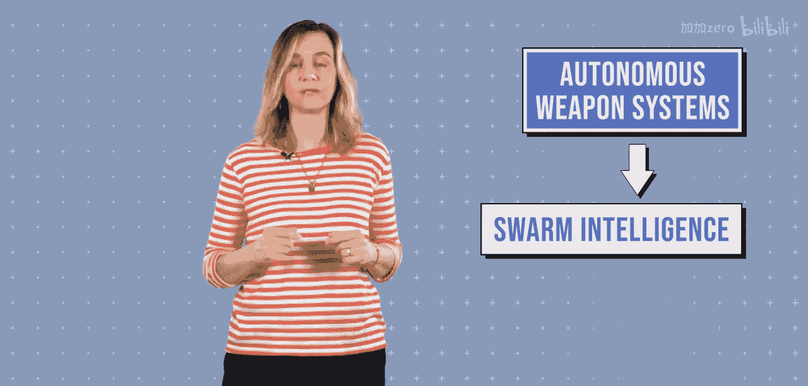
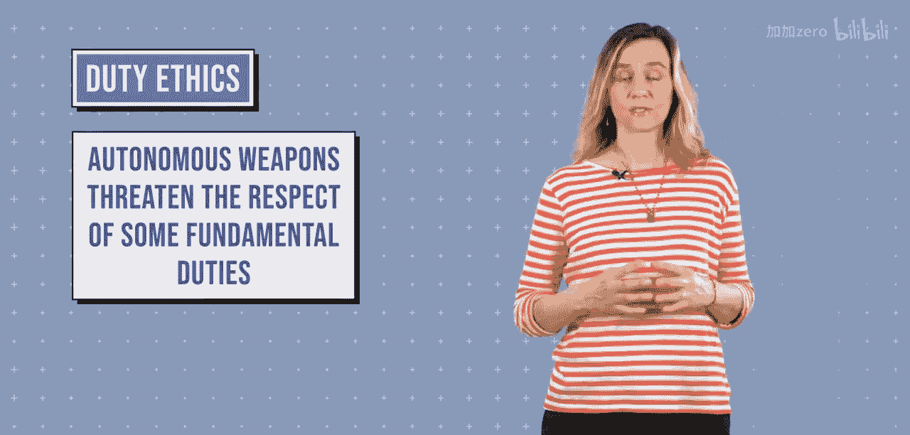
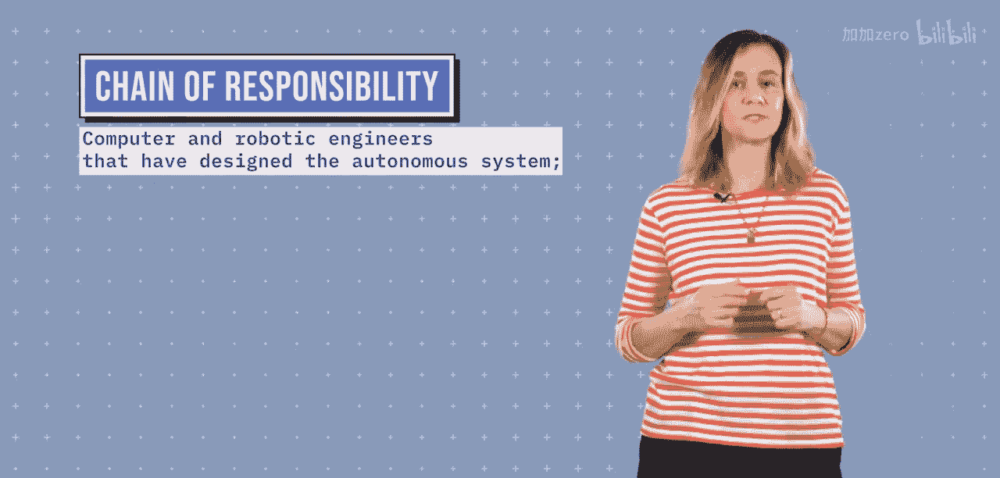
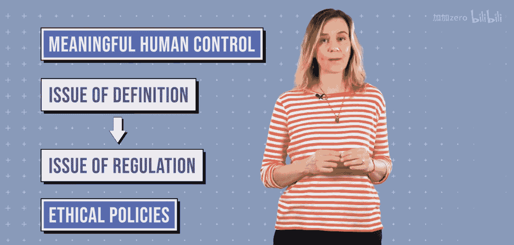

# 【人工智能：概述 专项课程】米兰理工大学—中英字幕 p31 p3_01_autonomous-weapons-and-the-digitalization-of-conflicts -BV1Er1PYhE9q_p31-

Autonomous weapon systems present similar， but also distinct ethical issues of autonomous vehicles。

In general， we can say that a weapon system is autonomous when it has navigation， exploration。

 and attack capabilities， and does not require continuous human supervision。

Ados webbone systems can be classified into different categories， such as for example。

 aerial systems， robotic sentinels for patrolling， loitering systems for attacking and destroying targets。

The definition of autonomy applied to weapon systems is critical。

 It constantly evolves according to the technical evolution of the field。For example。

 in the last years， weapon systems have been developed to exploit the socal swarm intelligence in which swarms of very small and cheap autonomous weapon systems coerate to achieve a complex task。

But what is the reason to design and use weapons systems that are autonomous。

We can distinguish here among three reasons， operative， economic and strategic。For example。

 an autonomous drone without a pilot is faster than in the case in which the pilot is operating thousands of miles away from the battlefield。

Moreover， autonomous weapon systems require fewer human operators than traditional ones。

 hence costs of operations are reduced。And finally。

 those systems play a strategic role for increasing military power and revising geopolitical relationships。

😊，It is very important to understand the difference between a traditional webon system like a teleoperated drone and an un autonomous webon systems。

 like a drone with autonomous capabilities to select and attack a target by using AI technologies。

To stress this difference is essential to focus on the ethical issues arising in the case of autonomous weapon systems。

A traditional drone is controlled by human operators。 Also。

 in the case they are very distant from it。An autonomous weapon instead is programmed to decide to attack in an autonomous way。

In other words， in the case of a drone， the command and control chain is preserved and responsibility can always。

 at least in principle， be attributed to humans。Whereas this human control is not preserved in autonomous weapon systems。

 and some decisions of attack can be taken by the weapon system in a partially independent way from the human operator。

In the current debate about the moral issues of autonomous weapon systems。

 pros and cons of developing and using them are discussed。

Roboticist Ronald Akin argues for the pros of these systems。

He stresses how artificial systems in this context are immune to the necessity of auto conservation and to the emotional reactions typical of humans。

According to Akin， these systems should be designed in a way to respect the international norms regulating warfare context。

On the opposite。Roberticis Noel Sharkkey argues that we do not have at the moment any proof that autonomous weapon systems can better adhere to these international norms。

Moreover， the interactions among these autonomous weapons are very difficult to be predicted。

 and they are too fast to be under human control。

Sharke contributed in a significant way to the campaign started in 2012。Called stop killer robots。

 whose goal is to ban autonomous weapon systems able to attack targets without any human intervention。

On these positions greatly vary， for example， in a document of March 2021。

 the US National Security Commission on Artificial Intelligence has declared that the Commission does not support a global Prohiion of AI enabled and autonomous Webon systems。

Let's consider now the debate on autonomous weapon systems in the context of neuroeths。Dios。

 also known as deontological ethics， is the class of approaches in ethics in which an action is considered moral right if it is in agreement with a certain moral rule。

According to duty ethics， these autonomous weapons threaten the respect of some fundamental duties。

 such as respecting the international humanitarian law， maintaining the chain of responsibility。

And considering the dignity of humans involved in warfare situations。

The respect of dignity requires that any decision regarding the life or that of any human being。

Should be taken only by other humans。Capable of feeling empathy and appreciating the value of human life。

To respect the international humanitarian law， the proportionality principle plays a very important role。

This principle refers to the fact that military attacks should be limited to those target。

Whose destruction contributes to a military advantage。

A major element to correctly apply this principle is to be able to distinguish between those subjects that are active in the warfare situations。

And those enemies that are instead out of action and showing the intention to surrender。

How is it possible for an artificial system to recognize the behaviors of those soldiers who express their intention of surrendering？

Indeed， this intention can be expressed in many different and not conventional ways。😊。

How is it possible to avoid the perceptual errors typical of an artificial system that can be easily overcome by common sense in the case of humans？

These questions do not have at the moment， any satisfactory answer。In particular。

 if we think of military contexts that are unpredictable and subjected to many changes。

Let's see now how complex it is to maintain the chain of responsibility that is required by the international humanitarian law。

Let's suppose an autonomous webon system attacking a school bus。

Confused with a military target due to some perceptual errors。

Who should be considered morally responsible in this case？

Not the autonoous system that is not a moral agent。

A responsibility instead is to be attributed to the people involved in the activation of the weapon system。

Such as， for example， the computer and robotic engineers that have designed the autonoous system。

The managers of the company that manufactured the， the product。

Those politicians that decided to purchase the autonomous weapon system。

The consultants and employees of the Ministry of the Def that have developed the acquisition plan。

The military personnel that has breach the instruction for use。

The commander in chief of the military operation。Or those soldierss employed in the supervision of the system。

From this long lease， it is clear that none of these agents has contributed in a significant way to the accident and that here we can observe a gap in the attribution of responsibility。

 and this is of course a moral problem。Let's consider now the debate on autonomous weapon systems in the context of consequentialism。

According to consequentials， decisions and actions are evaluated as morally good or bad。

 according to the consequences they bring about。If duty ethics mostly presents argument against the use of autonomous weapon systems。

 consequentially offers arguments both in favor and against them。

The main arguments in favor of autonomous weapon systems are three。First。

 autonomous weapon systems can guarantee better precision to attack military targets。Second。

They can be used in substitution of human beings to decrease human victims and guarantee the respect of the existing laws。

Third， these weapons can be programmed to tuck only in those cases in which the aggressive intentions of the enemies are very clear。

Here， one of the problem is that to evaluate the consequences of adopting these weapons。

Not only the single battlefield should be taken into account。

 but also the long term consequences that are not always easy to predict。For example。

 a reasonable consequence could be the acceleration in the speed of conflict。

 such that this could become incompatible with the rate of human reactions。

Some other long term consequences that should be considered are the risks connected to security breaches and possible malwares or the possible changes in the geopolitical scenarios。

According to what we have seen so far， a major element is to reconsider the notion of responsibility in the light of those elements of uncertainty that are typical of warfare scenarios。

In this context， the concept of meaningful human control has been proposed in the last years as a necessary condition for the responsible employment of autonomous weapon systems。

Meaningful means here that the human controller must have enough information and time to intervene on the autonal systems。

To specify what meaningful really means in this context is not easy。

 and the issue is still open in the current debate。However。

 the focus on this has the merit to shift the attention from an issue of definition。

What is an autonomous weapon system。To an issue of regulation。

 what should be the human control adopted other weapons systems。

The discussion of these normative issues has an impact also on the debate concerning the ethical policies that can be adopted for the development and the use of autonomous weapon systems。

