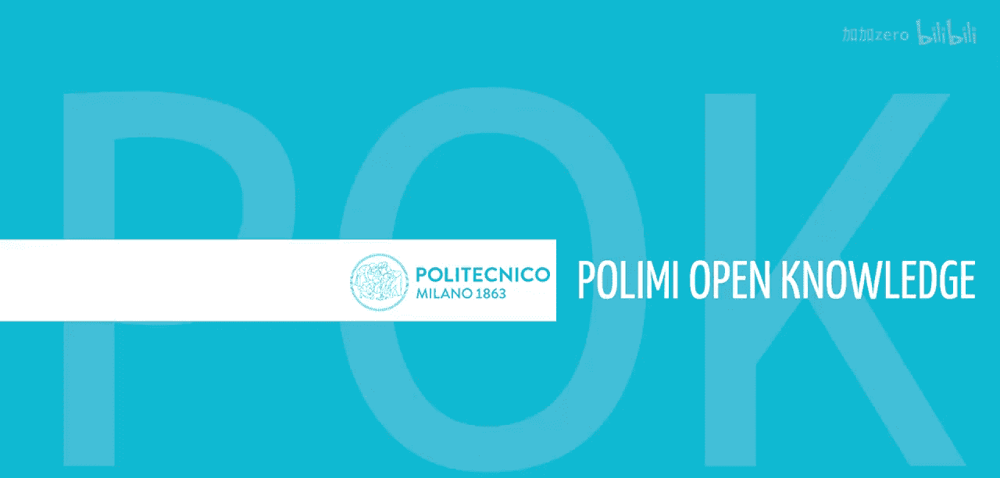
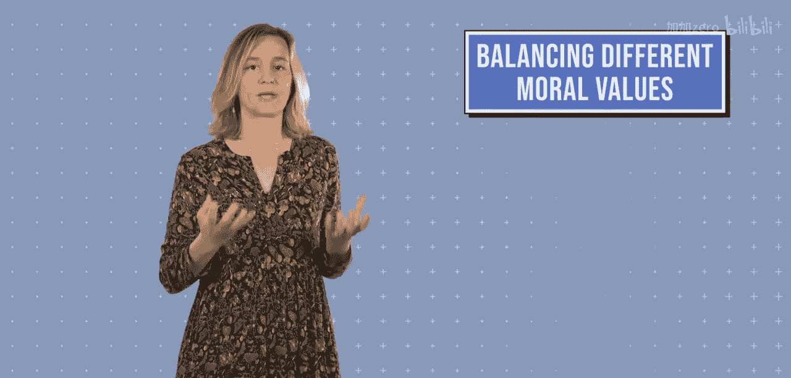

# 【人工智能：概述 专项课程】米兰理工大学—中英字幕 p34 p6_01_cybersecurity-and-ai -BV1Er1PYhE9q_p34-

Cybersecurity is a wide field， including the protection of personal information and of technological systems and people using them。

The goals of cybersecurity can be summarized using the a Chium CA， C stands for confidentiality。

 I for In， and A for availability of information。In other words。

 cybersecurity aims at assuring that information is exchanged to guarantee first confidentiality。

 so that information is accessible only to whom are authorized to access it， second integrity。

 so that any non-authorized change of information is denied and third availability so that information is always available to whom are authorized to use it and without any denial of service。

😊，But what is the ethical dimension of cyberse， What does security have to do with addicts？

The simpler answer is that it is wrong to gain access to systems1 is not authorizedized to access。

But there is something more that is worth stressing。 Security influences order。

This means that security measures， both technical and social shape computing environments。😊。

There are also other ethical dimensions of cybersecurity worth considering One is related to situations in which a human agent is responsible for the benefits and risk for other people who is to blame in security breaches。

 for example。If someone chooses not to take steps to protect a system from intruders。

Are they partially at least to blame when an intruder breaks in？

Another ethical dimension of cybersecurity is related to the problem of balancing different moral values。

 where not all them can be promoted。

Trade offs are often necessary and is important to determine in any situation which values led to the best trade off。

For example， a better solution in terms of integrity。

 such as the possibility for the system administrators to monitor all information。

Can raise risks in time of confidentiality because private information is exposed to individuals that do not have the right to access them。

On the contrary， solutions that guarantee high levels of both confidentiality and integrity can be very complex so as to reduce the usability of the system。

 as in the case in which out indicationcation is required to access the system。From this。

 it is clear that not every solution can guarantee the same level of confidentiality。

 integrity and availability of information。The problem of balancing different values is not only an individual one。

 but a social as well。A key question is the following， what should we allow as a society。

 our governments to do with respect to security？Think， for example。

 when the value of security comes into conflict with the value of privacy。

This is the case of the US Patriarch Act approved in 2001 after September 11 to grant the federal government broader power for electronic surveillance。

In 2007， the Justice Department found out that the FBI adding properly and in some cases illegally used the Patriot Act to obtain personal information。

In general， security shouldn't trump other values， but at the same time。

 we must recognize that it's critical to this smooth and reliable functioning of information societies。

😊，Here it is important to recognize that we don't have any simple rule to achieve the optimal balance。

😊，Every time the best trade off among different values should be considered。

 starting from the analysis of which the values at stake are。😊。

Another scenario in which ethical dilemmas can potentially arise is the so called ethical hacking。

Ethical hacking can be defined as the violation of cybersecurity with a pro social goal。For example。

 the case of a hacker attacking a system with the authorization of its own areas to test the security of the system itself。

Not all the cases of ethical hacking are so clearly defined from an ethical point of view。

 for example， think about the case of the search for vulnerabilities by researchers and how they can deal with the report of them in different ways。

😊，What hackers say in defense of their behavior can be sorted into four arguments。First。

 they claim that all information should be free， free is meant here both without cost and without restrictions due to ownership or censorship。

This claim is controversial。😊，Actually， if all information were free。

 there would be no market and no incentive to develop information。😊，Moreover。

 individuals couldn't have the right to keep some information private。Second。

 hackers claim that the attempts by hackers to break into computer systems are often beneficial because they illustrate security problems to subjects who can do something about them。

In other words， hackers break into systems for the sake of breaking in and not to steal or damage。

Here a metaphor can be used to show the problems of this claim。

The vigilantes have the right to attempts to break into houses in order to demonstrate that they are susceptible to thieves。

What is the ethical justification for using viruses， denial law of service attacks。

 or accessing private files as a means to get the problem fixed？😊，Third。

 hackers argue that gaining unauthorized access to computer systems causes no harm as long as the hacker changes nothing。

However， individuals can be harmed simply by the unauthorized entry that violates property rights and rights to privacy。

😊，Fourth， hackers claim they help to keep Big Brother at bay because they have the expertise to find out about illegal or immoral uses and abuses of IT。

The argument is correct in suggesting that the public needs protection against abuses and inappropriate use of information。

But whether hackers are the best form of protection seems another matter。

Cybersecurity is also important in the specific case of AI。

If we consider the document ethics guidelines for trustworthy AI produced by the high level expert group appointed by the European Commission。

There are several principles that need to be discussed with respect to cybersecurity。

Let's consider some of them。Let's start with the principle of prevention of harm。

 which is closer to the goals of cybersecurity。Any solution on protecting the wellbeing and rights of its users is not ethically appropriate。

 as we have seen this principle should be achieved in a balanced way not to compromise the usability of the system。

😊，Let's consider then the respect for human autonomy that can be violated， for example。

 in those cases of cyber warfare where human capabilities in recognizing attacks can be thell due to the increasing use of autonomous artificial systems。

😊，Let's see now the value of fairness， this can be violated when automatic decision systems are used to detect hacker attacks as these systems can be subjected to errors and have bias embedded into them。

😊，Let's consider finally the principle of explicability that acquired importance after the eventdvent of AI technologies based on machine learning techniques。

 producing results that are sometimes difficult to explain。😊。

A possible risk here is of having programs using these machine learning techniques so that a meaningful human control becomes impossible due to the lack of explicability。

In conclusion， cybersecurity presents different ethical challenges。

 both in general and specifically in the case of AI technologies。😊。

