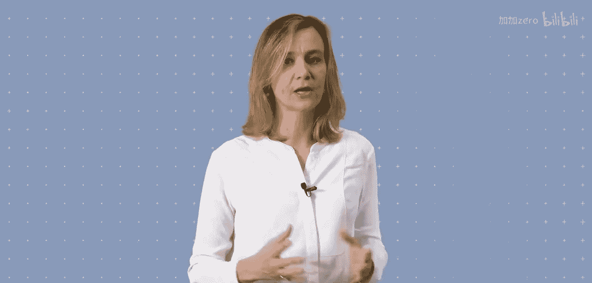

# 【人工智能：概述 专项课程】米兰理工大学—中英字幕 p37 p9_01_what-is-the-value-of-privacy-in-information-society-part-one -BV1Er1PYhE9q_p37-

This lecture discusses artificial intelligence and privacy because AI tools enable different forms of surveillance。

 and this affects privacy。Moreover， the privacy debate has co evolved with the development of information technologies。

In particular， information technologies configure societies are often characterized as surveillance societies。

 But first of all， what is privacy。Privacy is usually connected to the right to be left alone and can be meant into different ways。

 Constitutional or decisional privacy is the freedom to make one son's decisions without interference by others in regards to matter that are seen as intimate and personal。

For example， the decision to have an abortion。On the other side。

 thought or informational privacy is the interest of individuals in exercising control over access to information about themselves。

 For example， the information one decides to disclose on social media。

But why do we need to care about privacy？As the scholar Deborah Johnson suggests。

 this question can be further articulated into other questions， such as what is， if anything。

 the value of privacy， if privacy disappears， what will exactly be lost。

 what sort of beings do we become when we live in surveillance societies？

To better understand how the debate on privacy is shaped by the development of information technologies。

It is important to list the features of the current flow of information。

The first feature is related to scale。 much more personal information is collect nowadays。

 The reason is that electronic records are easy to create， store， maintain， manipulate。

 search and share。The second feature regards the type of information。

 actually new kinds of personal information are created， such as for example。

 the transaction generated information that is produced when we use our credit card。

The third element is a matter of the distribution of current information。

 given that personal information is distributed more widely。

Once information about an individual is recorded on a server， it can be bought and sold， given away。

 traded， or even stolen。The fourth element concern endurance。

 that is that information endures for longer periods of time。

 when information is stored electronically， there may be little incentive to get rid of it。

And finally， the first element concerns the effect of Erner's personal information that in this context is magnified。

 Erner's information may spread out so quickly that is impossible for an individual to track down all the places where it exists。

To understand the importance of privacy， it is useful to consider the arguments advanced by those who think that we need not to worry about intensive tracking and monitoring of behaviors。

They usually advance the following arguments。😊，First。

Privacy only protects people who have something to hide。 So if you aren't doing anything wrong。

 you should have no need to worry about being watched。Second。Privacy is overrated。

Those who live in I T con societies have in fact let privacy go and this evidence that privacy is neither valued nor valuable。

And third， the information that organizations gather about individuals has enormous benefits to the organizations that gather it。

 as well as to the individuals the information is about。😊。

Let's consider now possible objections to this argument。

 So to understand the value of privacy and its role。Let's say first。

 that is not true that privacy only protects people who have sent into hide and rather information can dramatically affect your life。

 even if you haven't done nothing wrong， it may result in you being denied benefit you are entitled to or subjected to a treatment you don't deserve just because。

 for example you are wrongly recorded in a police database， moreover。

 it might be the case that some information is inappropriate or unfair or even illegal for an organization to use in a particular context。

This is the case， for example， of the information passed on a social networking side and used by a company to make a hiring decision。

Let's discuss now why it is not true that privacy is overrated。

The fact that individuals readily give out personal information doesn't mean necessary that they don't value privacy or that privacy is invaluable。

Indeed， they may be naive or uninformed or maybe just wrong。And this is， for example。

 the case in which the choice is available to individuals when they opt to give out personal information may be constructed in such a way that individuals may choose against their own interests without knowing it。

Often， we are given only the choice to take the benefit in exchange for disclosure of information or not to get the benefit at all。

Let's see finally， why it is not always true that personal information gathering practices can be beneficial both through information gathering organizations and to their customers。

It can be the case that organizations use the information not to serve their customers。

 but to shape them， Moreoverover， it is also true that these organizations can use inappropriate information when to make decisions about individuals。

In conclusion， having discussed how the most important arguments against privacy can be criticized。

 we have listed different cases in which privacy is important。

 in particular in the context of information society。

