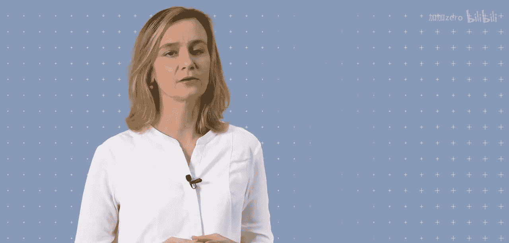
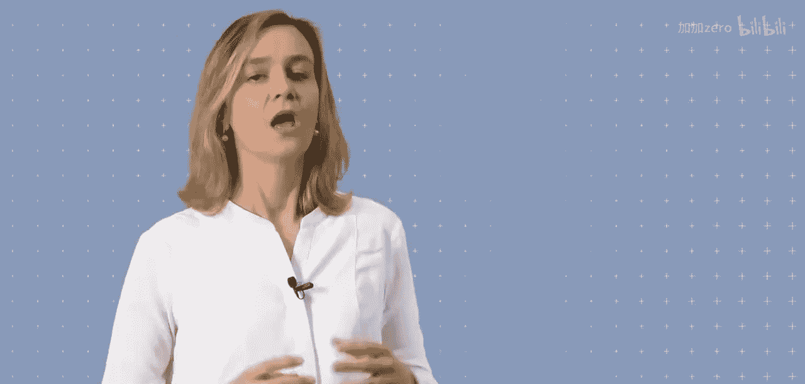
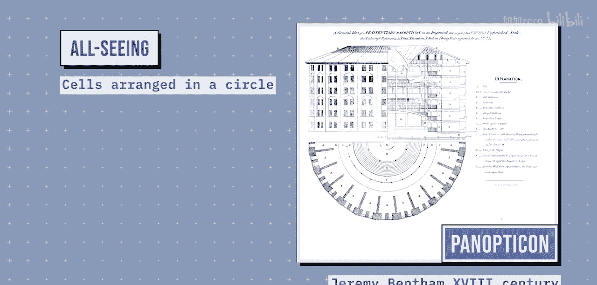
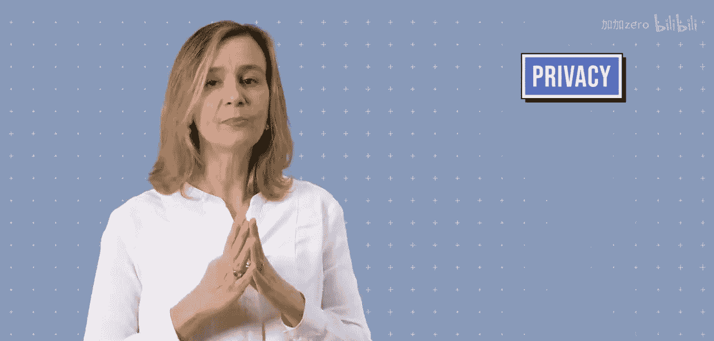
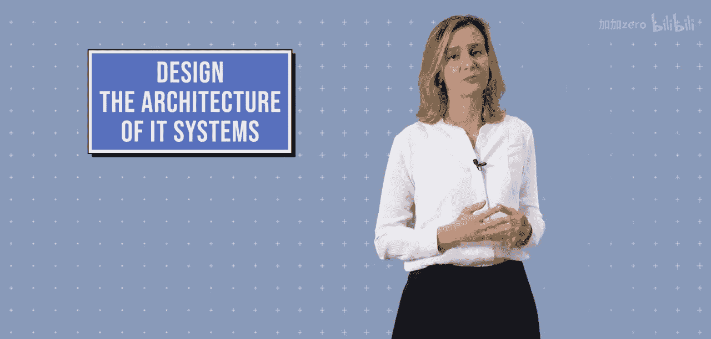
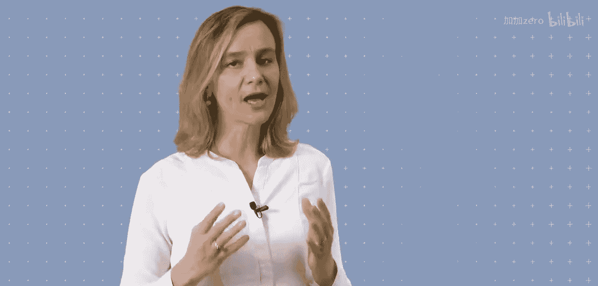
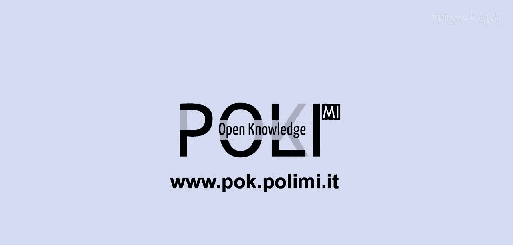

# 【人工智能：概述 专项课程】米兰理工大学—中英字幕 p38 p10_03_what-is-the-value-of-privacy-in-information-society-part-two -BV1Er1PYhE9q_p38-

Welcome back， we have discussed about privacy and surveillance societies this lecture now discusses the importance of privacy。

 both as an individual and a social good。

To understand this， it is fundamental to recognize how privacy is interwinned with data fundamental values。

 such as autonomy， equality and democracy。Let's see how privacy can be analyzed as an individual good。

As the ethicist James Ras recognized already in 1975 privacy plays an essential role for human relationships。

 for example， privacy is necessary to maintain a diversity of relationships indeed the kind of relationships we have with others is precisely a function of the information we have about each other if everyone had the same information about us we would not have a diversity of relationships。

However， when privacy frame exclusively as an individual good。

 an individual privacy is balanced against social goods， such as security or public health。

Personal privacy always loses。This is the case， for example。

 of the US Patrick Act that was easily approved after September 11th。

 even if it is introduced strong limitations to individual privacy。For this reason。

 the political scientist， Pricilla Rean， argues that privacy should be framed as a social good and not only as an individual one。

To better understand the value and role of privacy as a social good。

Let's introduce a metaphor usually mentioned in this discussion。

A number of information theorists have observed that living in an I T configured society is similar to living in a panopticum。

A panopon is a structure designed by the British philosopher Jeremy Benon in the 18th century to serve as a prison Panopticon means all seeing because prisoners live in cells arranged in a circle and the side of each cell is facing the inside of the circle and is made of glass。

 the guard tower is placed in the beetle of the circle so a guard standing in the guard tower can view every chamber but prisoners could not see the guard in the tower。

As long as prisoners believe they are probably being watched。

They will adjust their behavior and adhere to the norms they believe the guards want to enforce。

This metaphor of the panopticcon is often used to describe our current societies if much of what we do is recorded and likely to have future consequences in the way we are treated。

 then we have to consider our watchers and the norms whenever we act。

Here two different concerns arise the first one is the effect on our freedom meant as autonomy。

 the second one is related to who are our watchers and how have they selected the norms of behavior by which they evaluated us。

The lack of privacy therefore effects on democracy and not only on the diversity of relationships。😊。

The idea of democracy is that citizens have the freedom to exercise their autonomy。

Democracy hence requires citizens capable of critical thinking and freedom。

The problem here is not just that we are being track and monitored。

The problem is that the norms by which we are measured。

 evaluated and treated are often not subject to public discussion and negotiation。

They are invisible to the individuals being watched， evaluated and treated。

All this given importance of privacy cannot be underestimated。

 and the public debate around the impact of AI should fully include a discussion about privacy。

 both as an individual and as a social good。

This debate should be accompanied by a number of strategies to deal with it。

 and it should be recognized that it includes different stakeholders such as regulators。

 policymakers， citizens， companies， professional associations and computer scientists and engineers。

For example， professional associations should formulate called soads and conduct that promote fair practices to deal with information。

Another example is how regulators and policymakers should push for the adoption of transparent policies by companies one of the reasons why consumers and clients are so complained when it comes to their privacy is that they are mostly unaware of information practices。

Given how little information consumers， clients and citizens have about information practices。

 the opt out strategy seems unfair。If not deceptive。

 if organizations cannot use personal information about us unless they get our permission。

 then they have to inform us of their practices and convince us that we want to opt in。😊。

Another example is how important it is to design the architecture of IT systems in a way that they can protect privacy。

 such as in the case of the socal privacy by design。

This can make a big difference in what kind of data is collected and how it flows from place to place。

In conclusion， these are the reasons why not only computer scientists and engineers。

 but also everybody should become aware of the centrality of privacy and its impact on our individual lives and on our democratic societies。

