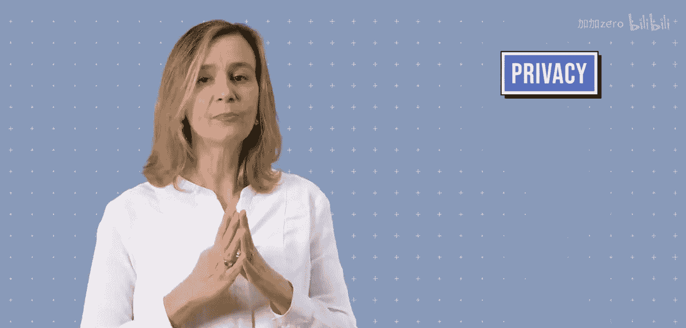
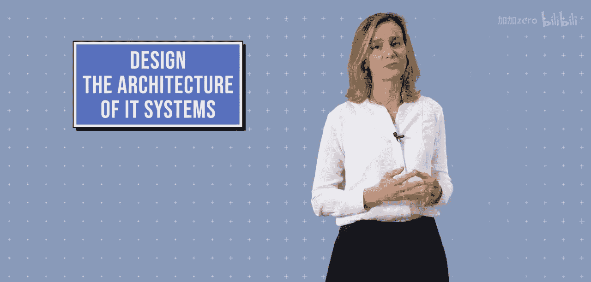
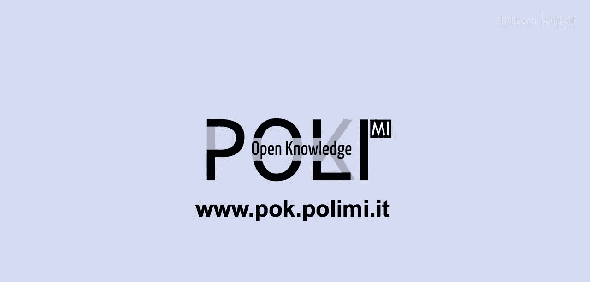

# 人工智能：概述 专项课程：第38讲：信息社会中隐私的价值（第二部分）🔍

在本节课中，我们将深入探讨隐私的重要性，不仅将其视为个人利益，更将其视为一种社会公益。我们将分析隐私如何与自主权、平等和民主等核心价值交织在一起，并探讨在人工智能时代保护隐私的策略。

---

上一节我们讨论了隐私与监控社会，本节中我们来看看隐私作为个人利益和社会公益的重要性。

要理解这一点，关键在于认识到隐私如何与数据的基本价值（如自主权、平等和民主）紧密相连。

首先，让我们看看如何将隐私分析为一种个人利益。

正如伦理学家詹姆斯·拉斯早在1975年就认识到的，隐私在人际关系中扮演着至关重要的角色。例如，隐私对于维持多样化的关系是必要的。我们与他人的关系类型，恰恰取决于我们彼此掌握的信息。如果每个人都拥有关于我们的相同信息，我们就无法拥有多样化的关系。

然而，当隐私被仅仅框定为一种个人利益时，个人隐私就常常需要与安全或公共卫生等社会公益进行权衡。

在这种情况下，个人隐私总是处于下风。例如，美国《爱国者法案》在9/11事件后轻易获得通过，即使它对个人隐私施加了严格的限制。

正因如此，政治学家普里西拉·里根主张，隐私应被框定为一种社会公益，而不仅仅是个人利益。

---

为了更好地理解隐私作为社会公益的价值和作用，让我们引入一个在此讨论中常被提及的隐喻。

一些信息理论家观察到，生活在信息技术配置的社会中，类似于生活在一个“全景监狱”中。

全景监狱是由英国哲学家杰里米·边沁在18世纪设计的一种监狱结构。“全景”意味着“全视”，因为囚犯住在呈圆形排列的牢房里，每个牢房的一侧面向圆形内部，并且由玻璃制成。守卫塔位于圆形的中心，因此站在守卫塔中的守卫可以查看每个牢房，但囚犯却看不到塔中的守卫。

只要囚犯相信他们可能正在被监视，他们就会调整自己的行为，并遵守他们认为守卫想要执行的规范。

全景监狱的隐喻常被用来描述我们当前的社会。如果我们所做的大部分事情都被记录，并可能对我们未来的待遇产生影响，那么我们在行动时就必须考虑我们的监视者及其规范。

这里产生了两个不同的关切：第一个关切是对我们自由（即自主权）的影响；第二个关切则与“谁是我们的监视者”以及“他们如何选择用以评估我们的行为规范”有关。

因此，隐私的缺失不仅影响人际关系的多样性，更影响民主。民主的理念在于公民拥有行使自主权的自由。因此，民主需要具备批判性思维和自由的公民。

这里的问题不仅仅在于我们被追踪和监控。问题在于，用以衡量、评估和对待我们的规范，往往未经公众讨论和协商。这些规范对于被监视、评估和对待的个人而言是不可见的。

鉴于以上所有原因，隐私的重要性不容低估。围绕人工智能影响的公共辩论应充分包含对隐私的讨论，既包括其作为个人利益，也包括其作为社会公益的层面。

---

这场辩论应伴随着一系列应对策略，并且应认识到它涉及不同的利益相关者，例如监管机构、政策制定者、公民、公司、专业协会以及计算机科学家和工程师。

以下是应对隐私挑战的一些策略示例：

*   **专业协会**：应制定行为准则，倡导处理信息的公平实践。
*   **监管机构与政策制定者**：应推动公司采用透明的政策。消费者和客户在隐私问题上如此顺从的原因之一，是他们大多不了解信息处理实践。
*   **关于“选择退出”策略**：鉴于消费者、客户和公民对信息处理实践知之甚少，“选择退出”策略似乎不公平，甚至具有欺骗性。如果组织未经我们许可不能使用我们的个人信息，那么他们就必须告知我们他们的做法，并说服我们选择加入。
*   **系统架构设计**：以能够保护隐私的方式设计信息技术系统的架构至关重要，例如“通过设计保护隐私”的理念。这能在收集何种数据以及数据如何流动方面产生巨大差异。

---

本节课中，我们一起学习了隐私的双重价值。我们了解到，隐私不仅是维护个人人际关系多样性的关键，更是民主社会赖以生存的基石，它保障了公民的自主权和自由。隐私的缺失会导致无形的规范支配社会，削弱民主。因此，不仅是计算机科学家和工程师，每个人都应认识到隐私的核心地位及其对我们个人生活和民主社会的深远影响。应对这一挑战需要多方利益相关者共同努力，从制定行业准则、推动政策透明化，到在技术设计中嵌入隐私保护理念。