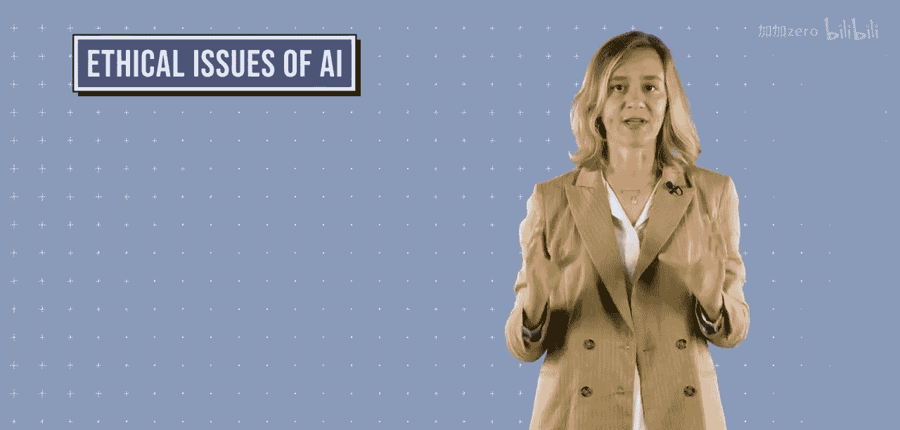
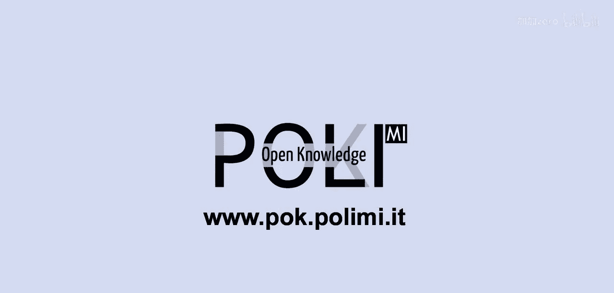

# 【人工智能：概述 专项课程】米兰理工大学—中英字幕 p41 p13_01_ethics-of-ai-a-paradigmatic-change -BV1Er1PYhE9q_p41-

We have seen that the ethics of artificial intelligence is a wide and expanding field。

Many new topics are emerging from the sustainability of AI to digital medicine。

 together with some more traditional ones such as privacy related issues or the problem of responsibility for autonomous systems。

What emerged as a common element is that ethical issues of AI cannot be solved only by technical means。

They require a socio technicalchical perspective that means integrating the technical solutions into broader。

 ethical and social frameworks。😊，This requires a radical shift in the current paradigm and involves different stakeholders。

 First， a designer of AI technologies cannot simply inscribe a desired form of morality into an artifact。

They need to anticipate the future mediating role of technologies， also by using moral imagination。

Second， users and citizens need to be aware of who decides which are the values to be embedded into AI technologies。

And finally， policymakers have to intervene not only a posterii to regulate already existing technologies。

 but to co shape them and promote an open public debate。In conclusion。

 it is important to reaffirm that ethics is not a manual with answers， neither a checklist。Rather。

 ethics is a process and a complex one indeed。It reflects on questions and arguments concerning the moral choice people make。

 and for this reason， it cannot be unocally determined。

Ethics requires ingenuity and moral imagination so as to increase our ability to cope with moral problems。

😊。

