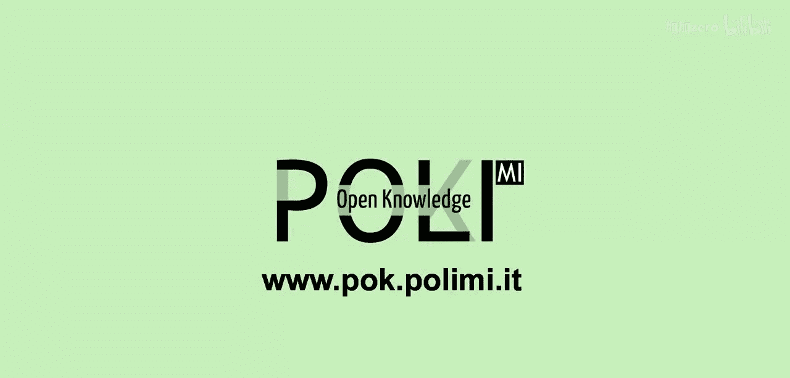

# 【人工智能：概述 专项课程】米兰理工大学—中英字幕 p42 p0_01_artificial-intelligence-and-law-introduction-and-general-overview -BV1Er1PYhE9q_p42-

🎼。Artificial intelligence due to the transversal nature of its possible application and its potential aptitude to increase and improve productivity while reducing costs appears today as one of the most promising technologies of our times。

 one of the enabling factors of what is considered as a new industry revolution the industry 4。0。

Recent developments in AI and related solutions such as the machine learning have radically changed not only the IT environment。

 but also everyday life， just think of the drones that makes deliveries or the self driven cars。

There are also areas such as retail in which AI already has multiple concrete but imperceptible applications that help repercussion on our customer experience。

 both online and in stores while improving margins and overall efficiency of the supply and demand。

This revolution inevitably also brings audit reflections on the regulatory and social fields。

 creating a new legal gaps to be filled and challenges that only a few decades ago seemed to belong to a distant future。

In the face of the countless benefits expected from the development of AI。

 it is undeniable that the use of form of robotics and intelligence systems also brings with it a series of risks that are essential to foring and monitoring。

Just to name a few an illegitimate compression of the privacy sphere of individuals due to the pervasiveness of technologies。

 the risk that intelligent systems， which result from the programming by human beings。

Inherit the cognitive biases of the humans and therefore make choices that may be discriminatory。

 The possibility that the availability of big data in the end of a few companies may favour the creation of new monopolies or be a source of distortion of competition on the market。

Or the risk that an extreme profiling of the choices of individuals may select and filter the content information to be proposed to each of them up to compromising their freedom of choice and their ability to selfdeter。

Added to this is the need to regulate specific issues related to the use of AI， such as， for example。

 the allocation of liability for conduct of intelligent machines that are not always predictable or controllable by humans。

 or the applicability of intellectual property legislation to the world of AI。

 both issues that are not easily solve in the light of the existing categories and legal principles and that now require the adoption of a specific legislation on the subject。

To date， in fact， there is no specific legislation addressed to regulate the use of artificial intelligence systems。

 nor the consequences deriving on a civil and criminal level。

 respectively from harmful events or offenses dependent on or connected to their use。

The legal effects and legal problems related to the design。

 production and use of these new technologies are therefore to be included in the context of current legislation and to be resolved on the basis of the existing legal categories and principles。

Similarly， for the protection of intellectual and industrial property related to the design and creation of intelligent systems and the outputs deriving from their views。

 reference will be made to the legislation on copyright and the industrial property code。Finally。

 to settle the issues relating the complex matter of the processing of personal data and the protection of rights and freedoms of the data subject。

 the reference regulatory framework is now constitute by the new European regulation number 6792016。

 so-called GDPR， which while never making explicit and specific reference to new technologies。

 moves precisely from the premise of adapting the subject of the processing and protection of personal data。

 to the current technological context， also and above all for the risks associated with innovation and to the pervasiveness of the most advanced instrument regarding the intimacy and the personal sphere of individuals。

Precisely in order to create a common and uniform framework within the European Union on April 21。

 2021， the European Commission presented the draft of the future European regulation on artificial intelligence。

 which will be the first regulatory Act adopted in Europe in this field with the aim of mitigating and managing the risk associated with the use of intelligence systems without ining their development and diffusion。

In this course， we will try to give an overview of the main legal issues related to the production and use of artificial intelligence technologies。

 trying to give a framework and answers in the light of current legislation election and the proposed regulation requested by the European Parliament and issued by the Commission。

In particular， in week two， we will address the issue of civil and criminal liability deriving from the conduct carried out in full autonomy by intelligent systems。

If artificial intelligence makes a wrong decisions and causes damage。

 who compensates for this damage？If it commits a crime who should be held responsible。

 these are some of the questions we will try to answer。In victory。

 we will address the issue of the protection of artificial intelligence in the light of the legislation on intellectual property。

 we will see why it is important to protect the intellectual property of a company。

 what are the rights that the law attributes to the order of an intellectual work of a creative nature as the software that underlies intellectual systems must be considered and if and under what conditions a technology based on artificial intelligence can be patented。

😊，Finally， we will try to understand who owes the intellectual property rights of works created independently by AI。

 such as work of art， musical pieces， poems， pieces of journalism， literary works， and so on。Finally。

 we will address the issue of the risks to fundamental rights and freedoms that could derive from the use of AI。

We will talk about alcracy， algorithmic bias and the risk of discrimination。

 we will also try to understand what the GDPR provides with respect to the use of intelligence technologies based on automatic profiling and what are all the formalities step by step required by the legislation to produce and implement intelligent technologies that comply with the regulations。

