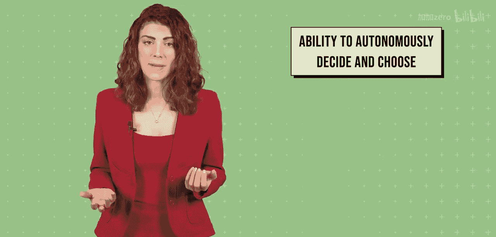

# 【人工智能：概述 专项课程】米兰理工大学—中英字幕 p44 p2_01_the-existing-legal-framework-on-civil-liability -BV1Er1PYhE9q_p44-

🎼。We previously saw how fundamental is the issue of identifying who should compensate for the damage caused by an AI system in this lesson we are going to frame the existing applicable rules to a harmful event in which an intelligence system is involved。

First of all， it must be premised that when it comes to civil liability。

 we have to keep in mind that such a liability may be contractual and noncontractual。

 the first one presuposes the existence of a contractual relationship between two parties and occurs when one of the two is in breach with respect to the obligations infer in the contract。

The second one does not require the necessary existence of a contract。

 but derives from a general principle of the legal system， the principle of the letter。

 which means that in ordinary life activities， care must be taken not to cause unjust the damage to others。

 whoever causes unjust the damage to others， whether intentionally or negligently is liable for it and is therefore required to pay compensation。

Of course， platforms forms or liability can be configured in relation to the use of intelligent systems。

 sometimes even being able to overlap with reference to the same harmful event。Let's make an example。

 if something jams in the operating system of an autonomous driving car and its user suffers damage。

 then the liability that the user can assert towards the car manufacturer will be contractual。

IfHowever， as a result of such a defect， the car impacts another vehicle causing material damage to a third party。

 the owner of the car will be liable to the letter for non contractual damage。Given the above。

 there is to date no Italian or European legislation that specifically regulates the use of artificial intelligence systems and the legal consequences deriving from the conduct of robots。

However， there is a legislative framework applicable to AI systems considered as products。

I'm referring in particular to two legislative frameworks。

 the first one consists of the regulations governing the general safety of products which imposes specific safety requirements for each product placed on the market and intended for consumers including products used in the provision of services。

 such could be， for example， as MA assistant which is a product through which various continuous services can be provided over time by the manufacturer。

The second legislative framework is the legislation that regulates liability for defective products based on the principle that in the event of damage to the user and to the third parties。

 caused by manufacturing defects， the producer is strict liable regardless of elements fault in its conduct。

😊，We have to underline that according to European legislation。

 the term producer means the manufacturer of a finished product。

 the producer of any raw material and the manufacturer of a component part and any person who by putting his name。

 trademark or other distinguishing feature on the product presents itself as a producer。

By accepting and applying a similar definition to the production of artificial intelligence systems。

 we could arrive at a affirming the strict responsibility not only of the producer of the finished system。

 but to also the producer of a simple component such as the developer of the software。

 or even of the only algorithm underlying the system。😊，However。

 the regulation of producer responsibility only succeeds in resolving cases where the intelligence system is considered as a product that is an object。

 but does not help in cases where the system acts as an agent。Also， in this case。

 let's make an example that clarifies the concept。It is relatively simple to say that the damage caused by a radio controlled drone should be compensated by the person who commands it or who has built it in a defect way。

 this is what the law currently provides。But much more difficult is to apply the same principle of responsibility instead of the damage caused by radio control at the drone。

 to the damage caused by a drone controlled by an artificial intelligence。

 autonomous driving system that to decide which trajectory to follow in order to reach a determined objective。

 which movements to execute， and up to which point to expose or not to expose risk things or people in the movement area。

In addition， the complexity of AI systems and their connectivity required that several subjects in addition to the producer are involved in their design and operation。

Upon a careful analysis， it's easy to see that in a case of damage， many subjects could be involved。

 for example， the creator or the ideator or the algorithm， the programmer， the producer。

 the user of the system， its owner and so on， but the current legislation does not allow for a certain answer to the question of who should compensate for the damage caused by a wrong decision of the AI。

To return to the example of the intelligent drone， it's no easy to establish with certainty whether the damage procured by it is attributable。

 for example， to the producer or rather to its owner。In fact。

 the ability of the intelligence system to autonomously decide and choose。

 not according to predetermin instructions， but in a way that could evolve on the basis of the interaction of the AI with the external environment could give rise to unpredic or inevitable conduct。

 in any case such as to break the link of strict causality between the conduct of the programmer or user of the AI system and the harmfulful event。

In essence， in some cases， it might not even be possible to attribute specific harmful action of AI systems to a specific human input or design decisions。

The inadequacy of current legislation to guarantee compensation for damages could on the one end。

 discourage consumers from buying and using AI goods and services， and on the other end。

 discourage investment does holding back the development of the sector。

This is why the issue of liability has been strongly discussed for years today it appears necessary and urgent to reform the current regulatory system。

 both at the European and Italian level to adapt it to the new technologies while at the same time standardizing the legislation of all member states to facilitate cross borderor trade and the European single market。

🎼Oh。

