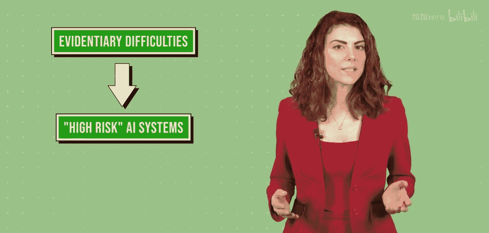
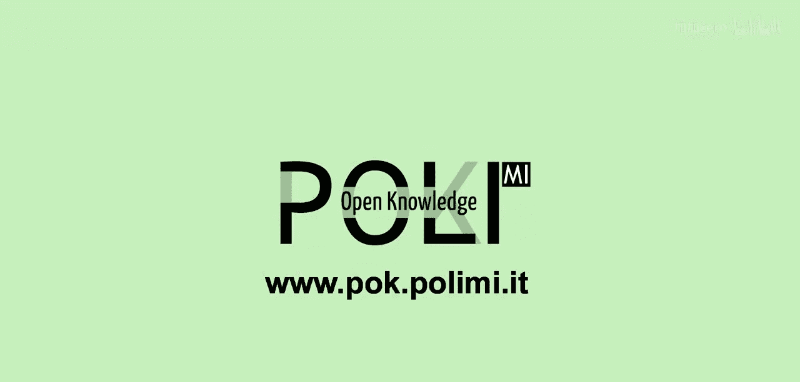

# 【人工智能：概述 专项课程】米兰理工大学—中英字幕 p45 p3_01_liability-on-the-production-and-use-of-the-intelligent-systems -BV1Er1PYhE9q_p45-

🎼。We saw in the past lessons that the current legislation liability for damages caused by AI systems is still incomplete and not always adequate to solve the issues related to this topic。

For this reason with its resolution of October 20， 2020。

 the European Parliament has requested the commission to develop and submit to the legislative process。

 a draft to law establishing a specific liability regime for a artificial intelligence。

 we will try to identify what the main points of this resolution are。

The resolution starts from the assumption that a legal framework in this matter must have two purposes。

 first to ensure the effective and fair protection of potential victims of damage， and second。

 to ensure sufficient freedom of action for companies in the development of new technologies。

The realization of these objectives， in fact， will help to increase the confidence of users on the one end and to provide the stability for investment。

 On the other end， this can also better contribute to the growth of startup ups and small and medium sized companies that are primarily concerned with these technologies。

According to the European Parliament， however， the objective of uniform legislation must be pursued without removing the regulations currently in force。

 in particular the regulations on product liability must not be deleted but updatedd with respect to new technologies and supported by the new provisions on AI systems。

In addition， the European Parliament recognizes that although it is preferable to provide for sectoral disciplines for each area of relevance。

 it is in any case appropriate to provide foreign unitary regulation for all sectors involved in AI systems and therefore to formulate common principles。

The main problem to be solved for the regulational liability for damages caused by AI systems is to establish who can be held responsible for the activities carry out by AI systems this is a problem that affects several levels because there are several operators who can be involved from the design phase of the technologies up to the subsequent phases of execution。

 control and maintenance the situation becomes more complicated in cases of automatic decision making processes where a user initially delegates a decision in part or in full to an entity using software or a service or in cases where the activity of an AI system is closely linked to other systems。

 AI or not independent dependent on them Just think for example。

Of the damage caused by a car with automatic driving。

 which has left the road because the software of the navigator has suggested a wrong move。Moreover。

 the resolution inequivocally clarifies that AI systems cannot be considered as entities with legal personality。

 in other words， its to be excluded that the AAI system alone can be responsible for damage。

The European Parliament deems that the most appropriate solution is to all the jointly and several liable audio operators who created or maintained the risk situation and who should have minimized it exemptant and therefore have to compensate it exposed。

These are the subjects who have control of the AI systems and who have been involved in the value chain or creation of the AI system。

 therefore they will have to be responsible in proportion to the degree of control that teach of them as over the AI system。

On this point， it is the same resolution that compares the operator of an AI system to the owner of a car。

He will therefore be liable in proportion to the control he and exercise over it。However。

 having identified who is liable， it must be understood in what way they are liable。

 especially considering the fact that there are many sectors in which AI systems may be deployed in accurate assessment of liability will need to consider the specific risks in that sector。

 for example， it is clear that the use of AI systems in medicine may involve greater risk and therefore liability than in purely economic relationships。

In addition， it must be taken into account that very often doesarmed by an AI system may not even be aware of them。

Think of an AI system operating in a public space， for example， a square。

Victims of arm may not have any relationship， not even a contractual one with the operators of an AI systems and therefore would be forced to prove that they have suffered the harm through the negligence of parties with whom they have not established any relationship。

Think again of the case of a car driven by an a system。

 the pedestrian hit by this car has no relationship with the owner of the car， its manufacturer。

 maintainer， and so on， however， he has suffered an injury。

How will he be able to prove the negligence of any of these parties？

In order to overcome the evidentary difficulties of the victims of the damage caused by AI systems。

 the resolution introduces the concept of high risk AI systems。In particular。

 AI systems are high risk when they operation SA AI potential to cause damage to one or more persons in a way that is accidental and beyond what can reasonably be expected。

Therefore， to this end， the European Parliament suggests to specify within a list what must be meant by high risk systems。

 distinguishing according to the cases， what must be proved to identify the liability of the operators。

For eye risk AI systems， liability will be strict， it will not be necessary to demonstrate any profile of negligence by an operator。

 the operator will be held liable for the me connection in terms of risk control that he with the AI system。

For AI systems that are not high risk， liability will be assessed insofar as there is negligence by the operator in controlling the risk itself。

 which in any case is presumed， therefore it will be up to the operator to overcome this presumption。

 and demonstrate that he has always been diligent。Therefore。

 having established who and in what way is liable for the damages suffered。

 what are the legal measures provided by the resolution to protect both users and operators？

In order to define the protection of victims of harm， but at the same time。

 not to indefinitely expose operators of AI systems。

 the European Parliament identifies in particular to measures first。

 the provision of economic caps to be respected establishing the amount of the compensation which in the most serious cases may reach up to 2 million euros。

Second， the provision of an insurance coverage for all operators。

 at the least in the case of high risk systems suitable to cover even the most serious damages and in compliance with the CAP established by law。

However， in order to cope with large amounts of compensation。

 the resolution does not exclude the possibility that it might be appropriate to set up a fund in each member state to recover damages in excess of the established caps。

In addition， the resolution proposed to establish time limits for exercising the right to compensation。

 which in the most serious cases may extend up to 30 years。Finally。

 in order to facilitate contacts between producers based outside the EU and operators。

 each producer of AI systems may designate an European representative for the liability in AI matters。

As is evident， the resolution proposed to guarantee a reference discipline regarding the damage caused by AI。

A discipline that is currently absent and which however， if adopted。

 will have to be combined with specific provision designated for each risk sector。

