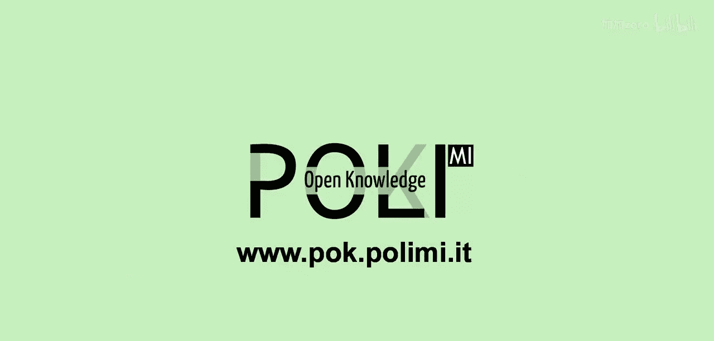

# 【人工智能：概述 专项课程】米兰理工大学—中英字幕 p47 p5_01_the-protection-of-intelligent-systems-in-the-light-of-copyright -BV1Er1PYhE9q_p47-

🎼。Why protecting the intellectual property also said the IP is so important for a company。

Intellectual property rights constitute an important corporate asset for all types of companies to cultivate and protect as the value of companies today is mainly represented by intangible assets such as trademarks。

 patents， design models， industrial design， software programs， NoA and so on。In other words。

 IP is an important part of a company's wealth and a way of preserving its competitive advantage in the market。

😊，Inventors， scientists， computer programmers and businesses put a lot of time， money。

 energy and so into developing their innovations and creations to encourage them to do that。

 they need the chance to make a favorite term on their investment That means giving them rights to protect their intellectual property。

 essentially， intellectual property rights， such as copyright patents and trademark。

 allow creators or owners of IP to benefit from their work or from their investment in creation by giving them control over how their property is used At the same time。

 the law provides them with some legal actions， to protect themselves from any abuse by person not author to exploit such works。

So what rights do those who create and produce systems based on AI technology have。

Typically the software that underlies an intelligent system is protected under copyright law。

 but as we will see later， it is generally not patentable copyright or authors write is a legal term used to describe the rights that creators of intellectual works of creative nature have on their own works copyrightpy covers an enormous range of work such as those that belong to literature。

 music， figurative arts， architecture， theater and cinematography。

Copyright covers also computer programs which are equated to literary works and are protected for their expressive form。

 I。e for the way their source code is written and not for their functionality， I。e。

 for what they do and for the idea that is the basis of the software。

Copyright includes both economic and moral rights， essentially economic rights involve the right to exploit the work for economic benefit。

 to modify it or to distribute it， in other words， a copyright owner such as a software author maybe be。

Can stop anyone from copying or using its work without permission， including， for example。

 by creating new unauthorized copies of the program or by modifying or revotlving the source code。

How exactly the owners may enforce these rights will depend on the national laws of the country concerned。

 but normally for copyright infringements， laws provide a mixture of civil remedies in particular in the form of obligation to compensate for damage and criminal penalties。

Copyright also includes certain moral rights of the creator， including among others。

 the right to be acknowledged as the author of a work and to prevent it from being altered in a way that might damage the creator's reputation。

The peculiarity of copyright， which distinguishes this protection from that granted by the patent is that it arises as soon as the work is created。

 this means that at the very moment in which the source code of software program is written at that moment its author is recognized as such by the law。

 and as copyright without the need for any formality or registration to gain the protection。

Moral rights are perpetual， which means that the author of a work will be recognized as such forever。

 even after is death， they cannot be transferred， nor can they be renounced。 on the contrary。

 economic rights have a limited duration in time， for example， in Italy。

 they last for the entire life of the author， and for 70 years after is death。

 after which they are extinguished， they can also be assigned I。e。

 they can be transferred to third parties。Furthermore。

 economic rights that the law attributes to the authortter are many and all independent of each other。

This means for example， that I can choose to give a third party the right to use the program in a certain number of copies or according to certain conditions。

 reserving the exclusive right to modify the program and therefore to prohibit the modification of the source code by third parties。

 likewise， I can， for example， grant third parties the right to modify the program。

 but re the right to distribute the program to the public and so on。

Since economic rights are transferred through contracts。

 great attention will have to be paid to how intellectual property is regulated when regulating a contractual relationship involving rights in software and intelligence systems whose development is protected by copyright。

For example， when a developer transfers some rights of economic exploitation to a company that produces intelligent systems。

 it is good that the contract regulates in detail the conditions under which this transfer takes place which rights the company acquires and which rights remain in the end of the author of the software。

Finally， it should be considered that intellectual property。

 noau and trade secrets that have commercial value for a company can be protected indirectly。

 also through contractual provisions that impose specific confidentiality or non-compet obligations on all third parties who become aware of information to be considered privileged。

