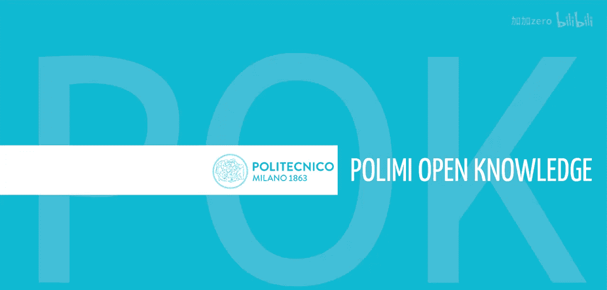
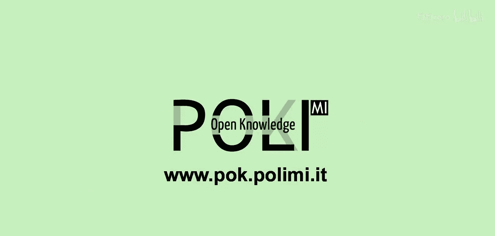

# 人工智能：概述 专项课程：第5章：智能系统的版权保护

## 概述

在本节课中，我们将要学习知识产权保护对于公司的重要性，并重点探讨基于人工智能技术的系统如何受到版权法的保护。我们将了解版权的核心概念、权利内容及其与专利保护的区别。

---

## 🎼 知识产权的重要性

知识产权对于所有类型的公司而言，都是一项需要培育和保护的重要资产。当今公司的价值主要体现在无形资产上，例如商标、专利、设计模型、工业设计、软件程序、商业秘密等。换言之，知识产权是公司财富的重要组成部分，也是保持其市场竞争优势的一种方式。

发明家、科学家、计算机程序员和企业投入了大量时间、金钱和精力来开发他们的创新和创造。为了鼓励这种行为，他们需要有机会从其投资中获得回报。这意味着赋予他们保护知识产权的权利。

本质上，版权、专利和商标等知识产权，通过让创作者或所有者控制其财产的使用方式，使他们能够从其工作或创作投资中获益。同时，法律为他们提供了一些法律行动，以保护自己免受未经授权利用此类作品的人的侵害。

---

## 😊 人工智能系统的权利归属

那么，那些基于人工智能技术创造和生产系统的人拥有哪些权利呢？

通常，智能系统底层的软件受版权法保护，但正如我们稍后将看到的，它通常不能申请专利。版权或作者权是一个法律术语，用于描述具有创造性的智力作品的创作者对其作品所拥有的权利。

版权涵盖范围极广，包括文学、音乐、造型艺术、建筑、戏剧和电影摄影领域的作品。

版权也涵盖计算机程序，它们被等同于文学作品，并因其表达形式（即其源代码的编写方式）而受到保护，而非因其功能性（即它们能做什么）或作为软件基础的思想。

---

## 版权的核心内容

版权包括经济权利和精神权利。

本质上，经济权利涉及为经济利益而利用作品、修改作品或分发作品的权利。换句话说，像软件作者这样的版权所有者，可以阻止任何人在未经许可的情况下复制或使用其作品，例如，包括创建新的未经授权的程序副本，或修改、重新编译源代码。

所有者如何具体执行这些权利，将取决于相关国家的国内法。但通常对于版权侵权，法律会提供民事救济（特别是以赔偿损失义务的形式）和刑事处罚的混合措施。

版权还包括创作者的某些精神权利，其中包括被承认为作品作者的权利，以及防止作品以可能损害创作者声誉的方式被篡改的权利。

---

## 版权与专利的区别

版权保护的一个独特之处，使其区别于专利保护，在于它在作品被创造出来的那一刻就自动产生。这意味着，在软件程序的源代码被编写出来的那一刻，其作者就被法律承认，并自动获得版权保护，无需任何形式或注册手续。

精神权利是永久性的，这意味着作品的作者将永远被承认，即使在其去世后。这些权利不能被转让，也不能被放弃。

相反，经济权利具有时间限制。例如，在意大利，它们持续于作者的整个生命周期，并在其去世后延续70年，之后权利即告终止。经济权利也可以被转让，即可以转移给第三方。

此外，法律赋予作者的经济权利有很多，且彼此独立。这意味着，例如，我可以选择授予第三方在一定副本数量或特定条件下使用程序的权利，同时保留修改程序的专有权，从而禁止第三方修改源代码。同样，我也可以授予第三方修改程序的权利，但保留向公众分发程序的权利，等等。

---

## 合同中的注意事项

由于经济权利是通过合同转让的，因此在规范涉及软件和受版权保护的智能系统开发的权利的合同关系时，必须高度关注知识产权的规定方式。

例如，当开发者将某些经济利用权转让给一家生产智能系统的公司时，合同最好详细规定转让发生的条件、公司获得哪些权利，以及哪些权利最终仍保留在软件作者手中。

---

## 间接保护方式

最后，应考虑的是，对公司具有商业价值的知识产权、商业秘密，也可以通过合同条款进行间接保护。这些条款可以对所有获知应被视为机密信息的第三方，施加特定的保密或竞业禁止义务。

---

## 总结

本节课中，我们一起学习了知识产权保护对公司的重要性，并深入探讨了版权如何保护人工智能系统底层的软件。我们明确了版权自动产生、涵盖经济与精神权利、且与专利保护有本质区别。同时，我们也了解了在商业合作中，通过合同明确约定权利归属与转让条件至关重要。