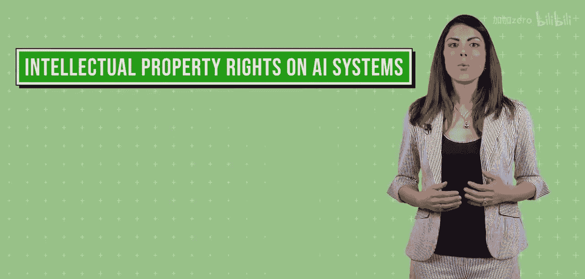
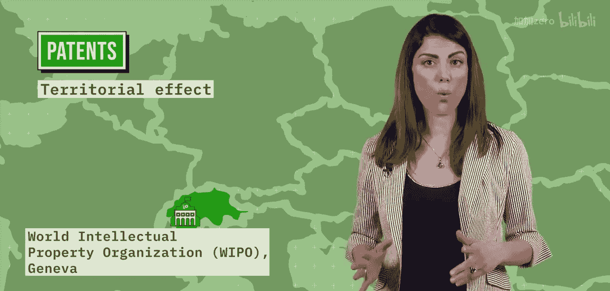
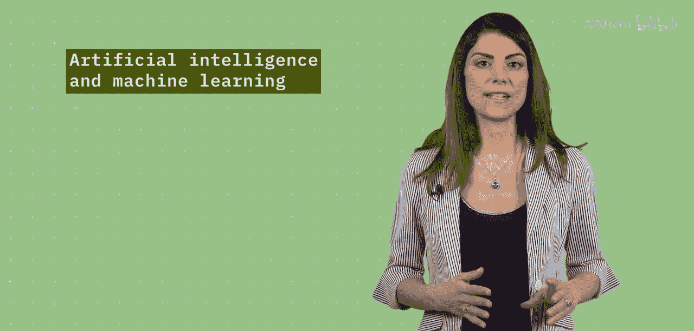
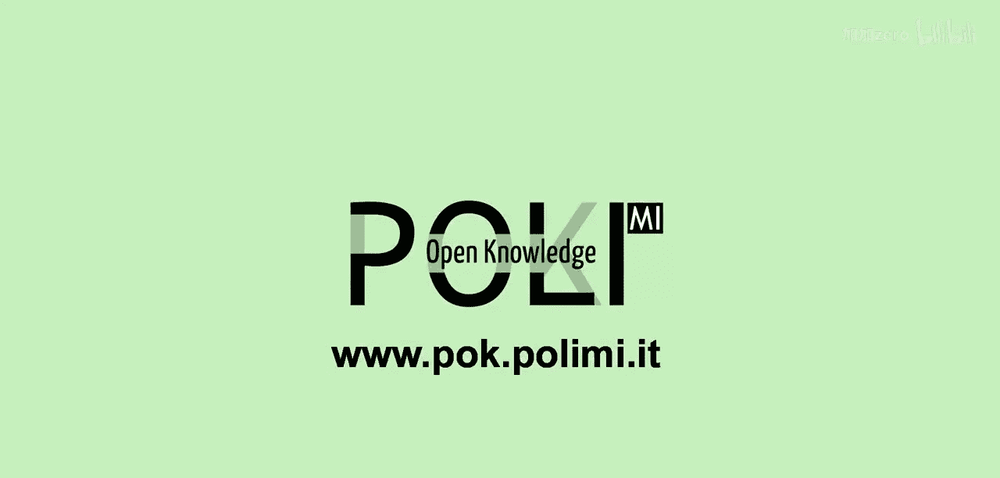

# 【人工智能：概述 专项课程】米兰理工大学—中英字幕 p48 p6_01_ai-and-patentability -BV1Er1PYhE9q_p48-

🎼。In this lesson we will return to the subject of intellectual property rights on AI systems as said intellectual property includes any creations of the mind or intellect。

 and is divided into two categories， copyright， which includes any literary and artistic works。

 and industrial property which includes patents， trademarks and design。

 all having as a fundamental characteristic and industrial application。

In our first lesson about intellectual property， we have learned that an AI system can be protected by copyright as a creative invention。

It now remains to be seen whether and to what extent an AI system can be patentable。First of all。

 a patent is a legal title that gives inventors the right for a limited period of time。

 usually 20 years， to prevent others from making using or selling their invention without their permission in the countries for which the patent is being granted。

Paents have a territorial effect and usually must be applied for either in front of each single patent offices of the country in which the inventor as an interest in obtaining them or to simplifyplified the procedure in front of the world intellectual property Orization wipe in Geneva or in front of the European patent office in Munich I to obtain a European patent that in short。

 is a bundle of national patents granted for all EU states at the same time。

Like copyright， also patents grant both moral and economic rights。

 moral rights consist of the right to be recognized as the author of the invention。

 they belong always end only to the inventor and can also be claimed by the inventor descendant after is or death。

Moral rights cannot be alienated or transferred to third parties。

Parimonial rights consist of right to the economic exploitation of the patent invention and can be solved。

 Ased， or any out transferred to third parties。Parimonial rights generally belong to the inventor of the industrial invention unless the invention was made in performance of a contract or an employment relationship in which the inventive activity is the subject of the contract or relationship itself and the inventor is paid for it in the latter case。

 the patrimonial rights belong to the employer or principal。Now。

 let's see what condition an invention must have to be patentable。Firstly。

 it must admit the novelty requirement， an invention is novel or new if it does not form part of the state of the art。

 i。e。 it was not available to the public in written or or form by use or in any other way before the filing of the patent application。

 then it must involve an inventive step， this means that a person with the ordinary skills in the particular field of technology of the invention。

 cannot consider the invention as obvious nor can easily deduce it from publicly available information。

Thirdly， the invention must be susceptible to industrial application。

 This means that it must be used in industrial or manufacturing processes。Looking at AI。

 the YIO technology Trans report issued in 2019 highlighted that patent applications for the AI systems filed have increased exponentially between 2013 and today。

However， considering the requirements for patentability， not all AI components can obtain a patent。

 In fact， we must also take into account that under pillows cannot be considered as invention discoveries。

 scientific theories and mathematical methods， For example， mere algorithms。Scaamps。

 rules and methods for performing mental acts， playing games or doing business and programs for computers。

 for example， source code。And presentations of information， all the above mentioneded methods。

 computer programs and activities cannot be patented if claimed as such。In other words。

 abstract or mere sets of commands are not patentable instead they must be strictly associated with technical means without a computer nor advice and must be able to solve a technical problem In other words。

 they must be able to be applied to the industrial field。As we can immediately note。

 such a limitation gross affects the patentability of AI based systems that accordingly to European Commission's definition。

 can consist only of software acting in the virtual world， EG voice assistance， image analysis。

 software， search engines， voice and threshold recognition systems， or incorporate AI。

 into hardware devices， EG in advanced robots， self-diving cars， drones， or internet of things。

 applications。Now as stressed by Ipo guidelines for patent applications。

 artificial intelligence and machine learning such as neural networks， genetic algorithms。

 support bacterial machines， cans， kernel regression。

 and discriminant analysis are based on computational models， and algorithms for classification。

 clustering and so on that are per se of an abstract mathematical nature。

However， their practical impact in various fields of technology cannot be ignored。Therefore。

 the I indicates that with respect to AI， they may be patentable even if they are based on abstract computational models or classification method if they contribute to the solution of a technical problem their technical features involve inventive activity that makes a new and innovative contribution compared to the state of the art。

 even for a person skilled in the sector。And the patent application is clear and sufficiently descriptive with regard to the ability of AI to solve technical problems。

It means that from reading the patent description an expert in the field must be able to implement the invention。

