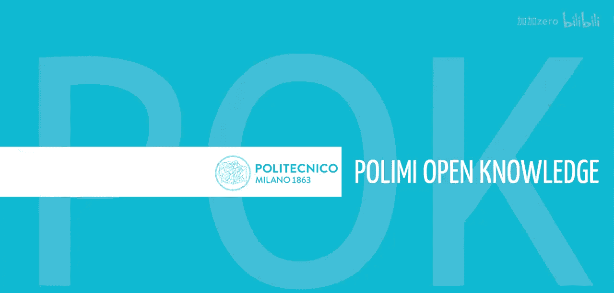
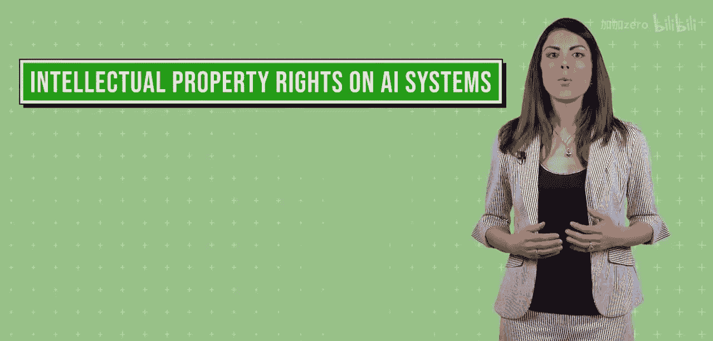
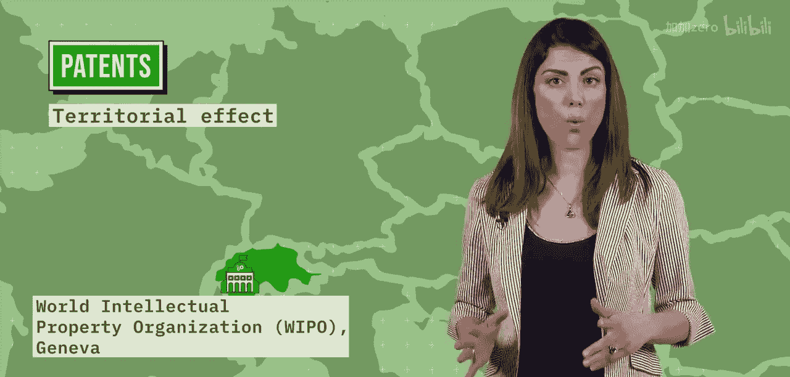
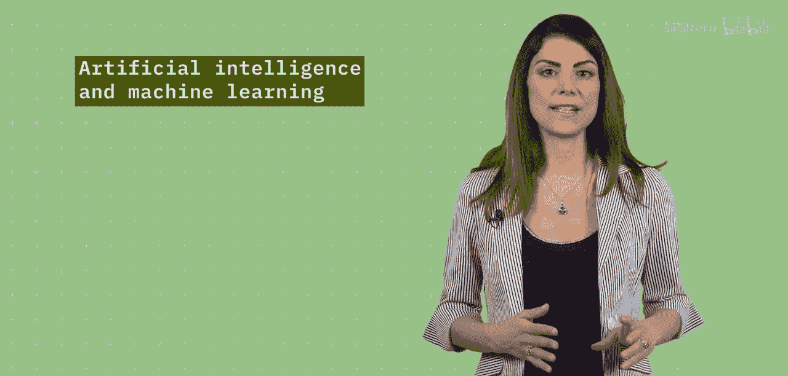

# 人工智能：概述 专项课程：第48课：人工智能与可专利性

在本节课中，我们将回到人工智能系统知识产权这一主题。知识产权包括任何智力或精神的创造，并分为两大类：版权（包括任何文学和艺术作品）和工业产权（包括专利、商标和设计）。工业产权的基本特征是具备工业应用性。

在上一节关于知识产权的课程中，我们学习了人工智能系统可以作为创造性发明受到版权保护。

现在，我们需要探讨人工智能系统是否以及在多大程度上可以获得专利。

## 什么是专利？

首先，专利是一种法律文件，授予发明人在有限时间内（通常为20年）的权利，以防止他人在授予专利的国家内未经许可制造、使用或销售其发明。

专利具有地域性。通常，发明人需要向每个感兴趣国家的专利局单独申请。为了简化流程，也可以向位于日内瓦的世界知识产权组织或位于慕尼黑的欧洲专利局申请。欧洲专利本质上是一组同时授予所有欧盟成员国的国家专利。

## 专利的权利内容

与版权类似，专利也授予精神权利和经济权利。

*   **精神权利**：指被承认为发明作者的权利。这项权利始终且仅属于发明人本人，在其去世后，其后代也可主张。精神权利不可转让给第三方。
*   **经济权利**：指对专利发明进行经济利用的权利。这项权利可以出售、许可或以其他方式转让给第三方。

经济权利通常属于工业发明的发明人，除非该发明是在履行合同或雇佣关系期间完成的，且发明活动本身就是合同或关系的标的，并且发明人因此获得了报酬。在后一种情况下，经济权利属于雇主或委托人。

## 可专利性的条件

现在，让我们看看一项发明必须具备哪些条件才能获得专利。

1.  **新颖性**：一项发明是新颖的，如果它不构成现有技术的一部分。即在提交专利申请之前，没有以书面或口头形式、通过使用或任何其他方式为公众所知。
2.  **创造性步骤**：这意味着在发明所属技术领域内，具备普通技能的人不能认为该发明是显而易见的，也不能轻易地从公开可获得的信息中推导出来。
3.  **工业实用性**：这意味着该发明必须能够在工业或制造过程中使用。

## 人工智能与专利挑战

在人工智能领域，2019年发布的《WIPO技术趋势报告》指出，2013年至今，人工智能系统的专利申请数量呈指数级增长。

然而，考虑到可专利性的要求，并非所有人工智能组件都能获得专利。事实上，我们还必须考虑到，根据法律，某些内容不能被视为可专利的发明，例如：
*   发现、科学理论和数学方法（例如，单纯的算法）。
*   执行心理活动、玩游戏或做生意的方法、规则（例如，商业方法）。
*   计算机程序（例如，源代码）。
*   信息呈现。

上述方法、计算机程序和活动，如果仅以其本身的形式主张，则不能获得专利。换句话说，抽象的或单纯的指令集合是不可专利的。它们必须与**技术手段**紧密结合，并且必须能够解决**技术问题**。换言之，它们必须能够应用于工业领域。

我们可以立即注意到，这种限制极大地影响了基于人工智能的系统的可专利性。根据欧盟委员会的定义，人工智能系统可以仅由在虚拟世界中运行的软件构成（例如，语音助手、图像分析软件、搜索引擎、语音和面部识别系统），也可以将人工智能集成到硬件设备中（例如，高级机器人、自动驾驶汽车、无人机或物联网应用）。

## 专利实践中的考量

正如WIPO的专利申请指南所强调的，人工智能和机器学习（如神经网络、遗传算法、支持向量机、卷积神经网络、核回归和判别分析）基于计算模型和分类、聚类等算法，这些本身具有抽象的数学性质。

然而，它们在各个技术领域的实际影响不容忽视。因此，WIPO指南指出，对于人工智能，即使它们基于抽象的计算模型或分类方法，只要满足以下条件，仍可能具有可专利性：
*   它们有助于解决**技术问题**。
*   其技术特征涉及**创造性活动**，与现有技术相比做出了新的、创新的贡献，即使对于该领域的技术人员而言也是如此。
*   专利申请在描述人工智能解决技术问题的能力方面是**清晰和充分描述**的。

这意味着，通过阅读专利说明书，该领域的专家必须能够实施该发明。

## 总结

在本节课中，我们一起学习了人工智能系统的可专利性问题。我们首先回顾了专利的定义、地域性和权利内容。然后，我们详细探讨了获得专利必须满足的三个核心条件：**新颖性**、**创造性步骤**和**工业实用性**。最后，我们分析了人工智能技术在专利申请中面临的主要挑战，特别是其算法和模型的抽象数学性质。关键在于，人工智能发明必须与具体的技术手段结合，并致力于解决明确的技术问题，才能跨越可专利性的门槛。