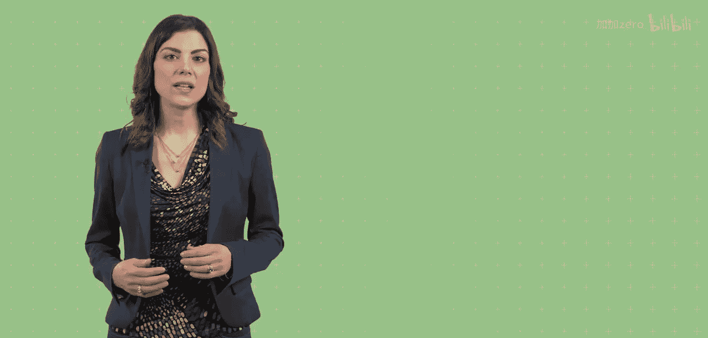
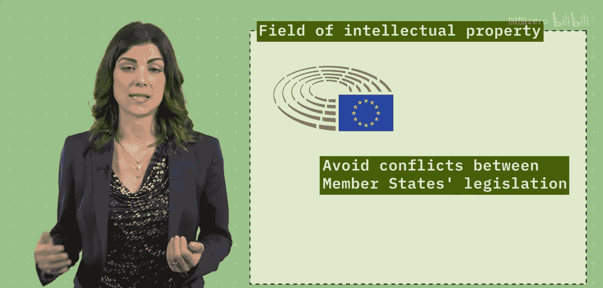
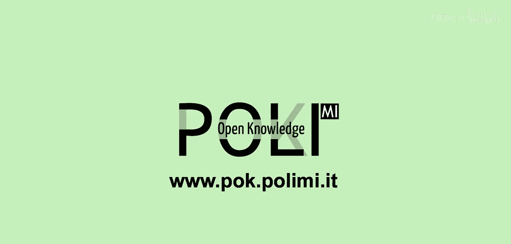

# 【人工智能：概述 专项课程】米兰理工大学—中英字幕 p49 p7_01_the-protection-of-works-created-by-ai -BV1Er1PYhE9q_p49-

🎼。In the previous lesson we saw how AI systems are protected under copyright law In this lesson。

 we will try to understand who holds the intellectual property rights to the intellectual works created by AI the issue does not concern the case in which it is a human author who creates the work with the help of more or less advanced software because in such a case the creative input is in any case attributable to a human individual。

 the issue concerns the case of programs operating with the AI components of the machine learning type able to autonomously elaborate outputs that can be independent of the inputs entered by the programmer。

🎼Actually， we are talking about something that is already happening since there are already artificial intelligence systems able to independently create musical。

 artistic or literary works， learning from the processing of thousands of pieces of music。

 artworks or poems。😊，🎼What is impressive is that the works created by AI were absolutely similar and not so different from those created by human intelligence。

😊，However， also in this context， similarly to what we have already noted about the field of liability for damages resulting from AI conduct。

 the existing legislation is not complete therefore it is not easy to solve the problem on the basis of the existing legal framework。

 the Italian legislation which is similar to that enforce in most foreign countries seems to presume that only a natural person can be an author and therefore the original owner of both moral rights and economic rights to the intellectual work。

So there is no doubt that artificial intelligence being an object and not a human subject。

 even though it is the author of the work cannot be the beneficiary of economic rights and even less of moral rights。

Among the foreign legal systems， the only one which explicitly takes into consideration the possibility that the work of an intellectual nature is the result of the creative activity of a computer is the legislation of the United Kingdom。

In fact， the 1988 copyrightpy designs and patent art provides that ownership of the intellectual rights in their economic component of a work created by a machine is vested in the person who made the necessary configurations so that the machine could generate the work in question。

 it is expressly provided that in the case of a literary dramatic musical or artistic work which is computer generated。

 the author shall be taken to be the person by whom the arrangements necessary for the creation of the work are undertaken。

Surely the course outlined by the UK legislation may be one of the alternatives to follow for our national legislation and for the European legislation but it is not the only one there are some doctrinal theories that can be reduced to three principal orientations the first possible approach is to deny any form of protection in terms of intellectual property rights of words created by artificial intelligence。

Today in the absence of a specific legislative measure。

 this is the most acceptable theory if we want to adhere to a literal interpretation of the provisions of law。

However， it might discourage investment in the implementation and use of intelligent systems。

The second possible approach supported by those who would like to grant AI legal personality implies recognizing the ownership of rights to the artificial intelligence itself。

 if the first theory does not appear to be very attractive from an economic point of view。

 this second theory appears at present to be excessively futuristic and not very well justified from a legal point of view。

 the third possible approach median between the first two and in our opinion。

 surely preferable to the others， seeks to apply copyright law。

 even if amending and updating it in all cases in which the results of the activity of intelligent systems are in any case dependent on the choices and the inputs of a human being so。

Cases where， after all， those results are wanted by an individual or a group of individuals。

But following this approach， who would be entitled to the rights provided for by copyright law and in particular the rights of economic exploitation of the intellectual works resulting from AI's creative activity？

Three possibilities could be considered the honor of the property rights in the work created by the AI may be the person who invented。

 created and produced the machine。The person who in some way set up the function of the machine saw that it could create the working question。

Or the honor of the machine now also by Vi2 of a purchase made by a producer or a distributor。

 and regardless of who set it up， that started the economic exploitation of the work itself。

A correct solution in the light of current legislation does not exist For this reason。

 the field of intellectual property is one of the areas in which the European Parliament is called on the European Commission to submit legislative proposal in order to adapt the existing legislation to the development of AI Tech。

🎼The purpose， of course， is to avoid conflicts between member states legislation and to encourage investment in these technologies。

